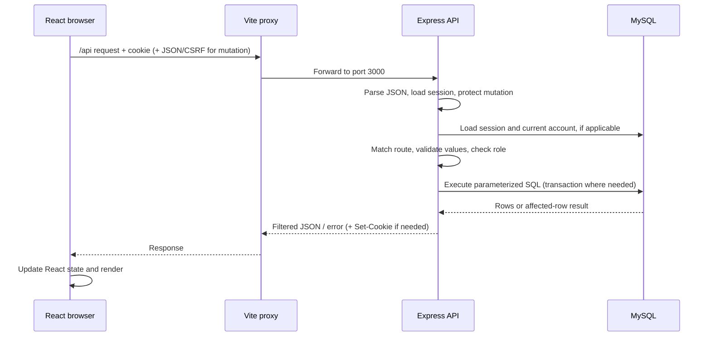

# Backend learning guide — implemented Modules 1 and 2

Start with [BACKEND_30_MIN_GUIDE.md](BACKEND_30_MIN_GUIDE.md) for a short explanation of the implemented backend and data flows.

This guide explains the current source without changing application behavior. Read the request/data walkthrough first, then follow the source files in order. Every line of each server JavaScript file is reproduced with its original line number. Explanation tables cover consecutive line ranges: a multiline call, its arguments, and its closing brackets belong to one operation. Standalone braces close the surrounding operation; blank lines separate ideas. The schema is explained column by column. The repeating curriculum data uses one common record shape explained below.

## What exists today

The backend is JavaScript running in Node.js, with Express for HTTP requests and mysql2 for SQL. There is no ORM, MongoDB, JWT login, Google OAuth, signup email verification, or persistent review/report/vote implementation. Catalog CRUD and password-based accounts/sessions/private identity foundation are implemented. The official course seed contains 101 CS-coded courses; professors are initially empty. Administrators can add professors and their course assignments.

## The three local processes

| Process | Local address | Responsibility |
|---|---|---|
| Vite / React | http://localhost:5173 | Serves the frontend during development and proxies `/api` |
| Node / Express | http://127.0.0.1:3000 | Validates requests, checks permissions, and runs SQL |
| MySQL | 127.0.0.1:3307 | Persists rows, constraints, relationships, and sessions |

`npm run dev` starts Vite, `npm run dev:server` starts Node, and `npm run db:local` starts the isolated MySQL instance. Browser requests to `/api` pass through the proxy in `vite.config.js`; the browser does not connect directly to port 3307. `ECONNREFUSED 127.0.0.1:3000` means the proxy cannot connect to the API at that address. Creating a mysql2 pool does not start MySQL.

## A request from start to finish



Middleware runs in registration order. `req` contains incoming body/query/route parameters/headers and the loaded session/user. `res` writes outgoing status/JSON/cookies. `next()` continues; `next(error)` selects error handling. Express 5 forwards rejected asynchronous route/middleware promises to the error handler. A successful response usually ends the route. SQL is awaited before responding.

## JavaScript syntax you will repeatedly see

| Code | Meaning |
|---|---|
| `import { name } from './file.js'` | Load a named export; relative paths start at this file |
| `export function ...` | Make a function available to other files |
| `async` / `await` | Wait for asynchronous work without synchronously blocking Node’s event loop; awaiting rejects if the promise rejects |
| `const [rows] = await pool.execute(...)` | Extract rows from mysql2’s `[rows, fieldMetadata]` array; it does not mean the first database row |
| `rows[0]` | The first row inside that rows array |
| `?` in SQL plus `[value]` | Bind a value separately from SQL syntax |
| `...values` | Expand an array; `...common` copies object properties |
| `?.` | Read a property only when the left value is not null/undefined |
| `a || b` | Use b when a is falsy |
| `value ||= fallback` | Assign fallback only when the existing value is falsy |
| `` `${value}` `` | Insert a value into a JavaScript template string; this alone is not SQL-safe |
| `.map`, `.filter`, `.find` | Transform each item, retain matching items, or select the first match |
| `try / catch / finally` | Perform work, handle failure, and run cleanup in either case |
| `return` inside a transaction callback | Finish the callback normally, so transaction() commits; throwing makes it roll back |
| `Date.now()` | Milliseconds since the Unix epoch, distinct from SQL timestamp strings |
| `{ ... }`, `[ ... ]`, `( ... )` | Object/block, array, and argument/expression delimiters depending on context |

A function can be declared inside another function. Auth/catalog factories use this to give their nested functions access to the same pool/config without global mutable credentials.

## How signup data moves

1. React sends `POST /api/auth/register` with `{email, password, agreed}`. It first obtains a session/CSRF token if necessary.
2. Express checks the body and mutation token. Registration does not require an already logged-in user.
3. `register` lowercases/trims email, checks exact `student.nitw.ac.in`, rejects plus aliases, requires consent, and validates password length.
4. The server generates a UUID, fresh password salt/hash, and private random anonymous seed.
5. A parameterized INSERT writes one `users` row. Schema defaults choose student role, version zero, and creation timestamp.
6. React receives only email/success message. Signup does not automatically authenticate the account. A duplicate email produces 409 ACCOUNT_EXISTS without changing the existing password.

The plaintext password exists in the browser request and briefly in backend memory while it is validated/hashed. It is not inserted into MySQL or logged by these handlers. Development is localhost HTTP; production uses HTTPS through the deployment setup. Email format/domain checking does not establish mailbox ownership or one physical person per account.

## How login, cookies, and sessions move

1. React sends email/password with its cookie and CSRF header.
2. The service reads the private account row, derives a candidate scrypt key using its stored salt, and compares bytes. The server cannot decrypt a password hash.
3. The route regenerates the session ID so the pre-login ID does not become the authenticated ID.
4. Session contents gain `userId`, `version`, and a fresh `csrfToken`; the session store writes JSON in MySQL.
5. The browser receives a signed, HttpOnly `rmp.sid` cookie identifying that session. The full account/session JSON is not stored inside this cookie.
6. Later requests automatically send the cookie. The store retrieves unexpired session JSON; loadUser fetches id/email/role/version from users and compares versions.
7. Responses expose only the current account’s id/email/role. Public catalog APIs expose no student account data.

Illustrative database session payload (not actual secrets):

```json
{"cookie":{"expires":"...","httpOnly":true,"sameSite":"lax"},"userId":"example-uuid","version":0,"csrfToken":"random-example-token"}
```

The cookie signature prevents client modification of the session ID; the database session JSON itself is not encrypted. React holds the CSRF token in JavaScript memory through `src/services/api.js` and sends `X-CSRF-Token` for mutations. The CSRF token is distinct from the HttpOnly cookie. Logout deletes one session; password reset increments the account’s version to invalidate all earlier sessions on their next request. It does not immediately physically delete every other device’s session row.

## How catalog reads, search, and edits move

A catalog read joins professors/courses to departments and maps SQL fields to public JSON. `department_id` becomes `departmentId`; decimal credits become a number; professor initials are computed; teaching-link rows become a course-ID array. The browser receives the catalog snapshot and keeps it in React state.

The current directory searches on each keystroke in React by filtering the already fetched arrays. It does not run a new SQL search for every character. Backend search APIs also exist, such as `GET /api/courses?q=data`, for clients or a future paginated directory. SQL search uses LOCATE rather than LIKE.

For an admin save, React sends validated-looking form data, but the server independently checks login/role and validates everything again. Saving a professor and replacing its teaching links happen on one borrowed connection in one transaction. Invalid course IDs cause rollback. The final API result is a public catalog record; React then reloads the catalog. Editing a department changes joined display names without rewriting every child row.

Example SQL binding:

```js
const [rows] = await pool.execute(
  'SELECT id, email FROM users WHERE email = ?',
  [address],
);
```

`address` is data. A value containing SQL punctuation cannot become another statement through this binding. Dynamic table names are chosen from fixed code branches. `pool.query` also supports value escaping, used where account-management DDL cannot use ordinary prepared statements; `execute` uses prepared statements. Neither method starts the database.

## How password recovery moves

Forgot-password generates a six-digit code and stores only its keyed HMAC, expiry, send time, and attempts in password_resets. File mail mode writes the actual code in a private JSON development message; SMTP sends it to the configured mail provider. Signup/login never use these codes. Codes expire after ten minutes, replacement requests have a sixty-second cooldown, and five wrong attempts exhaust one code.

Reset locks the account/reset rows, compares HMACs, updates the password hash/version and deletes the code in one transaction. Wrong guesses commit their attempt count before an HTTP error is thrown. Resetting logs out the current browser and invalidates older sessions elsewhere through the version comparison. Private outbox files contain real recovery credentials; the SQL table contains keyed hashes.

## What persists, and where

| Data | Location | Survives refresh/API restart? | Sent to browser? |
|---|---|---|---|
| Departments, courses, professors, assignments | MySQL | Yes | Public catalog fields |
| User email/role | MySQL users | Yes | Only own account via session/login |
| Password hash/private seed | MySQL users | Yes | No |
| Session data/expiry | MySQL sessions | Yes, until expiry/invalidation | Cookie identifier; own safe account + CSRF token separately |
| Reset hash/expiry/attempts | MySQL password_resets | Yes until consumed/replaced/deleted | No hash; actual code delivered by file/SMTP |
| DB credentials/HMAC/session secrets | Backend .env | Yes | No |
| Development reset messages/admin initial credentials | Private .local files | Yes | Not public API output |
| Search text/tabs and preview reviews/reports/votes | React memory | No on full reload | Browser-owned preview state |
| HTTP rate-limit counters | Node memory | No on API restart | Limit metadata/errors only |

MySQL stores its actual database files in the isolated `.local/mysql-data` directory. JavaScript files are not the live database. shared/cseCurriculum.js is an import/seed source; modifying it alone does not modify existing database rows. Database inspection through SELECT reads the persisted rows.

## Database schema, every column and constraint

**[schema.sql:1](/Users/naman/rate-your-prof/server/schema.sql:1)** — `-- Modules 1 and 2 only. Review data is still a frontend demonstration.`

SQL comment: documents scope or storage engine; it does not execute.

**[schema.sql:2](/Users/naman/rate-your-prof/server/schema.sql:2)** — `-- InnoDB supplies foreign keys, transactions, and row-level locking.`

SQL comment: documents scope or storage engine; it does not execute.

**[schema.sql:3](/Users/naman/rate-your-prof/server/schema.sql:3)** — `CREATE TABLE IF NOT EXISTS departments (`

Create this named table only if absent. Existing tables are not automatically altered by CREATE IF NOT EXISTS; migrations perform upgrades.

**[schema.sql:4](/Users/naman/rate-your-prof/server/schema.sql:4)** — `id VARCHAR(80) PRIMARY KEY`

Stable catalog ID, at most eighty characters, unique and non-null; curriculum IDs and UUIDs both fit.

**[schema.sql:5](/Users/naman/rate-your-prof/server/schema.sql:5)** — `name VARCHAR(100) NOT NULL UNIQUE`

Required department name, unique among departments.

**[schema.sql:6](/Users/naman/rate-your-prof/server/schema.sql:6)** — `code VARCHAR(20) NOT NULL UNIQUE`

Required unique department/course code, at most twenty characters.

**[schema.sql:7](/Users/naman/rate-your-prof/server/schema.sql:7)** — `) ENGINE=InnoDB;`

Close the table definition and use InnoDB for transactional changes, row locking, and foreign keys.

**[schema.sql:8](/Users/naman/rate-your-prof/server/schema.sql:8)** — `CREATE TABLE IF NOT EXISTS professors (`

Create this named table only if absent. Existing tables are not automatically altered by CREATE IF NOT EXISTS; migrations perform upgrades.

**[schema.sql:9](/Users/naman/rate-your-prof/server/schema.sql:9)** — `id VARCHAR(80) PRIMARY KEY`

Stable catalog ID, at most eighty characters, unique and non-null; curriculum IDs and UUIDs both fit.

**[schema.sql:10](/Users/naman/rate-your-prof/server/schema.sql:10)** — `name VARCHAR(100) NOT NULL`

Required professor/course display name; duplicate names are allowed.

**[schema.sql:11](/Users/naman/rate-your-prof/server/schema.sql:11)** — `department_id VARCHAR(80) NOT NULL`

Stable parent department ID, required for every professor/course.

**[schema.sql:12](/Users/naman/rate-your-prof/server/schema.sql:12)** — `designation VARCHAR(50) NOT NULL`

Required professor title; the service further limits supported titles.

**[schema.sql:13](/Users/naman/rate-your-prof/server/schema.sql:13)** — `office VARCHAR(100) NOT NULL DEFAULT ''`

Office text; empty string is the default, rather than SQL NULL.

**[schema.sql:14](/Users/naman/rate-your-prof/server/schema.sql:14)** — `bio TEXT NOT NULL`

Professor biography; the application permits empty text and limits submitted length.

**[schema.sql:15](/Users/naman/rate-your-prof/server/schema.sql:15)** — `created_at TIMESTAMP NOT NULL DEFAULT CURRENT_TIMESTAMP`

Creation time supplied automatically by MySQL unless explicitly set.

**[schema.sql:16](/Users/naman/rate-your-prof/server/schema.sql:16)** — `FOREIGN KEY (department_id) REFERENCES departments(id) ON DELETE RESTRICT`

Every parent ID must exist; refuse deleting a department while child rows reference it.

**[schema.sql:17](/Users/naman/rate-your-prof/server/schema.sql:17)** — `INDEX idx_professors_department (department_id)`

Index supports department lookups and its foreign-key checks.

**[schema.sql:18](/Users/naman/rate-your-prof/server/schema.sql:18)** — `INDEX idx_professors_name (name)`

Name index can support appropriate name ordering/lookups; LOCATE substring search is not automatically an indexed prefix search.

**[schema.sql:19](/Users/naman/rate-your-prof/server/schema.sql:19)** — `) ENGINE=InnoDB;`

Close the table definition and use InnoDB for transactional changes, row locking, and foreign keys.

**[schema.sql:20](/Users/naman/rate-your-prof/server/schema.sql:20)** — `CREATE TABLE IF NOT EXISTS courses (`

Create this named table only if absent. Existing tables are not automatically altered by CREATE IF NOT EXISTS; migrations perform upgrades.

**[schema.sql:21](/Users/naman/rate-your-prof/server/schema.sql:21)** — `id VARCHAR(80) PRIMARY KEY`

Stable catalog ID, at most eighty characters, unique and non-null; curriculum IDs and UUIDs both fit.

**[schema.sql:22](/Users/naman/rate-your-prof/server/schema.sql:22)** — `code VARCHAR(20) NOT NULL UNIQUE`

Required unique department/course code, at most twenty characters.

**[schema.sql:23](/Users/naman/rate-your-prof/server/schema.sql:23)** — `name VARCHAR(100) NOT NULL`

Required professor/course display name; duplicate names are allowed.

**[schema.sql:24](/Users/naman/rate-your-prof/server/schema.sql:24)** — `department_id VARCHAR(80) NOT NULL`

Stable parent department ID, required for every professor/course.

**[schema.sql:25](/Users/naman/rate-your-prof/server/schema.sql:25)** — `credits DECIMAL(3,1) UNSIGNED NOT NULL`

Required nonnegative exact decimal credits with one fractional digit; service/check restrict actual values further.

**[schema.sql:26](/Users/naman/rate-your-prof/server/schema.sql:26)** — `semester VARCHAR(20) NOT NULL`

Required semester label, including the supported Semester 7 or 8 form.

**[schema.sql:27](/Users/naman/rate-your-prof/server/schema.sql:27)** — `description TEXT NOT NULL`

Course description; empty string is permitted by the application.

**[schema.sql:28](/Users/naman/rate-your-prof/server/schema.sql:28)** — `created_at TIMESTAMP NOT NULL DEFAULT CURRENT_TIMESTAMP`

Creation time supplied automatically by MySQL unless explicitly set.

**[schema.sql:29](/Users/naman/rate-your-prof/server/schema.sql:29)** — `FOREIGN KEY (department_id) REFERENCES departments(id) ON DELETE RESTRICT`

Every parent ID must exist; refuse deleting a department while child rows reference it.

**[schema.sql:30](/Users/naman/rate-your-prof/server/schema.sql:30)** — `CONSTRAINT chk_courses_credits CHECK (credits BETWEEN 0.5 AND 10)`

Database enforces the numeric credit interval even when a direct SQL client bypasses React/Express. Half-step increments are additionally checked in the service.

**[schema.sql:31](/Users/naman/rate-your-prof/server/schema.sql:31)** — `INDEX idx_courses_department (department_id)`

Index supports department lookup and referential checks.

**[schema.sql:32](/Users/naman/rate-your-prof/server/schema.sql:32)** — `) ENGINE=InnoDB;`

Close the table definition and use InnoDB for transactional changes, row locking, and foreign keys.

**[schema.sql:33](/Users/naman/rate-your-prof/server/schema.sql:33)** — `CREATE TABLE IF NOT EXISTS professor_courses (`

Create this named table only if absent. Existing tables are not automatically altered by CREATE IF NOT EXISTS; migrations perform upgrades.

**[schema.sql:34](/Users/naman/rate-your-prof/server/schema.sql:34)** — `professor_id VARCHAR(80) NOT NULL`

Required professor side of a teaching assignment.

**[schema.sql:35](/Users/naman/rate-your-prof/server/schema.sql:35)** — `course_id VARCHAR(80) NOT NULL`

Required course side of a teaching assignment.

**[schema.sql:36](/Users/naman/rate-your-prof/server/schema.sql:36)** — `PRIMARY KEY (professor_id, course_id)`

Composite primary key prevents duplicate copies of the same assignment while permitting many courses per professor and many professors per course.

**[schema.sql:37](/Users/naman/rate-your-prof/server/schema.sql:37)** — `FOREIGN KEY (professor_id) REFERENCES professors(id) ON DELETE CASCADE`

A deleted professor causes only its assignment rows here to be deleted; courses remain.

**[schema.sql:38](/Users/naman/rate-your-prof/server/schema.sql:38)** — `FOREIGN KEY (course_id) REFERENCES courses(id) ON DELETE CASCADE`

A deleted course causes only its assignment rows here to be deleted; professors remain.

**[schema.sql:39](/Users/naman/rate-your-prof/server/schema.sql:39)** — `) ENGINE=InnoDB;`

Close the table definition and use InnoDB for transactional changes, row locking, and foreign keys.

**[schema.sql:40](/Users/naman/rate-your-prof/server/schema.sql:40)** — `CREATE TABLE IF NOT EXISTS users (`

Create this named table only if absent. Existing tables are not automatically altered by CREATE IF NOT EXISTS; migrations perform upgrades.

**[schema.sql:41](/Users/naman/rate-your-prof/server/schema.sql:41)** — `id CHAR(36) PRIMARY KEY`

Fixed-length UUID for a student or website admin account.

**[schema.sql:42](/Users/naman/rate-your-prof/server/schema.sql:42)** — `email VARCHAR(254) NOT NULL UNIQUE`

Required canonical account email. Database uniqueness prevents a concurrent duplicate registration.

**[schema.sql:43](/Users/naman/rate-your-prof/server/schema.sql:43)** — `password_hash VARCHAR(255) NOT NULL`

Encoded scrypt algorithm/salt/key; plaintext password is not stored in this column.

**[schema.sql:44](/Users/naman/rate-your-prof/server/schema.sql:44)** — `role ENUM('student', 'admin') NOT NULL DEFAULT 'student'`

Required authorization role. Public registration omits it so the database assigns student.

**[schema.sql:45](/Users/naman/rate-your-prof/server/schema.sql:45)** — `anonymous_seed CHAR(64) NOT NULL`

Private random sixty-four-character hex seed used to derive context-specific review keys.

**[schema.sql:46](/Users/naman/rate-your-prof/server/schema.sql:46)** — `session_version INT UNSIGNED NOT NULL DEFAULT 0`

Account-wide login-generation counter. Incrementing it invalidates sessions containing the old number.

**[schema.sql:47](/Users/naman/rate-your-prof/server/schema.sql:47)** — `created_at TIMESTAMP NOT NULL DEFAULT CURRENT_TIMESTAMP`

Creation time supplied automatically by MySQL unless explicitly set.

**[schema.sql:48](/Users/naman/rate-your-prof/server/schema.sql:48)** — `) ENGINE=InnoDB;`

Close the table definition and use InnoDB for transactional changes, row locking, and foreign keys.

**[schema.sql:49](/Users/naman/rate-your-prof/server/schema.sql:49)** — `CREATE TABLE IF NOT EXISTS password_resets (`

Create this named table only if absent. Existing tables are not automatically altered by CREATE IF NOT EXISTS; migrations perform upgrades.

**[schema.sql:50](/Users/naman/rate-your-prof/server/schema.sql:50)** — `user_id CHAR(36) NOT NULL`

Account requesting password recovery; no reset without an existing parent user.

**[schema.sql:51](/Users/naman/rate-your-prof/server/schema.sql:51)** — `code_hash CHAR(64) NOT NULL`

Sixty-four-character HMAC-SHA256 hex encoding of the current recovery code context.

**[schema.sql:52](/Users/naman/rate-your-prof/server/schema.sql:52)** — `expires_at BIGINT UNSIGNED NOT NULL`

Millisecond expiry timestamp, large enough for JavaScript epoch times.

**[schema.sql:53](/Users/naman/rate-your-prof/server/schema.sql:53)** — `sent_at BIGINT UNSIGNED NOT NULL`

Last code-issuance time in milliseconds, used for resend cooldown.

**[schema.sql:54](/Users/naman/rate-your-prof/server/schema.sql:54)** — `attempts TINYINT UNSIGNED NOT NULL DEFAULT 0`

Wrong-guess counter starting at zero; the service rejects a code after five wrong guesses.

**[schema.sql:55](/Users/naman/rate-your-prof/server/schema.sql:55)** — `PRIMARY KEY (user_id)`

Only one current password-reset record per user.

**[schema.sql:56](/Users/naman/rate-your-prof/server/schema.sql:56)** — `FOREIGN KEY (user_id) REFERENCES users(id) ON DELETE CASCADE`

Deleting an account removes its recovery record. Sessions have no direct user foreign key; loadUser rejects a missing account.

**[schema.sql:57](/Users/naman/rate-your-prof/server/schema.sql:57)** — `) ENGINE=InnoDB;`

Close the table definition and use InnoDB for transactional changes, row locking, and foreign keys.

**[schema.sql:58](/Users/naman/rate-your-prof/server/schema.sql:58)** — `CREATE TABLE IF NOT EXISTS sessions (`

Create this named table only if absent. Existing tables are not automatically altered by CREATE IF NOT EXISTS; migrations perform upgrades.

**[schema.sql:59](/Users/naman/rate-your-prof/server/schema.sql:59)** — `sid VARCHAR(128) PRIMARY KEY`

Unique server-side session identifier used by express-session.

**[schema.sql:60](/Users/naman/rate-your-prof/server/schema.sql:60)** — `data JSON NOT NULL`

Server session payload: cookie metadata, CSRF token, and logged-in user ID/version where applicable.

**[schema.sql:61](/Users/naman/rate-your-prof/server/schema.sql:61)** — `expires_at BIGINT UNSIGNED NOT NULL`

Millisecond expiry timestamp, large enough for JavaScript epoch times.

**[schema.sql:62](/Users/naman/rate-your-prof/server/schema.sql:62)** — `INDEX idx_sessions_expiry (expires_at)`

Expiry index supports selecting/deleting expired session records.

**[schema.sql:63](/Users/naman/rate-your-prof/server/schema.sql:63)** — `) ENGINE=InnoDB;`

Close the table definition and use InnoDB for transactional changes, row locking, and foreign keys.

The relationship graph is departments → professors/courses, and professors ↔ courses through professor_courses. Accounts are separate from public catalog records. password_resets belongs to users. Session JSON refers to a user ID but does not declare a relational foreign key on that embedded value.

## Source walkthrough

The following sections include the actual code followed by consecutive explanations. Line numbers correspond to this repository snapshot. No .env or private credential/outbox contents are copied into this guide.

### server/index.js

[Open source](/Users/naman/rate-your-prof/server/index.js)

<details>
<summary>Read the numbered source (36 lines)</summary>

```text
  1 | import { readConfig } from "./config.js";
  2 | import { createPool } from "./db.js";
  3 | import { createApp } from "./app.js";
  4 | 
  5 | let pool;
  6 | try {
  7 |   const config = readConfig();
  8 |   pool = createPool(config);
  9 |   await pool.query("SELECT 1 FROM departments LIMIT 1");
 10 |   const { app, store } = await createApp(pool, config);
 11 |   const server = app.listen(config.port, "127.0.0.1", () =>
 12 |     console.log(
 13 |       `RateMyProf API: http://localhost:${config.port} · mail: ${config.mail.mode}`,
 14 |     ),
 15 |   );
 16 |   const cleanup = setInterval(
 17 |     () => store.prune().catch(() => console.error("Session cleanup failed.")),
 18 |     3600000,
 19 |   );
 20 |   cleanup.unref();
 21 |   for (const signal of ["SIGINT", "SIGTERM"])
 22 |     process.once(signal, () => {
 23 |       clearInterval(cleanup);
 24 |       server.close(async () => {
 25 |         await pool.end();
 26 |         process.exit(0);
 27 |       });
 28 |     });
 29 | } catch (error) {
 30 |   console.error("Server could not start:", error.code || error.message);
 31 |   console.error(
 32 |     "Check .env, start MySQL, and run npm run db:migrate. See README.md.",
 33 |   );
 34 |   if (pool) await pool.end();
 35 |   process.exitCode = 1;
 36 | }
```

</details>

| Source lines | Explanation and data handling |
|---|---|
| [1–4](/Users/naman/rate-your-prof/server/index.js:1) | Import the configuration reader, MySQL pool factory, and Express application factory. These are functions; importing them does not start the HTTP server. |
| [5–5](/Users/naman/rate-your-prof/server/index.js:5) | Declare pool outside try so the error handler can close it if startup fails. |
| [6–9](/Users/naman/rate-your-prof/server/index.js:6) | Read validated configuration, create the pool, and query departments to confirm the database and initial schema are accessible. An empty departments table still allows this query to succeed. |
| [10–15](/Users/naman/rate-your-prof/server/index.js:10) | Build the Express app and obtain its session store. Listen on the configured API port and the local loopback interface. The callback runs after listening begins; it prints the URL and mail mode, without passwords. |
| [16–20](/Users/naman/rate-your-prof/server/index.js:16) | Schedule expired-session deletion every 3,600,000 milliseconds (one hour). Catch cleanup errors so a rejected promise does not become an unhandled failure. unref() means this timer alone will not keep Node alive. |
| [21–28](/Users/naman/rate-your-prof/server/index.js:21) | Handle Ctrl+C (SIGINT) and process termination (SIGTERM) once. Stop the timer, stop accepting HTTP connections, wait for the server to close, close MySQL connections, and exit successfully. |
| [29–36](/Users/naman/rate-your-prof/server/index.js:29) | On startup failure, print only the error code/message and setup guidance. Close a pool if one was created. Set a nonzero exit status so the terminal knows startup failed. |

### server/config.js

[Open source](/Users/naman/rate-your-prof/server/config.js)

<details>
<summary>Read the numbered source (79 lines)</summary>

```text
  1 | import dotenv from "dotenv";
  2 | import path from "node:path";
  3 | import { fileURLToPath } from "node:url";
  4 | 
  5 | export const projectRoot = path.resolve(
  6 |   path.dirname(fileURLToPath(import.meta.url)),
  7 |   "..",
  8 | );
  9 | dotenv.config({ path: path.join(projectRoot, ".env"), quiet: true });
 10 | 
 11 | export function readConfig(env = process.env) {
 12 |   const production =
 13 |     env.APP_ENV === "production" || env.NODE_ENV === "production";
 14 |   const secret = (name) => {
 15 |     const value = env[name] || "";
 16 |     if (value.length < 32 || value.startsWith("replace-"))
 17 |       throw new Error(
 18 |         `${name} must contain at least 32 random characters. Run npm run setup:local or configure .env.`,
 19 |       );
 20 |     return value;
 21 |   };
 22 |   const mailMode = env.MAIL_MODE || "file";
 23 |   if (
 24 |     !["file", "smtp"].includes(mailMode) ||
 25 |     (production && mailMode !== "smtp")
 26 |   )
 27 |     throw new Error(
 28 |       "Use MAIL_MODE=file for development or MAIL_MODE=smtp with SMTP_HOST for production.",
 29 |     );
 30 |   if (mailMode === "smtp" && !env.SMTP_HOST)
 31 |     throw new Error("SMTP_HOST is required for SMTP email delivery.");
 32 |   const origin = new URL(env.APP_ORIGIN || "http://localhost:5173").origin;
 33 |   if (production && !origin.startsWith("https://"))
 34 |     throw new Error("Production APP_ORIGIN must use HTTPS.");
 35 |   const database = env.DB_NAME || "rate_my_prof";
 36 |   if (!/^[a-zA-Z0-9_]+$/.test(database))
 37 |     throw new Error(
 38 |       "DB_NAME may contain only letters, numbers, and underscores.",
 39 |     );
 40 |   const domains = (env.STUDENT_EMAIL_DOMAINS || "student.nitw.ac.in")
 41 |     .split(",")
 42 |     .map((d) => d.trim().toLowerCase())
 43 |     .filter(Boolean);
 44 |   if (
 45 |     !domains.length ||
 46 |     domains.some((d) => !/^[a-z0-9.-]+\.[a-z]{2,}$/.test(d))
 47 |   )
 48 |     throw new Error("Configure valid STUDENT_EMAIL_DOMAINS.");
 49 |   return {
 50 |     production,
 51 |     port: Number(env.PORT || 3000),
 52 |     origin,
 53 |     domains,
 54 |     sessionSecret: secret("SESSION_SECRET"),
 55 |     otpSecret: secret("OTP_SECRET"),
 56 |     anonymousSecret: secret("ANONYMOUS_SECRET"),
 57 |     trustProxy: env.TRUST_PROXY === "true" ? 1 : false,
 58 |     db: {
 59 |       host: env.DB_HOST || "127.0.0.1",
 60 |       port: Number(env.DB_PORT || 3307),
 61 |       database,
 62 |       user: env.DB_USER || "rate_my_prof_app",
 63 |       password: env.DB_PASSWORD || "",
 64 |       charset: "utf8mb4",
 65 |       timezone: "Z",
 66 |       connectionLimit: 10,
 67 |     },
 68 |     mail: {
 69 |       mode: mailMode,
 70 |       directory: path.join(projectRoot, ".local", "mail"),
 71 |       from: env.MAIL_FROM || "RateMyProf <noreply@example.com>",
 72 |       host: env.SMTP_HOST,
 73 |       port: Number(env.SMTP_PORT || 587),
 74 |       secure: env.SMTP_SECURE === "true",
 75 |       user: env.SMTP_USER,
 76 |       password: env.SMTP_PASSWORD,
 77 |     },
 78 |   };
 79 | }
```

</details>

| Source lines | Explanation and data handling |
|---|---|
| [1–4](/Users/naman/rate-your-prof/server/config.js:1) | dotenv reads environment variables from a file; path joins filesystem paths; fileURLToPath converts this module URL to a normal path. |
| [5–10](/Users/naman/rate-your-prof/server/config.js:5) | Find the repository root from the directory containing config.js, then load root/.env quietly. No secret values are returned to the browser. |
| [11–13](/Users/naman/rate-your-prof/server/config.js:11) | readConfig accepts an environment object; by default it reads process.env. Tests can pass a separate object without changing the real configuration. Either production environment flag enables production behavior. |
| [14–21](/Users/naman/rate-your-prof/server/config.js:14) | The nested secret helper rejects secrets shorter than 32 characters and template placeholders. This checks configuration quality, but cannot prove that a human-supplied string is random. |
| [22–31](/Users/naman/rate-your-prof/server/config.js:22) | Default mail delivery to file. Accept only file/smtp, require smtp in production, and require an SMTP host when SMTP is selected. |
| [32–34](/Users/naman/rate-your-prof/server/config.js:32) | Normalize APP_ORIGIN to scheme/hostname/port using URL.origin. Production requires an HTTPS origin. This is the allowed browser origin for mutations. |
| [35–39](/Users/naman/rate-your-prof/server/config.js:35) | Default the database name and restrict it to letters, digits, and underscores because provisioning embeds it into database identifiers. |
| [40–48](/Users/naman/rate-your-prof/server/config.js:40) | Split the approved student domain list, trim and lowercase each entry, discard empty entries, and reject an empty or malformed list. |
| [49–58](/Users/naman/rate-your-prof/server/config.js:49) | Return the application settings: production flag, numeric API port, allowed origin/domains, three separate secrets, and whether one reverse-proxy hop is trusted. SESSION_SECRET signs cookies; OTP_SECRET keys password recovery hashes; ANONYMOUS_SECRET keys private review identities. |
| [59–68](/Users/naman/rate-your-prof/server/config.js:59) | Return MySQL host, numeric port, database/user/password, utf8mb4 encoding, UTC conversion, and a maximum pool size of ten connections. Defaults include local MySQL port 3307. These are database credentials, separate from website student accounts. |
| [69–79](/Users/naman/rate-your-prof/server/config.js:69) | Return mail delivery configuration: private development directory, sender, SMTP host/port, implicit-TLS flag, and optional SMTP credentials. Number() converts numeric settings from environment strings. |

### server/db.js

[Open source](/Users/naman/rate-your-prof/server/db.js)

<details>
<summary>Read the numbered source (21 lines)</summary>

```text
  1 | import mysql from "mysql2/promise";
  2 | 
  3 | export function createPool(config) {
  4 |   return mysql.createPool(config.db);
  5 | }
  6 | 
  7 | // Reuse one connection for an entire transaction. Always return it to the pool.
  8 | export async function transaction(pool, work) {
  9 |   const connection = await pool.getConnection();
 10 |   try {
 11 |     await connection.beginTransaction();
 12 |     const result = await work(connection);
 13 |     await connection.commit();
 14 |     return result;
 15 |   } catch (error) {
 16 |     await connection.rollback();
 17 |     throw error;
 18 |   } finally {
 19 |     connection.release();
 20 |   }
 21 | }
```

</details>

| Source lines | Explanation and data handling |
|---|---|
| [1–2](/Users/naman/rate-your-prof/server/db.js:1) | Import the promise-based mysql2 API so database calls can use await. |
| [3–6](/Users/naman/rate-your-prof/server/db.js:3) | createPool returns a reusable group of connections configured by config.db. It does not create the database or its tables. |
| [7–14](/Users/naman/rate-your-prof/server/db.js:7) | transaction receives a callback named work. Borrow one connection, start a transaction, await work(connection), commit all its SQL changes, and return its result. |
| [15–21](/Users/naman/rate-your-prof/server/db.js:15) | If work fails, roll back the transaction and rethrow the original failure. finally always releases the borrowed connection, even after success/failure. Releasing returns it to the pool rather than destroying it. |

### server/app.js

[Open source](/Users/naman/rate-your-prof/server/app.js)

<details>
<summary>Read the numbered source (119 lines)</summary>

```text
  1 | import express from "express";
  2 | import session from "express-session";
  3 | import helmet from "helmet";
  4 | import { rateLimit } from "express-rate-limit";
  5 | import path from "node:path";
  6 | import { projectRoot } from "./config.js";
  7 | import { createMailer } from "./lib/mail.js";
  8 | import { MySqlSessionStore } from "./lib/session-store.js";
  9 | import { errorHandler, HttpError } from "./lib/errors.js";
 10 | import { loadUser, protectMutations } from "./middleware/auth.js";
 11 | import { createAuthService } from "./services/auth.js";
 12 | import { authRoutes } from "./routes/auth.js";
 13 | import { catalogRoutes } from "./routes/catalog.js";
 14 | 
 15 | export async function createApp(pool, config, options = {}) {
 16 |   const app = express(),
 17 |     store = new MySqlSessionStore(pool);
 18 |   app.disable("x-powered-by");
 19 |   app.set("trust proxy", config.trustProxy);
 20 |   app.use(
 21 |     helmet({
 22 |       contentSecurityPolicy: {
 23 |         directives: {
 24 |           styleSrc: [
 25 |             "'self'",
 26 |             "'unsafe-inline'",
 27 |             "https://fonts.googleapis.com",
 28 |           ],
 29 |           fontSrc: ["'self'", "https://fonts.gstatic.com"],
 30 |           imgSrc: ["'self'", "data:"],
 31 |         },
 32 |       },
 33 |     }),
 34 |   );
 35 |   app.use(
 36 |     "/api",
 37 |     rateLimit({
 38 |       windowMs: 60000,
 39 |       limit: options.test ? 10000 : 300,
 40 |       standardHeaders: "draft-8",
 41 |       legacyHeaders: false,
 42 |       message: {
 43 |         error: {
 44 |           message: "Too many requests. Please try again shortly.",
 45 |           code: "RATE_LIMITED",
 46 |         },
 47 |       },
 48 |     }),
 49 |   );
 50 |   app.use(express.json({ limit: "32kb" }));
 51 |   app.use("/api", (req, res, next) => {
 52 |     if (
 53 |       req.body !== undefined &&
 54 |       (req.body === null ||
 55 |         typeof req.body !== "object" ||
 56 |         Array.isArray(req.body))
 57 |     )
 58 |       return next(new HttpError(400, "Request body must be a JSON object."));
 59 |     req.body ||= {};
 60 |     next();
 61 |   });
 62 |   app.get("/api/health", async (req, res) => {
 63 |     await pool.query("SELECT 1");
 64 |     res.json({ status: "ok" });
 65 |   });
 66 |   app.use("/api", (req, res, next) => {
 67 |     res.set("Cache-Control", "no-store");
 68 |     next();
 69 |   });
 70 |   app.use(
 71 |     "/api",
 72 |     session({
 73 |       name: "rmp.sid",
 74 |       secret: config.sessionSecret,
 75 |       store,
 76 |       resave: false,
 77 |       saveUninitialized: false,
 78 |       cookie: {
 79 |         httpOnly: true,
 80 |         sameSite: "lax",
 81 |         secure: config.production,
 82 |         maxAge: 86400000,
 83 |       },
 84 |     }),
 85 |   );
 86 |   app.use("/api", protectMutations(config), loadUser(pool));
 87 |   const auth = await createAuthService(
 88 |     pool,
 89 |     config,
 90 |     options.sendOtp || createMailer(config),
 91 |   );
 92 |   app.use("/api/auth", (req, res, next) => {
 93 |     if (req.method === "GET") return next();
 94 |     return authLimiter(req, res, next);
 95 |   });
 96 |   const authLimiter = rateLimit({
 97 |     windowMs: 15 * 60000,
 98 |     limit: options.test ? 1000 : 30,
 99 |     standardHeaders: "draft-8",
100 |     legacyHeaders: false,
101 |     message: {
102 |       error: {
103 |         message: "Too many authentication attempts. Try again in 15 minutes.",
104 |         code: "RATE_LIMITED",
105 |       },
106 |     },
107 |   });
108 |   app.use("/api/auth", authRoutes(auth, config));
109 |   app.use("/api", catalogRoutes(pool));
110 |   app.use("/api", (req, res) =>
111 |     res.status(404).json({
112 |       error: { message: "API endpoint not found.", code: "NOT_FOUND" },
113 |     }),
114 |   );
115 |   if (config.production)
116 |     app.use(express.static(path.join(projectRoot, "dist")));
117 |   app.use(errorHandler);
118 |   return { app, store };
119 | }
```

</details>

| Source lines | Explanation and data handling |
|---|---|
| [1–14](/Users/naman/rate-your-prof/server/app.js:1) | Import Express (HTTP routing), express-session (cookie/session lifecycle), Helmet (security headers), rateLimit (request limits), path/projectRoot (production files), mail/session/error helpers, auth middleware/services/routes, and catalog routes. |
| [15–19](/Users/naman/rate-your-prof/server/app.js:15) | Build one app and one database-backed session store. Disable the Express product header. Configure proxy trust from config; this affects how Express interprets forwarded client/protocol information. |
| [20–35](/Users/naman/rate-your-prof/server/app.js:20) | Install Helmet. Its Content Security Policy permits local resources, the font stylesheet/font hosts, inline styles, and local/data images. Header protection does not perform student authentication. |
| [36–49](/Users/naman/rate-your-prof/server/app.js:36) | Apply a 60-second request limit to /api: 300 per IP under normal operation; a higher test limit avoids test fixtures exhausting it. Modern limit headers and a JSON 429 message are configured. Counters live in this Node process, not MySQL. |
| [50–50](/Users/naman/rate-your-prof/server/app.js:50) | Parse JSON bodies up to 32 KB. Requests containing malformed JSON or excessive payloads become errors handled at the end of the middleware chain. |
| [51–61](/Users/naman/rate-your-prof/server/app.js:51) | Require request bodies to be objects, rejecting null and arrays when a body is present. Ensure req.body is at least an empty object, then call next() to continue. |
| [62–65](/Users/naman/rate-your-prof/server/app.js:62) | GET /api/health runs SELECT 1 and responds with status ok. This checks connectivity, not that every application table or feature works. It is registered before session/mutation middleware. |
| [66–69](/Users/naman/rate-your-prof/server/app.js:66) | Tell API clients/caches not to store responses using Cache-Control: no-store. Continue to the next handler. |
| [70–78](/Users/naman/rate-your-prof/server/app.js:70) | Install session middleware for /api. The browser cookie is named rmp.sid and signed with SESSION_SECRET. MySQL stores session contents. resave:false avoids needless rewrites; saveUninitialized:false avoids persisting untouched sessions. Creating a CSRF token does modify a session and therefore causes it to be saved. |
| [79–85](/Users/naman/rate-your-prof/server/app.js:79) | Configure the cookie: HttpOnly prevents JavaScript reading it, SameSite=lax limits cross-site sending, Secure requires HTTPS in production, maxAge 86,400,000 means one day. Cookie signing detects tampering; it is not encryption of the MySQL session record. |
| [86–86](/Users/naman/rate-your-prof/server/app.js:86) | After sessions are available, protect state-changing requests, then reload the logged-in user from MySQL. Middleware order matters because both use req.session. |
| [87–91](/Users/naman/rate-your-prof/server/app.js:87) | Construct the auth service with the shared pool/settings and a mail function. Tests can replace delivery using options.sendOtp; regular startup uses createMailer. |
| [92–95](/Users/naman/rate-your-prof/server/app.js:92) | Apply a separate limiter only to non-GET authentication requests. authLimiter is declared immediately below; requests arrive after createApp finishes, so the closure reads an initialized variable. |
| [96–108](/Users/naman/rate-your-prof/server/app.js:96) | Authentication limit is 30 requests per IP per 15 minutes, increased in tests. Send JSON 429 feedback when exceeded. This supplements, rather than replaces, the per-code five-attempt rule. |
| [109–119](/Users/naman/rate-your-prof/server/app.js:109) | Mount auth routes under /api/auth and catalog routes under /api. If no API route matches, return JSON 404. In production serve the built React files from dist. Install the error handler last; return app/store to the caller. |

### server/lib/validation.js

[Open source](/Users/naman/rate-your-prof/server/lib/validation.js)

<details>
<summary>Read the numbered source (54 lines)</summary>

```text
  1 | import { requireValue } from "./errors.js";
  2 | export function text(value, label, max, optional = false) {
  3 |   requireValue(typeof value === "string", `${label} must be text.`);
  4 |   const trimmed = value.trim();
  5 |   requireValue(
  6 |     (optional || trimmed.length > 0) && trimmed.length <= max,
  7 |     `${label} must ${optional ? "" : "not be empty and "}contain at most ${max} characters.`,
  8 |   );
  9 |   return trimmed;
 10 | }
 11 | export function email(value) {
 12 |   const normalized = text(value, "Email", 254).toLowerCase();
 13 |   requireValue(
 14 |     /^[a-z0-9.!#$%&'*+/=?^_`{|}~-]+@[a-z0-9](?:[a-z0-9.-]*[a-z0-9])?\.[a-z]{2,}$/.test(
 15 |       normalized,
 16 |     ),
 17 |     "Enter a valid email address.",
 18 |   );
 19 |   return normalized;
 20 | }
 21 | export function studentEmail(value, domains) {
 22 |   const normalized = email(value);
 23 |   requireValue(
 24 |     !normalized.split("@")[0].includes("+"),
 25 |     "Use your original student email without a plus-address alias.",
 26 |   );
 27 |   requireValue(
 28 |     domains.includes(normalized.split("@")[1]),
 29 |     `Use a student email from: ${domains.join(", ")}.`,
 30 |   );
 31 |   return normalized;
 32 | }
 33 | export function password(value) {
 34 |   requireValue(
 35 |     typeof value === "string" && value.length >= 12 && value.length <= 128,
 36 |     "Password must contain 12–128 characters.",
 37 |   );
 38 |   return value;
 39 | }
 40 | export function id(value) {
 41 |   requireValue(
 42 |     typeof value === "string" && /^[a-zA-Z0-9-]{1,80}$/.test(value),
 43 |     "Invalid catalog identifier.",
 44 |   );
 45 |   return value;
 46 | }
 47 | export function code(value) {
 48 |   const result = text(value, "Code", 20).toUpperCase();
 49 |   requireValue(
 50 |     /^[A-Z0-9][A-Z0-9 -]*$/.test(result),
 51 |     "Code may contain letters, numbers, spaces, and hyphens.",
 52 |   );
 53 |   return result;
 54 | }
```

</details>

| Source lines | Explanation and data handling |
|---|---|
| [1–1](/Users/naman/rate-your-prof/server/lib/validation.js:1) | Import requireValue, which throws an HTTP validation error on false. |
| [2–10](/Users/naman/rate-your-prof/server/lib/validation.js:2) | text requires an actual string, trims outer whitespace, enforces maximum length, and requires nonempty text unless optional is true. Return the cleaned value. |
| [11–20](/Users/naman/rate-your-prof/server/lib/validation.js:11) | email applies text validation (maximum 254), lowercases the address, and checks its shape using an anchored regular expression. Anchors require the entire string to match. |
| [21–32](/Users/naman/rate-your-prof/server/lib/validation.js:21) | studentEmail additionally rejects plus aliases in the local part and checks the domain against the exact approved list. A suffix such as student.nitw.ac.in.evil.com is not accepted. This does not verify ownership of the inbox. |
| [33–39](/Users/naman/rate-your-prof/server/lib/validation.js:33) | password accepts strings of length 12–128 and returns the original string. Password whitespace is deliberately not trimmed, so verification uses exactly what the student typed. |
| [40–46](/Users/naman/rate-your-prof/server/lib/validation.js:40) | id accepts one to eighty ASCII letters, digits, or hyphens. UUIDs and curriculum IDs such as cs1206 pass; arbitrary SQL punctuation fails. |
| [47–54](/Users/naman/rate-your-prof/server/lib/validation.js:47) | code trims a maximum twenty-character string, uppercases it, and allows letters/digits/spaces/hyphens with an alphanumeric first character. Return the normalized code. |

### server/lib/errors.js

[Open source](/Users/naman/rate-your-prof/server/lib/errors.js)

<details>
<summary>Read the numbered source (50 lines)</summary>

```text
  1 | export class HttpError extends Error {
  2 |   constructor(status, message, code = "REQUEST_FAILED") {
  3 |     super(message);
  4 |     this.status = status;
  5 |     this.code = code;
  6 |   }
  7 | }
  8 | export function requireValue(condition, message, status = 400) {
  9 |   if (!condition) throw new HttpError(status, message);
 10 | }
 11 | export function errorHandler(error, req, res, next) {
 12 |   if (res.headersSent) return next(error);
 13 |   if (error instanceof HttpError)
 14 |     return res
 15 |       .status(error.status)
 16 |       .json({ error: { message: error.message, code: error.code } });
 17 |   if (error.code === "ER_DUP_ENTRY")
 18 |     return res.status(409).json({
 19 |       error: {
 20 |         message: "That email, department, or course code already exists.",
 21 |         code: "DUPLICATE",
 22 |       },
 23 |     });
 24 |   if (error.code === "ER_ROW_IS_REFERENCED_2")
 25 |     return res.status(409).json({
 26 |       error: {
 27 |         message:
 28 |           "Move or remove this department’s professors and courses before deleting it.",
 29 |         code: "IN_USE",
 30 |       },
 31 |     });
 32 |   if (error.type === "entity.parse.failed")
 33 |     return res.status(400).json({
 34 |       error: {
 35 |         message: "Request body must be valid JSON.",
 36 |         code: "INVALID_JSON",
 37 |       },
 38 |     });
 39 |   if (error.type === "entity.too.large")
 40 |     return res.status(413).json({
 41 |       error: { message: "Request body is too large.", code: "TOO_LARGE" },
 42 |     });
 43 |   console.error("API error:", error.code || error.name); // Never log request bodies, passwords, or OTPs.
 44 |   res.status(500).json({
 45 |     error: {
 46 |       message: "The server could not complete this request. Please try again.",
 47 |       code: "SERVER_ERROR",
 48 |     },
 49 |   });
 50 | }
```

</details>

| Source lines | Explanation and data handling |
|---|---|
| [1–7](/Users/naman/rate-your-prof/server/lib/errors.js:1) | HttpError extends the standard Error class, keeping the message plus an HTTP status and a machine-readable code. Its default code is REQUEST_FAILED. |
| [8–10](/Users/naman/rate-your-prof/server/lib/errors.js:8) | requireValue throws a 400 validation error unless a different status is supplied. Services use it to keep guard checks readable. |
| [11–16](/Users/naman/rate-your-prof/server/lib/errors.js:11) | Express identifies an error handler by four arguments. If response headers were already sent, delegate rather than writing another response. Otherwise serialize deliberate HttpError instances with their chosen status/message/code. |
| [17–23](/Users/naman/rate-your-prof/server/lib/errors.js:17) | Translate MySQL unique-key violations into HTTP 409 DUPLICATE without exposing raw SQL. |
| [24–31](/Users/naman/rate-your-prof/server/lib/errors.js:24) | Translate blocked parent-row deletion into HTTP 409 IN_USE, explaining that a department still has professors/courses referencing it. |
| [32–42](/Users/naman/rate-your-prof/server/lib/errors.js:32) | Translate malformed JSON to HTTP 400 and bodies over the size limit to HTTP 413. |
| [43–50](/Users/naman/rate-your-prof/server/lib/errors.js:43) | Log only an unexpected error code/name, then return a generic HTTP 500. Request passwords, reset codes, and private identity seeds are not logged by this handler. |

### server/lib/security.js

[Open source](/Users/naman/rate-your-prof/server/lib/security.js)

<details>
<summary>Read the numbered source (53 lines)</summary>

```text
  1 | import {
  2 |   randomBytes,
  3 |   randomInt,
  4 |   scrypt,
  5 |   timingSafeEqual,
  6 |   createHmac,
  7 | } from "node:crypto";
  8 | import { promisify } from "node:util";
  9 | const scryptAsync = promisify(scrypt);
 10 | const scryptOptions = { N: 32768, r: 8, p: 1, maxmem: 64 * 1024 * 1024 };
 11 | export async function hashPassword(password) {
 12 |   const salt = randomBytes(16).toString("hex");
 13 |   const key = await scryptAsync(password, salt, 64, scryptOptions);
 14 |   return `scrypt$${salt}$${key.toString("hex")}`;
 15 | }
 16 | export async function verifyPassword(password, encoded) {
 17 |   if (typeof password !== "string" || password.length > 128) return false;
 18 |   const [algorithm, salt, hash] = encoded.split("$");
 19 |   if (
 20 |     algorithm !== "scrypt" ||
 21 |     !/^[a-f0-9]{32}$/.test(salt) ||
 22 |     !/^[a-f0-9]{128}$/.test(hash)
 23 |   )
 24 |     return false;
 25 |   const key = await scryptAsync(password, salt, 64, scryptOptions);
 26 |   return timingSafeEqual(Buffer.from(hash, "hex"), key);
 27 | }
 28 | export const randomSecret = () => randomBytes(32).toString("hex");
 29 | export const generateOtp = () => String(randomInt(0, 1000000)).padStart(6, "0");
 30 | export function otpHash(secret, userId, otp) {
 31 |   return createHmac("sha256", secret)
 32 |     .update(JSON.stringify([userId, "reset", otp]))
 33 |     .digest("hex");
 34 | }
 35 | export function safeEqual(a, b) {
 36 |   return (
 37 |     typeof a === "string" &&
 38 |     typeof b === "string" &&
 39 |     Buffer.byteLength(a) === Buffer.byteLength(b) &&
 40 |     timingSafeEqual(Buffer.from(a), Buffer.from(b))
 41 |   );
 42 | }
 43 | // Module 3 will call this on the server. Never send it to a public review API.
 44 | export function anonymousReviewKey(
 45 |   secret,
 46 |   anonymousSeed,
 47 |   professorId,
 48 |   courseId,
 49 | ) {
 50 |   return createHmac("sha256", secret)
 51 |     .update(JSON.stringify([anonymousSeed, professorId, courseId]))
 52 |     .digest("hex");
 53 | }
```

</details>

| Source lines | Explanation and data handling |
|---|---|
| [1–8](/Users/naman/rate-your-prof/server/lib/security.js:1) | Import Node cryptographic tools: randomBytes for salts/secrets, randomInt for codes, scrypt for password hashing, timingSafeEqual for byte comparisons, createHmac for keyed hashes. promisify adapts callback-style scrypt to promises. |
| [9–10](/Users/naman/rate-your-prof/server/lib/security.js:9) | Set scryptAsync and explicit scrypt work/memory settings. N/r/p determine computational cost; maxmem allows the operation enough working memory. |
| [11–15](/Users/naman/rate-your-prof/server/lib/security.js:11) | Generate a fresh sixteen-byte salt, derive a sixty-four-byte key from password plus salt, and encode algorithm/salt/key as scrypt$...$.... Hex uses two text characters per byte. The salt is not a secret. |
| [16–27](/Users/naman/rate-your-prof/server/lib/security.js:16) | Reject invalid password input; split the stored encoding into algorithm/salt/hash. Check expected algorithm and hex lengths before deriving a candidate key. Compare candidate and stored bytes with timingSafeEqual. It is a hash comparison, not password decryption. |
| [28–29](/Users/naman/rate-your-prof/server/lib/security.js:28) | randomSecret generates thirty-two random bytes encoded as sixty-four hex characters. generateOtp generates a uniform integer from zero through 999999 and pads to six digits. It is used only for password recovery. |
| [30–34](/Users/naman/rate-your-prof/server/lib/security.js:30) | otpHash returns HMAC-SHA256 of [userId, fixed reset context, code] using the backend OTP_SECRET. Keeping the fixed reset string also preserves compatibility with existing reset-code hashes during the cleanup migration. |
| [35–42](/Users/naman/rate-your-prof/server/lib/security.js:35) | safeEqual checks both inputs are strings with equal byte lengths before timingSafeEqual. It returns false for missing tokens instead of throwing on length mismatch. |
| [43–53](/Users/naman/rate-your-prof/server/lib/security.js:43) | anonymousReviewKey returns HMAC-SHA256 of [private user seed, professor ID, course ID]. The secret is ANONYMOUS_SECRET. Same inputs give the same key; another context gives another key. This helper does not insert a review or enforce uniqueness by itself. |

### server/lib/session-store.js

[Open source](/Users/naman/rate-your-prof/server/lib/session-store.js)

<details>
<summary>Read the numbered source (57 lines)</summary>

```text
  1 | import session from "express-session";
  2 | export class MySqlSessionStore extends session.Store {
  3 |   constructor(pool) {
  4 |     super();
  5 |     this.pool = pool;
  6 |   }
  7 |   get(sid, callback) {
  8 |     this.pool
  9 |       .execute("SELECT data FROM sessions WHERE sid = ? AND expires_at > ?", [
 10 |         sid,
 11 |         Date.now(),
 12 |       ])
 13 |       .then(([rows]) =>
 14 |         callback(
 15 |           null,
 16 |           rows[0]
 17 |             ? typeof rows[0].data === "string"
 18 |               ? JSON.parse(rows[0].data)
 19 |               : rows[0].data
 20 |             : null,
 21 |         ),
 22 |       )
 23 |       .catch(callback);
 24 |   }
 25 |   set(sid, data, callback = () => {}) {
 26 |     const expiry = data.cookie.expires
 27 |       ? new Date(data.cookie.expires).getTime()
 28 |       : Date.now() + 86400000;
 29 |     this.pool
 30 |       .execute(
 31 |         "INSERT INTO sessions (sid, data, expires_at) VALUES (?, ?, ?) ON DUPLICATE KEY UPDATE data = VALUES(data), expires_at = VALUES(expires_at)",
 32 |         [sid, JSON.stringify(data), expiry],
 33 |       )
 34 |       .then(() => callback())
 35 |       .catch(callback);
 36 |   }
 37 |   destroy(sid, callback = () => {}) {
 38 |     this.pool
 39 |       .execute("DELETE FROM sessions WHERE sid = ?", [sid])
 40 |       .then(() => callback())
 41 |       .catch(callback);
 42 |   }
 43 |   touch(sid, data, callback = () => {}) {
 44 |     this.pool
 45 |       .execute("UPDATE sessions SET expires_at = ? WHERE sid = ?", [
 46 |         new Date(data.cookie.expires).getTime(),
 47 |         sid,
 48 |       ])
 49 |       .then(() => callback())
 50 |       .catch(callback);
 51 |   }
 52 |   async prune() {
 53 |     await this.pool.execute("DELETE FROM sessions WHERE expires_at <= ?", [
 54 |       Date.now(),
 55 |     ]);
 56 |   }
 57 | }
```

</details>

| Source lines | Explanation and data handling |
|---|---|
| [1–6](/Users/naman/rate-your-prof/server/lib/session-store.js:1) | Extend express-session.Store so the library can ask this class to load/save/delete sessions. The constructor saves the shared MySQL pool. |
| [7–24](/Users/naman/rate-your-prof/server/lib/session-store.js:7) | get selects an unexpired row by session ID. mysql2 may return JSON already parsed or as text, so normalize either form. callback(null, data) reports success; null data means no usable session. catch(callback) reports a database error to express-session. |
| [25–36](/Users/naman/rate-your-prof/server/lib/session-store.js:25) | set obtains cookie expiry, or defaults to one day. Insert sid/serialized session/expiry, updating the existing row if the primary key already exists. Inform express-session through the callback once SQL finishes. |
| [37–42](/Users/naman/rate-your-prof/server/lib/session-store.js:37) | destroy deletes the row for one session ID. Its default callback allows callers that do not supply one; success/error still follow the session-store interface. |
| [43–51](/Users/naman/rate-your-prof/server/lib/session-store.js:43) | touch refreshes expiry without rewriting the JSON payload. This supports session activity when contents did not change. |
| [52–57](/Users/naman/rate-your-prof/server/lib/session-store.js:52) | prune deletes rows whose expiry is at or before the current millisecond timestamp. index.js invokes it hourly. Expired sessions are already unusable before pruning physically deletes their rows. |

### server/lib/mail.js

[Open source](/Users/naman/rate-your-prof/server/lib/mail.js)

<details>
<summary>Read the numbered source (52 lines)</summary>

```text
  1 | import fs from "node:fs/promises";
  2 | import { randomUUID } from "node:crypto";
  3 | import path from "node:path";
  4 | import nodemailer from "nodemailer";
  5 | import { HttpError } from "./errors.js";
  6 | export function createMailer(config) {
  7 |   const transport =
  8 |     config.mail.mode === "smtp"
  9 |       ? nodemailer.createTransport({
 10 |           host: config.mail.host,
 11 |           port: config.mail.port,
 12 |           secure: config.mail.secure,
 13 |           requireTLS: !config.mail.secure,
 14 |           auth: config.mail.user
 15 |             ? { user: config.mail.user, pass: config.mail.password }
 16 |             : undefined,
 17 |         })
 18 |       : null;
 19 |   return async function sendOtp({ to, otp }) {
 20 |     const subject = "Reset your RateMyProf password";
 21 |     const message = {
 22 |       from: config.mail.from,
 23 |       to,
 24 |       subject,
 25 |       text: `Your RateMyProf password reset code is ${otp}.\n\nIt expires in 10 minutes. Never share this code. If you did not request it, ignore this message.`,
 26 |     };
 27 |     try {
 28 |       if (transport) await transport.sendMail(message);
 29 |       else {
 30 |         await fs.mkdir(config.mail.directory, { recursive: true, mode: 0o700 });
 31 |         await fs.writeFile(
 32 |           path.join(
 33 |             config.mail.directory,
 34 |             `${Date.now()}-${randomUUID()}.json`,
 35 |           ),
 36 |           JSON.stringify(
 37 |             { ...message, createdAt: new Date().toISOString() },
 38 |             null,
 39 |             2,
 40 |           ),
 41 |           { mode: 0o600 },
 42 |         );
 43 |       }
 44 |     } catch {
 45 |       throw new HttpError(
 46 |         503,
 47 |         "Email delivery failed. Please try requesting a new code shortly.",
 48 |         "EMAIL_DELIVERY_FAILED",
 49 |       );
 50 |     }
 51 |   };
 52 | }
```

</details>

| Source lines | Explanation and data handling |
|---|---|
| [1–5](/Users/naman/rate-your-prof/server/lib/mail.js:1) | Import asynchronous filesystem operations, UUID filenames, path joining, Nodemailer SMTP support, and HttpError. |
| [6–18](/Users/naman/rate-your-prof/server/lib/mail.js:6) | Build an SMTP transporter only in smtp mode; otherwise keep transport null. Configure host/port and implicit TLS. requireTLS demands STARTTLS when not using implicit TLS; SMTP authentication is supplied only when a username exists. |
| [19–26](/Users/naman/rate-your-prof/server/lib/mail.js:19) | Return a reusable sendOtp function that receives a recipient and recovery code. Construct the sender, recipient, password-reset subject, and text explaining expiry. This message contains the actual code so the student can use it. |
| [27–42](/Users/naman/rate-your-prof/server/lib/mail.js:27) | SMTP mode sends the message. Development mode creates a private owner-access directory and writes a unique timestamp/UUID JSON file with message and creation time. 0o700 is owner-only directory access; 0o600 is owner-only read/write. JSON indentation is two spaces. |
| [43–52](/Users/naman/rate-your-prof/server/lib/mail.js:43) | Convert delivery/file-write failures to HTTP 503 EMAIL_DELIVERY_FAILED. The auth service removes the matching stored hash if delivery fails. No real inbox mail is sent in file mode. |

### server/middleware/auth.js

[Open source](/Users/naman/rate-your-prof/server/middleware/auth.js)

<details>
<summary>Read the numbered source (73 lines)</summary>

```text
  1 | import { HttpError } from "../lib/errors.js";
  2 | import { safeEqual, randomSecret } from "../lib/security.js";
  3 | export function csrfToken(req) {
  4 |   req.session.csrfToken ||= randomSecret();
  5 |   return req.session.csrfToken;
  6 | }
  7 | export function protectMutations(config) {
  8 |   return (req, res, next) => {
  9 |     if (["GET", "HEAD", "OPTIONS"].includes(req.method)) return next();
 10 |     if (req.headers.origin && req.headers.origin !== config.origin)
 11 |       return next(
 12 |         new HttpError(403, "Request origin is not allowed.", "INVALID_ORIGIN"),
 13 |       );
 14 |     if (!safeEqual(req.session.csrfToken, req.headers["x-csrf-token"]))
 15 |       return next(
 16 |         new HttpError(
 17 |           403,
 18 |           "Your security token expired. Refresh the page and try again.",
 19 |           "INVALID_CSRF",
 20 |         ),
 21 |       );
 22 |     next();
 23 |   };
 24 | }
 25 | export function loadUser(pool) {
 26 |   return async (req, res, next) => {
 27 |     req.user = null;
 28 |     if (req.session.userId) {
 29 |       const [rows] = await pool.execute(
 30 |         "SELECT id, email, role, session_version FROM users WHERE id = ?",
 31 |         [req.session.userId],
 32 |       );
 33 |       const user = rows[0];
 34 |       if (user && user.session_version === req.session.version) {
 35 |         req.user = user;
 36 |       } else {
 37 |         delete req.session.userId;
 38 |         delete req.session.version;
 39 |       }
 40 |     }
 41 |     next();
 42 |   };
 43 | }
 44 | export function publicUser(user) {
 45 |   return user
 46 |     ? {
 47 |         id: user.id,
 48 |         email: user.email,
 49 |         role: user.role,
 50 |       }
 51 |     : null;
 52 | }
 53 | export function requireAccount(req, res, next) {
 54 |   if (!req.user)
 55 |     return next(
 56 |       new HttpError(401, "Please log in to continue.", "LOGIN_REQUIRED"),
 57 |     );
 58 |   next();
 59 | }
 60 | export function requireAdmin(req, res, next) {
 61 |   requireAccount(req, res, (error) => {
 62 |     if (error) return next(error);
 63 |     if (req.user.role !== "admin")
 64 |       return next(
 65 |         new HttpError(
 66 |           403,
 67 |           "Administrator access is required.",
 68 |           "ADMIN_REQUIRED",
 69 |         ),
 70 |       );
 71 |     next();
 72 |   });
 73 | }
```

</details>

| Source lines | Explanation and data handling |
|---|---|
| [1–2](/Users/naman/rate-your-prof/server/middleware/auth.js:1) | Import structured HTTP errors and token-generation/comparison helpers. |
| [3–6](/Users/naman/rate-your-prof/server/middleware/auth.js:3) | Create a random CSRF token only if this session has none, then return it. &#124;&#124;= is conditional assignment. Unlike the session cookie, this token is returned to React so React can send it as a header. |
| [7–13](/Users/naman/rate-your-prof/server/middleware/auth.js:7) | protectMutations returns middleware. GET/HEAD/OPTIONS pass through. If a mutation includes an Origin header, require exact agreement with configured APP_ORIGIN; an absent Origin is not rejected by this check. |
| [14–24](/Users/naman/rate-your-prof/server/middleware/auth.js:14) | Require the incoming X-CSRF-Token header to match the token in the session. On mismatch call next(error), which skips normal route handlers and reaches the error handler. On success call next(). |
| [25–33](/Users/naman/rate-your-prof/server/middleware/auth.js:25) | loadUser returns asynchronous middleware. Start req.user as null. If the session has a user ID, query only the needed account fields using a parameter placeholder. |
| [34–43](/Users/naman/rate-your-prof/server/middleware/auth.js:34) | Accept the user only if their database session_version matches the version saved at login. Otherwise delete the login association from the session. Resetting a password increments the database version, invalidating all old logins on their next request. |
| [44–52](/Users/naman/rate-your-prof/server/middleware/auth.js:44) | publicUser explicitly returns only id/email/role for the current account, or null. Private password hashes and anonymous_seed never appear in this response. |
| [53–59](/Users/naman/rate-your-prof/server/middleware/auth.js:53) | requireAccount rejects unauthenticated requests with HTTP 401 LOGIN_REQUIRED. Authentication means the server recognizes a valid signed-in session. |
| [60–73](/Users/naman/rate-your-prof/server/middleware/auth.js:60) | requireAdmin first requires a signed-in account, then checks its database role is admin. A student receives HTTP 403 ADMIN_REQUIRED. Frontend buttons/role fields cannot bypass this server check. |

### server/routes/auth.js

[Open source](/Users/naman/rate-your-prof/server/routes/auth.js)

<details>
<summary>Read the numbered source (64 lines)</summary>

```text
  1 | import { Router } from "express";
  2 | import { promisify } from "node:util";
  3 | import { csrfToken, publicUser, requireAccount } from "../middleware/auth.js";
  4 | import { id } from "../lib/validation.js";
  5 | 
  6 | export function authRoutes(auth, config) {
  7 |   const router = Router();
  8 |   router.get("/session", (req, res) =>
  9 |     res.json({
 10 |       user: publicUser(req.user),
 11 |       csrfToken: csrfToken(req),
 12 |       studentDomains: config.domains,
 13 |       mailMode: config.production ? "smtp" : config.mail.mode,
 14 |     }),
 15 |   );
 16 |   router.post("/register", async (req, res) =>
 17 |     res.status(201).json(await auth.register(req.body)),
 18 |   );
 19 |   router.post("/login", async (req, res) => {
 20 |     const user = await auth.login(req.body);
 21 |     // Regeneration prevents an anonymous session ID becoming a login session ID.
 22 |     await promisify(req.session.regenerate).call(req.session);
 23 |     req.session.userId = user.id;
 24 |     req.session.version = user.session_version;
 25 |     const token = csrfToken(req);
 26 |     await promisify(req.session.save).call(req.session);
 27 |     res.json({ user: publicUser(user), csrfToken: token });
 28 |   });
 29 |   router.post("/logout", async (req, res) => {
 30 |     await promisify(req.session.destroy).call(req.session);
 31 |     res.clearCookie("rmp.sid", {
 32 |       path: "/",
 33 |       httpOnly: true,
 34 |       sameSite: "lax",
 35 |       secure: config.production,
 36 |     });
 37 |     res.json({ user: null, message: "Logged out." });
 38 |   });
 39 |   router.post("/forgot-password", async (req, res) =>
 40 |     res.json(await auth.forgotPassword(req.body.email)),
 41 |   );
 42 |   router.post("/reset-password", async (req, res) => {
 43 |     const result = await auth.resetPassword(req.body);
 44 |     // Also invalidate this browser's session, not just sessions on other devices.
 45 |     await promisify(req.session.destroy).call(req.session);
 46 |     res.clearCookie("rmp.sid", {
 47 |       path: "/",
 48 |       httpOnly: true,
 49 |       sameSite: "lax",
 50 |       secure: config.production,
 51 |     });
 52 |     res.json(result);
 53 |   });
 54 |   router.get("/review-eligibility", requireAccount, async (req, res) => {
 55 |     // Validates the identity foundation without exposing its private key.
 56 |     await auth.reviewIdentity(
 57 |       req.user.id,
 58 |       id(req.query.professorId),
 59 |       id(req.query.courseId),
 60 |     );
 61 |     res.json({ eligible: true, reviewSubmissionImplemented: false });
 62 |   });
 63 |   return router;
 64 | }
```

</details>

| Source lines | Explanation and data handling |
|---|---|
| [1–5](/Users/naman/rate-your-prof/server/routes/auth.js:1) | Import Router, callback-to-promise support, authentication middleware/public response helper, and ID validation. |
| [6–15](/Users/naman/rate-your-prof/server/routes/auth.js:6) | Create an auth router. GET /session returns the current safe account, creates/returns a CSRF token, and supplies approved email domains and mail-mode information. Returning domains/mail mode does not expose mail credentials. |
| [16–18](/Users/naman/rate-your-prof/server/routes/auth.js:16) | POST /register passes JSON to the auth service, then returns HTTP 201 and its account-created confirmation. Registration does not log the student in. |
| [19–28](/Users/naman/rate-your-prof/server/routes/auth.js:19) | POST /login checks credentials through the service, regenerates the session ID, stores user ID/current version, creates a fresh CSRF token, explicitly saves the session, and returns safe account data. promisify(...).call(req.session) preserves the method receiver when converting callback methods to awaitable promises. |
| [29–39](/Users/naman/rate-your-prof/server/routes/auth.js:29) | POST /logout destroys the server session and clears its browser cookie using matching cookie attributes. Return a null account and success message. |
| [40–42](/Users/naman/rate-your-prof/server/routes/auth.js:40) | POST /forgot-password passes the email to the recovery service and returns its generic response. |
| [43–55](/Users/naman/rate-your-prof/server/routes/auth.js:43) | POST /reset-password updates the password through the service, destroys this browser session, clears its cookie, and returns the result. Other sessions are invalidated through session_version. |
| [56–64](/Users/naman/rate-your-prof/server/routes/auth.js:56) | GET /review-eligibility requires login, validates query professor/course IDs, and checks the private identity foundation/teaching link. Discard the computed key and return only eligible:true plus reviewSubmissionImplemented:false. Return the router for app.js to mount. |

### server/services/auth.js

[Open source](/Users/naman/rate-your-prof/server/services/auth.js)

<details>
<summary>Read the numbered source (198 lines)</summary>

```text
  1 | import { randomUUID } from "node:crypto";
  2 | import { transaction } from "../db.js";
  3 | import { email, studentEmail, password } from "../lib/validation.js";
  4 | import {
  5 |   hashPassword,
  6 |   verifyPassword,
  7 |   generateOtp,
  8 |   otpHash,
  9 |   safeEqual,
 10 |   randomSecret,
 11 |   anonymousReviewKey,
 12 | } from "../lib/security.js";
 13 | import { HttpError, requireValue } from "../lib/errors.js";
 14 | 
 15 | const INVALID_CODE =
 16 |   "This code is invalid, expired, or exhausted. Request a new code.";
 17 | export async function createAuthService(pool, config, sendOtp) {
 18 |   // Unknown users still run a real password comparison, reducing timing leakage.
 19 |   const dummyHash = await hashPassword(randomSecret());
 20 |   async function issue(user) {
 21 |     const otp = generateOtp(),
 22 |       hash = otpHash(config.otpSecret, user.id, otp),
 23 |       now = Date.now();
 24 |     await transaction(pool, async (connection) => {
 25 |       await connection.execute("SELECT id FROM users WHERE id = ? FOR UPDATE", [
 26 |         user.id,
 27 |       ]);
 28 |       const [rows] = await connection.execute(
 29 |         "SELECT sent_at FROM password_resets WHERE user_id = ?",
 30 |         [user.id],
 31 |       );
 32 |       if (rows.length && now - Number(rows[0].sent_at) < 60000)
 33 |         throw new HttpError(
 34 |           429,
 35 |           "Wait one minute before requesting another code.",
 36 |           "RESEND_COOLDOWN",
 37 |         );
 38 |       await connection.execute(
 39 |         "INSERT INTO password_resets (user_id, code_hash, expires_at, sent_at, attempts) VALUES (?, ?, ?, ?, 0) ON DUPLICATE KEY UPDATE code_hash = VALUES(code_hash), expires_at = VALUES(expires_at), sent_at = VALUES(sent_at), attempts = 0",
 40 |         [user.id, hash, now + 600000, now],
 41 |       );
 42 |     });
 43 |     try {
 44 |       await sendOtp({ to: user.email, otp });
 45 |     } catch (error) {
 46 |       await pool.execute(
 47 |         "DELETE FROM password_resets WHERE user_id = ? AND code_hash = ?",
 48 |         [user.id, hash],
 49 |       );
 50 |       throw error;
 51 |     }
 52 |   }
 53 |   async function register(body) {
 54 |     const address = studentEmail(body.email, config.domains);
 55 |     requireValue(
 56 |       body.agreed === true,
 57 |       "Agree to the community guidelines before registering.",
 58 |     );
 59 |     const hash = await hashPassword(password(body.password));
 60 |     const user = { id: randomUUID(), email: address };
 61 |     // The database UNIQUE constraint closes the race between concurrent signups.
 62 |     try {
 63 |       await pool.execute(
 64 |         "INSERT INTO users (id, email, password_hash, anonymous_seed) VALUES (?, ?, ?, ?)",
 65 |         [user.id, address, hash, randomSecret()],
 66 |       );
 67 |     } catch (error) {
 68 |       if (error.code === "ER_DUP_ENTRY")
 69 |         throw new HttpError(
 70 |           409,
 71 |           "An account with this email already exists. Please sign in.",
 72 |           "ACCOUNT_EXISTS",
 73 |         );
 74 |       throw error;
 75 |     }
 76 |     return {
 77 |       email: address,
 78 |       message:
 79 |         "Account created. You can now sign in with your email and password.",
 80 |     };
 81 |   }
 82 | 
 83 |   async function consume(value, otp, newPasswordHash) {
 84 |     const address = email(value);
 85 |     requireValue(
 86 |       typeof otp === "string" && /^\d{6}$/.test(otp),
 87 |       "Enter the six-digit code.",
 88 |     );
 89 |     const success = await transaction(pool, async (connection) => {
 90 |       const [users] = await connection.execute(
 91 |         "SELECT id FROM users WHERE email = ? FOR UPDATE",
 92 |         [address],
 93 |       );
 94 |       if (!users[0]) return false;
 95 |       const userId = users[0].id;
 96 |       const [challenges] = await connection.execute(
 97 |         "SELECT * FROM password_resets WHERE user_id = ? FOR UPDATE",
 98 |         [userId],
 99 |       );
100 |       const challenge = challenges[0];
101 |       if (
102 |         !challenge ||
103 |         challenge.attempts >= 5 ||
104 |         Number(challenge.expires_at) <= Date.now()
105 |       )
106 |         return false;
107 |       if (
108 |         !safeEqual(challenge.code_hash, otpHash(config.otpSecret, userId, otp))
109 |       ) {
110 |         // Return instead of throwing here, so the failed-attempt update commits.
111 |         await connection.execute(
112 |           "UPDATE password_resets SET attempts = attempts + 1 WHERE user_id = ?",
113 |           [userId],
114 |         );
115 |         return false;
116 |       }
117 |       await connection.execute(
118 |         "UPDATE users SET password_hash = ?, session_version = session_version + 1 WHERE id = ?",
119 |         [newPasswordHash, userId],
120 |       );
121 |       await connection.execute(
122 |         "DELETE FROM password_resets WHERE user_id = ?",
123 |         [userId],
124 |       );
125 |       return true;
126 |     });
127 |     if (!success) throw new HttpError(400, INVALID_CODE, "INVALID_CODE");
128 |   }
129 |   async function login(body) {
130 |     const address = email(body.email);
131 |     requireValue(
132 |       typeof body.password === "string" && body.password.length <= 128,
133 |       "Enter your password.",
134 |     );
135 |     const [rows] = await pool.execute("SELECT * FROM users WHERE email = ?", [
136 |       address,
137 |     ]);
138 |     const user = rows[0];
139 |     const valid = await verifyPassword(
140 |       body.password,
141 |       user?.password_hash || dummyHash,
142 |     );
143 |     if (!user || !valid)
144 |       throw new HttpError(
145 |         401,
146 |         "Email or password is incorrect.",
147 |         "INVALID_CREDENTIALS",
148 |       );
149 |     return user;
150 |   }
151 |   async function forgotPassword(value) {
152 |     const address = email(value);
153 |     const [rows] = await pool.execute(
154 |       "SELECT id, email FROM users WHERE email = ?",
155 |       [address],
156 |     );
157 |     if (rows[0]) await issue(rows[0]);
158 |     return {
159 |       message: "If this account exists, a password reset code has been sent.",
160 |     };
161 |   }
162 |   async function resetPassword(body) {
163 |     const hash = await hashPassword(password(body.password));
164 |     await consume(body.email, body.code, hash);
165 |     return {
166 |       message:
167 |         "Password changed. Existing login sessions have been invalidated. Please log in again.",
168 |     };
169 |   }
170 |   async function reviewIdentity(userId, professorId, courseId) {
171 |     const [rows] = await pool.execute(
172 |       "SELECT anonymous_seed FROM users WHERE id = ?",
173 |       [userId],
174 |     );
175 |     requireValue(rows[0], "Account access required.", 403);
176 |     const [links] = await pool.execute(
177 |       "SELECT 1 FROM professor_courses WHERE professor_id = ? AND course_id = ?",
178 |       [professorId, courseId],
179 |     );
180 |     requireValue(
181 |       links.length > 0,
182 |       "This professor does not teach the selected course.",
183 |     );
184 |     return anonymousReviewKey(
185 |       config.anonymousSecret,
186 |       rows[0].anonymous_seed,
187 |       professorId,
188 |       courseId,
189 |     );
190 |   }
191 |   return {
192 |     register,
193 |     login,
194 |     forgotPassword,
195 |     resetPassword,
196 |     reviewIdentity,
197 |   };
198 | }
```

</details>

| Source lines | Explanation and data handling |
|---|---|
| [1–14](/Users/naman/rate-your-prof/server/services/auth.js:1) | Import UUID generation, the transaction helper, email/password validators, cryptographic helpers, and deliberate HTTP/validation errors. |
| [15–19](/Users/naman/rate-your-prof/server/services/auth.js:15) | Define the generic invalid-code message. Construct a service bound to pool/config/mail function. Hash a random dummy password once so a nonexistent account still performs an expensive password comparison. |
| [20–27](/Users/naman/rate-your-prof/server/services/auth.js:20) | issue generates a six-digit recovery code, a keyed hash, and a current millisecond timestamp. Begin a transaction and exclusively lock the user row, serializing concurrent reset-code issuance/consumption for this user. |
| [28–37](/Users/naman/rate-your-prof/server/services/auth.js:28) | Read the previous send time. If a stored code was issued less than sixty seconds ago, throw HTTP 429 RESEND_COOLDOWN. This transaction rolls back when it throws. |
| [38–42](/Users/naman/rate-your-prof/server/services/auth.js:38) | Insert or replace the account’s reset hash, ten-minute expiry, send time, and zero failed attempts. The user_id primary key permits only one current code. Commit before trying delivery so another request can safely see committed state. |
| [43–52](/Users/naman/rate-your-prof/server/services/auth.js:43) | Send the actual recovery code through the injected mail function. On delivery failure, delete only the matching user/hash pair, so an unrelated newer code is not removed; then propagate the error. |
| [53–61](/Users/naman/rate-your-prof/server/services/auth.js:53) | register checks the approved domain and explicit agreement, validates/hashes the password, and creates a UUID. It does not trust a submitted role. |
| [62–67](/Users/naman/rate-your-prof/server/services/auth.js:62) | Insert only id/email/password_hash/anonymous_seed. The schema supplies student role and initial session version. MySQL unique email closes the race between simultaneous duplicate registrations. |
| [68–82](/Users/naman/rate-your-prof/server/services/auth.js:68) | Translate a duplicate email into HTTP 409 ACCOUNT_EXISTS and signin guidance. Other errors propagate. Return email and success message; no cookie login, reset code, hash, or private seed is returned. |
| [83–94](/Users/naman/rate-your-prof/server/services/auth.js:83) | consume validates email and a six-digit string. It receives the already-derived replacement password hash. Start a transaction, lock the account row by email, and return false if the account does not exist. |
| [95–108](/Users/naman/rate-your-prof/server/services/auth.js:95) | Read and lock the password-reset row by user ID. Reject missing, exhausted (five wrong attempts), or expired records. Number() normalizes bigint timestamp values for comparison. |
| [109–118](/Users/naman/rate-your-prof/server/services/auth.js:109) | Compute the submitted code’s HMAC and compare it with the stored hash. On mismatch increment attempts and return false. This is deliberately a return inside the transaction: it commits the increment. Throwing here would roll it back. |
| [119–128](/Users/naman/rate-your-prof/server/services/auth.js:119) | On a valid code, replace password_hash and increment session_version, then delete the reset row. These changes commit together. Throw INVALID_CODE only after the transaction when success is false. A consumed code cannot be replayed. |
| [129–150](/Users/naman/rate-your-prof/server/services/auth.js:129) | login normalizes email, checks password type/maximum length, and queries the account privately. Compare against its stored hash, or the dummy hash if it does not exist. Invalid credentials receive a generic 401. Return the internal user row only to the route, which filters it with publicUser. |
| [151–161](/Users/naman/rate-your-prof/server/services/auth.js:151) | forgotPassword accepts any syntactically valid email so admins can recover too. Look up id/email, issue a reset only if found, and return a generic account-exists-or-not message. Existing-account cooldown/delivery errors can still differ; this is not complete resistance to account enumeration. |
| [162–169](/Users/naman/rate-your-prof/server/services/auth.js:162) | resetPassword validates and hashes the replacement password, then consumes the code. Return signin guidance explaining all prior sessions are invalidated. |
| [170–190](/Users/naman/rate-your-prof/server/services/auth.js:170) | reviewIdentity reads the private user seed and requires an existing account. Verify the professor_courses relationship, then compute the private context key. This checks a listed teaching assignment, not proof the student actually attended that course. |
| [191–198](/Users/naman/rate-your-prof/server/services/auth.js:191) | Expose only the service methods routes/tests need. issue and consume remain private nested helpers bound to the same pool/config. |

### server/routes/catalog.js

[Open source](/Users/naman/rate-your-prof/server/routes/catalog.js)

<details>
<summary>Read the numbered source (52 lines)</summary>

```text
  1 | import { Router } from "express";
  2 | import { requireAdmin } from "../middleware/auth.js";
  3 | import { createCatalogService } from "../services/catalog.js";
  4 | 
  5 | export function catalogRoutes(pool) {
  6 |   const router = Router(),
  7 |     catalog = createCatalogService(pool);
  8 |   router.get("/catalog", async (req, res) =>
  9 |     res.json(await catalog.snapshot()),
 10 |   );
 11 |   router.get("/departments", async (req, res) =>
 12 |     res.json({ departments: await catalog.departments() }),
 13 |   );
 14 |   router.post("/departments", requireAdmin, async (req, res) =>
 15 |     res
 16 |       .status(201)
 17 |       .json({ department: await catalog.saveDepartment(null, req.body) }),
 18 |   );
 19 |   router.put("/departments/:id", requireAdmin, async (req, res) =>
 20 |     res.json({
 21 |       department: await catalog.saveDepartment(req.params.id, req.body),
 22 |     }),
 23 |   );
 24 |   router.delete("/departments/:id", requireAdmin, async (req, res) => {
 25 |     await catalog.removeDepartment(req.params.id);
 26 |     res.json({ message: "Department removed." });
 27 |   });
 28 |   for (const kind of ["professors", "courses"]) {
 29 |     router.get(`/${kind}`, async (req, res) =>
 30 |       res.json({ [kind]: await catalog.list(kind, req.query) }),
 31 |     );
 32 |     router.get(`/${kind}/:id`, async (req, res) =>
 33 |       res.json({
 34 |         [kind === "professors" ? "professor" : "course"]: await catalog.find(
 35 |           kind,
 36 |           req.params.id,
 37 |         ),
 38 |       }),
 39 |     );
 40 |     router.post(`/${kind}`, requireAdmin, async (req, res) =>
 41 |       res.status(201).json({ item: await catalog.save(kind, null, req.body) }),
 42 |     );
 43 |     router.put(`/${kind}/:id`, requireAdmin, async (req, res) =>
 44 |       res.json({ item: await catalog.save(kind, req.params.id, req.body) }),
 45 |     );
 46 |     router.delete(`/${kind}/:id`, requireAdmin, async (req, res) => {
 47 |       await catalog.remove(kind, req.params.id);
 48 |       res.json({ message: "Catalog record removed." });
 49 |     });
 50 |   }
 51 |   return router;
 52 | }
```

</details>

| Source lines | Explanation and data handling |
|---|---|
| [1–4](/Users/naman/rate-your-prof/server/routes/catalog.js:1) | Import Router, administrator authorization, and the catalog service factory. |
| [5–13](/Users/naman/rate-your-prof/server/routes/catalog.js:5) | Create one router and catalog service. GET /catalog returns a full snapshot; GET /departments returns a named departments array. These are public reads. |
| [14–27](/Users/naman/rate-your-prof/server/routes/catalog.js:14) | Protect department creation/update/deletion with requireAdmin. Read JSON from req.body and stable IDs from req.params. Creation returns 201; update/deletion return 200. |
| [28–39](/Users/naman/rate-your-prof/server/routes/catalog.js:28) | Build parallel routes for the fixed kinds professors/courses. GET collection passes query-string filters to list. GET detail passes the route ID to find and chooses singular response key professor/course. |
| [40–52](/Users/naman/rate-your-prof/server/routes/catalog.js:40) | POST creates with a null identifier; PUT edits the supplied identifier; DELETE removes it. Every mutation requires admin role. Creation returns item with HTTP 201; deletion returns a message. Return the constructed router. |

### server/services/catalog.js

[Open source](/Users/naman/rate-your-prof/server/services/catalog.js)

<details>
<summary>Read the numbered source (248 lines)</summary>

```text
  1 | import { randomUUID } from "node:crypto";
  2 | import { transaction } from "../db.js";
  3 | import { HttpError, requireValue } from "../lib/errors.js";
  4 | import { text, id, code } from "../lib/validation.js";
  5 | 
  6 | export function createCatalogService(pool) {
  7 |   async function departments() {
  8 |     const [rows] = await pool.query(
  9 |       "SELECT id, name, code FROM departments ORDER BY name",
 10 |     );
 11 |     return rows;
 12 |   }
 13 |   async function list(kind, filters = {}, connection = pool) {
 14 |     const professor = kind === "professors";
 15 |     const conditions = [],
 16 |       values = [];
 17 |     if (filters.department) {
 18 |       conditions.push("d.name = ?");
 19 |       values.push(text(filters.department, "Department", 100));
 20 |     }
 21 |     if (filters.course && professor) {
 22 |       conditions.push(
 23 |         "EXISTS (SELECT 1 FROM professor_courses pc WHERE pc.professor_id = t.id AND pc.course_id = ?)",
 24 |       );
 25 |       values.push(id(filters.course));
 26 |     }
 27 |     if (filters.q) {
 28 |       const query = text(filters.q, "Search", 120).toLowerCase();
 29 |       conditions.push(
 30 |         `(LOCATE(?, LOWER(CONCAT(t.name, ' ', d.name${professor ? "" : ", ' ', t.code"}))) > 0${professor ? " OR EXISTS (SELECT 1 FROM professor_courses pc JOIN courses c ON c.id = pc.course_id WHERE pc.professor_id = t.id AND LOCATE(?, LOWER(CONCAT(c.name, ' ', c.code))) > 0)" : ""})`,
 31 |       );
 32 |       values.push(query);
 33 |       if (professor) values.push(query);
 34 |     }
 35 |     // The table name comes from our fixed boolean, never from user input.
 36 |     const [rows] = await connection.execute(
 37 |       `SELECT t.*, d.name AS department FROM ${professor ? "professors" : "courses"} t JOIN departments d ON d.id = t.department_id ${conditions.length ? `WHERE ${conditions.join(" AND ")}` : ""} ORDER BY t.name`,
 38 |       values,
 39 |     );
 40 |     let links = [];
 41 |     if (professor)
 42 |       [links] = await connection.query(
 43 |         "SELECT professor_id, course_id FROM professor_courses ORDER BY course_id",
 44 |       );
 45 |     return rows.map((row) => {
 46 |       const common = {
 47 |         id: row.id,
 48 |         name: row.name,
 49 |         department: row.department,
 50 |         departmentId: row.department_id,
 51 |       };
 52 |       if (professor)
 53 |         return {
 54 |           ...common,
 55 |           designation: row.designation,
 56 |           office: row.office,
 57 |           bio: row.bio,
 58 |           courses: links
 59 |             .filter((link) => link.professor_id === row.id)
 60 |             .map((link) => link.course_id),
 61 |           initials: row.name
 62 |             .replace(/^Dr\.\s*/i, "")
 63 |             .split(" ")
 64 |             .filter(Boolean)
 65 |             .map((n) => n[0])
 66 |             .slice(0, 2)
 67 |             .join("")
 68 |             .toUpperCase(),
 69 |         };
 70 |       return {
 71 |         ...common,
 72 |         code: row.code,
 73 |         credits: Number(row.credits),
 74 |         semester: row.semester,
 75 |         description: row.description,
 76 |       };
 77 |     });
 78 |   }
 79 |   async function find(kind, identifier) {
 80 |     id(identifier);
 81 |     const items = await list(kind);
 82 |     const item = items.find((record) => record.id === identifier);
 83 |     if (!item)
 84 |       throw new HttpError(404, "Catalog record not found.", "NOT_FOUND");
 85 |     return item;
 86 |   }
 87 |   async function departmentId(connection, name) {
 88 |     const [rows] = await connection.execute(
 89 |       "SELECT id FROM departments WHERE name = ?",
 90 |       [text(name, "Department", 100)],
 91 |     );
 92 |     requireValue(rows.length > 0, "Choose an existing department.");
 93 |     return rows[0].id;
 94 |   }
 95 |   async function save(kind, identifier, body) {
 96 |     requireValue(
 97 |       body && typeof body === "object" && !Array.isArray(body),
 98 |       "Submit a catalog object.",
 99 |     );
100 |     const editing = Boolean(identifier);
101 |     const recordId = identifier ? id(identifier) : randomUUID();
102 |     const name = text(body.name, "Name", 100);
103 |     await transaction(pool, async (connection) => {
104 |       if (editing) {
105 |         const [exists] = await connection.execute(
106 |           `SELECT id FROM ${kind === "professors" ? "professors" : "courses"} WHERE id = ? FOR UPDATE`,
107 |           [recordId],
108 |         );
109 |         requireValue(exists.length > 0, "Catalog record not found.", 404);
110 |       }
111 |       const department = await departmentId(connection, body.department);
112 |       if (kind === "professors") {
113 |         const designation = text(body.designation, "Designation", 50);
114 |         requireValue(
115 |           ["Professor", "Associate Professor", "Assistant Professor"].includes(
116 |             designation,
117 |           ),
118 |           "Choose a valid designation.",
119 |         );
120 |         requireValue(
121 |           Array.isArray(body.courses) && body.courses.length <= 100,
122 |           "Courses must be a list of at most 100 course IDs.",
123 |         );
124 |         const courseIds = [...new Set(body.courses.map(id))];
125 |         for (const courseId of courseIds) {
126 |           const [rows] = await connection.execute(
127 |             "SELECT id FROM courses WHERE id = ? FOR SHARE",
128 |             [courseId],
129 |           );
130 |           requireValue(
131 |             rows.length > 0,
132 |             "One of the selected courses no longer exists.",
133 |           );
134 |         }
135 |         const values = [
136 |           name,
137 |           department,
138 |           designation,
139 |           text(body.office || "", "Office", 100, true),
140 |           text(body.bio || "", "Biography", 1000, true),
141 |         ];
142 |         if (editing)
143 |           await connection.execute(
144 |             "UPDATE professors SET name = ?, department_id = ?, designation = ?, office = ?, bio = ? WHERE id = ?",
145 |             [...values, recordId],
146 |           );
147 |         else
148 |           await connection.execute(
149 |             "INSERT INTO professors (id, name, department_id, designation, office, bio) VALUES (?, ?, ?, ?, ?, ?)",
150 |             [recordId, ...values],
151 |           );
152 |         await connection.execute(
153 |           "DELETE FROM professor_courses WHERE professor_id = ?",
154 |           [recordId],
155 |         );
156 |         for (const courseId of courseIds)
157 |           await connection.execute(
158 |             "INSERT INTO professor_courses (professor_id, course_id) VALUES (?, ?)",
159 |             [recordId, courseId],
160 |           );
161 |       } else {
162 |         requireValue(
163 |           Number.isFinite(body.credits) &&
164 |             Number.isInteger(body.credits * 2) &&
165 |             body.credits >= 0.5 &&
166 |             body.credits <= 10,
167 |           "Credits must be from 0.5 to 10 in half-credit increments.",
168 |         );
169 |         requireValue(
170 |           /^Semester [1-8]( or [1-8])?$/.test(body.semester),
171 |           "Choose a semester from 1 to 8.",
172 |         );
173 |         const values = [
174 |           code(body.code),
175 |           name,
176 |           department,
177 |           body.credits,
178 |           body.semester,
179 |           text(body.description || "", "Description", 1000, true),
180 |         ];
181 |         if (editing)
182 |           await connection.execute(
183 |             "UPDATE courses SET code = ?, name = ?, department_id = ?, credits = ?, semester = ?, description = ? WHERE id = ?",
184 |             [...values, recordId],
185 |           );
186 |         else
187 |           await connection.execute(
188 |             "INSERT INTO courses (id, code, name, department_id, credits, semester, description) VALUES (?, ?, ?, ?, ?, ?, ?)",
189 |             [recordId, ...values],
190 |           );
191 |       }
192 |     });
193 |     return find(kind, recordId);
194 |   }
195 |   async function remove(kind, identifier) {
196 |     id(identifier);
197 |     const [result] = await pool.execute(
198 |       `DELETE FROM ${kind === "professors" ? "professors" : "courses"} WHERE id = ?`,
199 |       [identifier],
200 |     );
201 |     requireValue(result.affectedRows > 0, "Catalog record not found.", 404);
202 |   }
203 |   async function saveDepartment(identifier, body) {
204 |     const values = [text(body.name, "Department name", 100), code(body.code)];
205 |     const recordId = identifier ? id(identifier) : randomUUID();
206 |     if (identifier) {
207 |       const [result] = await pool.execute(
208 |         "UPDATE departments SET name = ?, code = ? WHERE id = ?",
209 |         [...values, recordId],
210 |       );
211 |       requireValue(result.affectedRows > 0, "Department not found.", 404);
212 |     } else
213 |       await pool.execute(
214 |         "INSERT INTO departments (id, name, code) VALUES (?, ?, ?)",
215 |         [recordId, ...values],
216 |       );
217 |     return { id: recordId, name: values[0], code: values[1] };
218 |   }
219 |   async function removeDepartment(identifier) {
220 |     const [result] = await pool.execute(
221 |       "DELETE FROM departments WHERE id = ?",
222 |       [id(identifier)],
223 |     );
224 |     requireValue(result.affectedRows > 0, "Department not found.", 404);
225 |   }
226 |   async function snapshot() {
227 |     return transaction(pool, async (connection) => {
228 |       const [departmentRows] = await connection.query(
229 |         "SELECT id, name, code FROM departments ORDER BY name",
230 |       );
231 |       return {
232 |         departments: departmentRows,
233 |         professors: await list("professors", {}, connection),
234 |         courses: await list("courses", {}, connection),
235 |       };
236 |     });
237 |   }
238 |   return {
239 |     departments,
240 |     list,
241 |     find,
242 |     save,
243 |     remove,
244 |     saveDepartment,
245 |     removeDepartment,
246 |     snapshot,
247 |   };
248 | }
```

</details>

| Source lines | Explanation and data handling |
|---|---|
| [1–5](/Users/naman/rate-your-prof/server/services/catalog.js:1) | Import UUIDs, transactional database work, error guards, and text/ID/code validators. |
| [6–12](/Users/naman/rate-your-prof/server/services/catalog.js:6) | Create a catalog service bound to the pool. departments selects only id/name/code in alphabetical order; [rows] extracts the rows from mysql2’s [rows, metadata] return pair. |
| [13–16](/Users/naman/rate-your-prof/server/services/catalog.js:13) | list supports an optional transaction connection and defaults to the shared pool. kind determines which fixed table to query. Accumulate WHERE expressions and parameter values separately. |
| [17–26](/Users/naman/rate-your-prof/server/services/catalog.js:17) | For a department filter, validate its name and add d.name = ?. For a professor’s course filter, add an EXISTS subquery on professor_courses and a validated course ID. |
| [27–35](/Users/naman/rate-your-prof/server/services/catalog.js:27) | Normalize search text. LOCATE searches a literal substring in a lowercase concatenation of record/department/course code. Professor search also checks linked course names/codes through EXISTS. Push parameter values in the exact order their placeholders occur. A percent sign is literal here, because this uses LOCATE rather than LIKE wildcards. |
| [36–40](/Users/naman/rate-your-prof/server/services/catalog.js:36) | Select record columns plus department name through an inner join, append validated conditions joined by AND, and sort by name. User text is a bound value; it is never inserted into the SQL table name. The table choice comes from the fixed kind. |
| [41–49](/Users/naman/rate-your-prof/server/services/catalog.js:41) | For professors, load teaching-link IDs. Map each database row into a deliberate public object, translating department_id to departmentId. The API does not return raw table rows wholesale. |
| [50–69](/Users/naman/rate-your-prof/server/services/catalog.js:50) | For a professor, add designation/office/bio and its associated course IDs. Compute decorative initials by removing Dr., splitting words, ignoring empty words, taking the first letters of at most two words, and uppercasing them. |
| [70–78](/Users/naman/rate-your-prof/server/services/catalog.js:70) | For a course, add code/credits/semester/description. Convert MySQL decimal credits to a JavaScript number. These public objects carry no users, password hashes, private seeds, or invented review ratings. |
| [79–86](/Users/naman/rate-your-prof/server/services/catalog.js:79) | find validates an ID, gets the list, and searches it in JavaScript. Return the matching public record or 404. This works for this catalog, although a direct indexed detail query would be more efficient for a much larger catalog. |
| [87–94](/Users/naman/rate-your-prof/server/services/catalog.js:87) | departmentId resolves a submitted department name to a stable database ID. Reject a name that is not in departments rather than accepting a dangling foreign key. |
| [95–103](/Users/naman/rate-your-prof/server/services/catalog.js:95) | save validates the object, chooses create versus edit, validates an existing identifier or generates a UUID, validates the name, and begins a transaction. |
| [104–112](/Users/naman/rate-your-prof/server/services/catalog.js:104) | On edit, lock the existing professor/course row with FOR UPDATE and reject missing records. Resolve the selected department inside the same transaction. |
| [113–124](/Users/naman/rate-your-prof/server/services/catalog.js:113) | Professor branch: require one of the three supported designations. Require a course-ID array of at most one hundred items; validate each ID and remove duplicates using Set. |
| [125–134](/Users/naman/rate-your-prof/server/services/catalog.js:125) | Check every selected course exists using FOR SHARE, keeping those course rows from being deleted while this transaction writes their teaching links. |
| [135–153](/Users/naman/rate-your-prof/server/services/catalog.js:135) | Build validated professor values in SQL placeholder order. Office/bio may be empty and have length limits. UPDATE an edited record or INSERT a newly generated ID. |
| [154–163](/Users/naman/rate-your-prof/server/services/catalog.js:154) | Remove this professor’s existing links, then insert the desired unique links. Professor edits and link replacement commit together; any failure restores the previous state through rollback. |
| [164–181](/Users/naman/rate-your-prof/server/services/catalog.js:164) | Course branch: credits must be an actual finite number from 0.5 through 10 with half-credit increments. Semester must match Semester 1–8, optionally including or another 1–8. Build code/name/department/credits/semester/description values. |
| [182–194](/Users/naman/rate-your-prof/server/services/catalog.js:182) | UPDATE or INSERT the course with bound values. Commit transaction, then return its public detail through find. Description may be blank, but code/name/department/credits/semester must be valid. |
| [195–202](/Users/naman/rate-your-prof/server/services/catalog.js:195) | remove validates the ID, deletes from the fixed chosen table, and requires affectedRows > 0. Database cascades remove teaching-link rows, not other professors/courses. |
| [203–218](/Users/naman/rate-your-prof/server/services/catalog.js:203) | saveDepartment validates name/code and chooses an existing ID or new UUID. UPDATE or INSERT, reject an absent edited row, and return normalized public department fields. |
| [219–225](/Users/naman/rate-your-prof/server/services/catalog.js:219) | removeDepartment deletes by validated ID and rejects missing rows. In-use departments fail the schema’s RESTRICT foreign keys, translated to HTTP 409 by the error handler. |
| [226–237](/Users/naman/rate-your-prof/server/services/catalog.js:226) | snapshot borrows one transaction connection for departments and both lists, returning one object with three arrays. The project’s default InnoDB repeatable-read behavior provides a consistent read snapshot; changing database isolation would affect that guarantee. |
| [238–248](/Users/naman/rate-your-prof/server/services/catalog.js:238) | Expose the public service methods. The private departmentId helper is only called inside save. |

### server/scripts/migrate.js

[Open source](/Users/naman/rate-your-prof/server/scripts/migrate.js)

<details>
<summary>Read the numbered source (34 lines)</summary>

```text
  1 | import fs from "node:fs/promises";
  2 | import path from "node:path";
  3 | import { fileURLToPath } from "node:url";
  4 | import { readConfig, projectRoot } from "../config.js";
  5 | import { allowHalfCredits } from "../migrations/002-half-credit-courses.js";
  6 | import { removeUnusedFeatures } from "../migrations/003-remove-unused-features.js";
  7 | import { createPool } from "../db.js";
  8 | 
  9 | export async function migrate(pool) {
 10 |   const sql = await fs.readFile(
 11 |     path.join(projectRoot, "server", "schema.sql"),
 12 |     "utf8",
 13 |   );
 14 |   for (const statement of sql
 15 |     .split(";")
 16 |     .map((s) => s.trim())
 17 |     .filter(Boolean))
 18 |     await pool.query(statement);
 19 |   await allowHalfCredits(pool);
 20 |   await removeUnusedFeatures(pool);
 21 | }
 22 | if (process.argv[1] === fileURLToPath(import.meta.url)) {
 23 |   let pool;
 24 |   try {
 25 |     pool = createPool(readConfig());
 26 |     await migrate(pool);
 27 |     console.log("Module 1 and 2 tables are ready.");
 28 |   } catch (error) {
 29 |     console.error("Schema setup failed:", error.code || error.message);
 30 |     process.exitCode = 1;
 31 |   } finally {
 32 |     if (pool) await pool.end();
 33 |   }
 34 | }
```

</details>

| Source lines | Explanation and data handling |
|---|---|
| [1–8](/Users/naman/rate-your-prof/server/scripts/migrate.js:1) | Import file/path/direct-execution helpers, configuration, both migration functions, and database pooling. |
| [9–18](/Users/naman/rate-your-prof/server/scripts/migrate.js:9) | Read schema.sql as UTF-8, split its simple statements on semicolons, trim them, skip empty segments, and execute each. This splitting suits this file; it is not a general SQL parser for procedures or strings containing semicolons. |
| [19–21](/Users/naman/rate-your-prof/server/scripts/migrate.js:19) | Run the half-credit upgrade and obsolete-feature cleanup. They inspect current schema first, allowing repeated runs. |
| [22–34](/Users/naman/rate-your-prof/server/scripts/migrate.js:22) | Execute the CLI wrapper only when this file is the command being run directly. When imported, only its exported function is called by the importer/setup/tests. Create a pool, migrate, report success or a nonzero failure, and always close the pool. Older cleanup upgrades need DROP permission; setup:local uses its provisioning connection for them. |

### server/scripts/seed.js

[Open source](/Users/naman/rate-your-prof/server/scripts/seed.js)

<details>
<summary>Read the numbered source (45 lines)</summary>

```text
  1 | import { fileURLToPath } from "node:url";
  2 | import { departments } from "../../src/data/formOptions.js";
  3 | import { cseCurriculum } from "../../shared/cseCurriculum.js";
  4 | import { readConfig } from "../config.js";
  5 | import { createPool, transaction } from "../db.js";
  6 | const codes = ["CSE", "EEE", "ME", "CE", "MATH", "PHY"];
  7 | const departmentKey = (name) => name.toLowerCase().replaceAll(" ", "-");
  8 | 
  9 | export async function seed(pool) {
 10 |   await transaction(pool, async (connection) => {
 11 |     for (const [index, name] of departments.entries())
 12 |       await connection.execute(
 13 |         "INSERT IGNORE INTO departments (id, name, code) VALUES (?, ?, ?)",
 14 |         [departmentKey(name), name, codes[index]],
 15 |       );
 16 |     for (const course of cseCurriculum)
 17 |       await connection.execute(
 18 |         "INSERT IGNORE INTO courses (id, code, name, department_id, credits, semester, description) VALUES (?, ?, ?, ?, ?, ?, ?)",
 19 |         [
 20 |           course.id,
 21 |           course.code,
 22 |           course.name,
 23 |           departmentKey(course.department),
 24 |           course.credits,
 25 |           course.semester,
 26 |           course.description,
 27 |         ],
 28 |       );
 29 |   });
 30 | }
 31 | if (process.argv[1] === fileURLToPath(import.meta.url)) {
 32 |   let pool;
 33 |   try {
 34 |     pool = createPool(readConfig());
 35 |     await seed(pool);
 36 |     console.log(
 37 |       "Official CSE courses inserted; no professors or reviews are seeded; existing records were not overwritten.",
 38 |     );
 39 |   } catch (error) {
 40 |     console.error("Seed failed:", error.code || error.message);
 41 |     process.exitCode = 1;
 42 |   } finally {
 43 |     if (pool) await pool.end();
 44 |   }
 45 | }
```

</details>

| Source lines | Explanation and data handling |
|---|---|
| [1–8](/Users/naman/rate-your-prof/server/scripts/seed.js:1) | Import the official dataset, active department options, configuration, pooling/transactions, and direct-execution check. codes aligns by array index with department names. departmentKey makes stable lowercase hyphenated IDs. |
| [9–30](/Users/naman/rate-your-prof/server/scripts/seed.js:9) | Within one transaction, insert departments if their keys do not exist. Then insert every official course with its stable ID/code/name/department ID/credits/semester/description. INSERT IGNORE preserves existing matching records instead of overwriting edits; seed is initial data, not a hard replacement. |
| [31–45](/Users/naman/rate-your-prof/server/scripts/seed.js:31) | The CLI wrapper runs seed only when invoked directly, prints a summary, reports failures, and closes its pool. It does not insert professors, users, reviews, or teaching assignments. |

### server/scripts/create-admin.js

[Open source](/Users/naman/rate-your-prof/server/scripts/create-admin.js)

<details>
<summary>Read the numbered source (61 lines)</summary>

```text
  1 | import fs from "node:fs/promises";
  2 | import path from "node:path";
  3 | import { randomUUID } from "node:crypto";
  4 | import { fileURLToPath } from "node:url";
  5 | import { readConfig, projectRoot } from "../config.js";
  6 | import { createPool } from "../db.js";
  7 | import { email, password } from "../lib/validation.js";
  8 | import { hashPassword, randomSecret } from "../lib/security.js";
  9 | 
 10 | export async function createAdmin(
 11 |   pool,
 12 |   address = process.env.ADMIN_EMAIL || "admin@rate-my-prof.local",
 13 |   suppliedPassword = process.env.ADMIN_PASSWORD,
 14 | ) {
 15 |   const normalized = email(address);
 16 |   const [existing] = await pool.execute(
 17 |     "SELECT role FROM users WHERE email = ?",
 18 |     [normalized],
 19 |   );
 20 |   if (existing.length) {
 21 |     if (existing[0].role !== "admin")
 22 |       throw new Error(
 23 |         "A student account already uses ADMIN_EMAIL. Choose another admin email; existing students are never silently promoted.",
 24 |       );
 25 |     console.log("Admin account already exists; password was not changed.");
 26 |     return;
 27 |   }
 28 |   const actualPassword = suppliedPassword || randomSecret();
 29 |   password(actualPassword);
 30 |   await pool.execute(
 31 |     "INSERT INTO users (id, email, password_hash, role, anonymous_seed) VALUES (?, ?, ?, 'admin', ?)",
 32 |     [
 33 |       randomUUID(),
 34 |       normalized,
 35 |       await hashPassword(actualPassword),
 36 |       randomSecret(),
 37 |     ],
 38 |   );
 39 |   const directory = path.join(projectRoot, ".local");
 40 |   await fs.mkdir(directory, { recursive: true, mode: 0o700 });
 41 |   await fs.writeFile(
 42 |     path.join(directory, "admin-account.txt"),
 43 |     `Local RateMyProf admin account\nEmail: ${normalized}\nPassword: ${actualPassword}\n\nKeep this file private. Do not commit it.\n`,
 44 |     { mode: 0o600 },
 45 |   );
 46 |   console.log(
 47 |     "Admin created. Local credentials saved privately in .local/admin-account.txt.",
 48 |   );
 49 | }
 50 | if (process.argv[1] === fileURLToPath(import.meta.url)) {
 51 |   let pool;
 52 |   try {
 53 |     pool = createPool(readConfig());
 54 |     await createAdmin(pool);
 55 |   } catch (error) {
 56 |     console.error("Admin setup failed:", error.code || error.message);
 57 |     process.exitCode = 1;
 58 |   } finally {
 59 |     if (pool) await pool.end();
 60 |   }
 61 | }
```

</details>

| Source lines | Explanation and data handling |
|---|---|
| [1–9](/Users/naman/rate-your-prof/server/scripts/create-admin.js:1) | Import file/UUID/CLI helpers, configuration/pool, generic email/password validation, and hashing/random secrets. |
| [10–19](/Users/naman/rate-your-prof/server/scripts/create-admin.js:10) | createAdmin takes the pool and optional credentials, defaulting to environment settings. Normalize admin email without requiring the student domain. Query an existing account by that address. |
| [20–27](/Users/naman/rate-your-prof/server/scripts/create-admin.js:20) | If the address belongs to a student, refuse to silently promote it. If it is already an admin, leave its password unchanged and return. |
| [28–38](/Users/naman/rate-your-prof/server/scripts/create-admin.js:28) | Use the supplied password or generate a random one, validate it, and insert a UUID, normalized email, scrypt hash, explicit admin role, and private seed. This is an administrative script, not the public registration API. |
| [39–49](/Users/naman/rate-your-prof/server/scripts/create-admin.js:39) | Create the private local directory and save local admin email/plaintext initial password to an owner-readable credential file. The database keeps the password hash; this separate development file deliberately contains the initial credential so the owner can sign in. |
| [50–61](/Users/naman/rate-your-prof/server/scripts/create-admin.js:50) | When directly invoked, create the pool, createAdmin, report failure, and always close connections. No administrator is created on every ordinary API server startup. |

### server/scripts/import-curriculum.js

[Open source](/Users/naman/rate-your-prof/server/scripts/import-curriculum.js)

<details>
<summary>Read the numbered source (68 lines)</summary>

```text
  1 | import fs from "node:fs/promises";
  2 | import path from "node:path";
  3 | import { fileURLToPath } from "node:url";
  4 | import { cseCurriculum } from "../../shared/cseCurriculum.js";
  5 | import { createPool, transaction } from "../db.js";
  6 | import { projectRoot, readConfig } from "../config.js";
  7 | import { migrate } from "./migrate.js";
  8 | 
  9 | // Explicit catalog replacement requested by the project owner. Account and
 10 | // professor records are preserved; links to removed courses cascade away.
 11 | export async function importCurriculum(pool) {
 12 |   await transaction(pool, async (connection) => {
 13 |     await connection.execute(
 14 |       "INSERT INTO departments (id, name, code) VALUES ('computer-science', 'Computer Science', 'CSE') ON DUPLICATE KEY UPDATE name = name",
 15 |     );
 16 |     const [departments] = await connection.execute(
 17 |       "SELECT id FROM departments WHERE name = 'Computer Science'",
 18 |     );
 19 |     const codes = cseCurriculum.map((course) => course.code);
 20 |     await connection.execute(
 21 |       `DELETE FROM courses WHERE code NOT IN (${codes.map(() => "?").join(",")})`,
 22 |       codes,
 23 |     );
 24 |     for (const course of cseCurriculum) {
 25 |       await connection.execute(
 26 |         "INSERT INTO courses (id, code, name, department_id, credits, semester, description) VALUES (?, ?, ?, ?, ?, ?, ?) ON DUPLICATE KEY UPDATE name = VALUES(name), department_id = VALUES(department_id), credits = VALUES(credits), semester = VALUES(semester), description = VALUES(description)",
 27 |         [
 28 |           course.id,
 29 |           course.code,
 30 |           course.name,
 31 |           departments[0].id,
 32 |           course.credits,
 33 |           course.semester,
 34 |           course.description,
 35 |         ],
 36 |       );
 37 |     }
 38 |   });
 39 | }
 40 | if (process.argv[1] === fileURLToPath(import.meta.url)) {
 41 |   let pool;
 42 |   try {
 43 |     pool = createPool(readConfig());
 44 |     const [courses] = await pool.query("SELECT * FROM courses");
 45 |     const [assignments] = await pool.query("SELECT * FROM professor_courses");
 46 |     const directory = path.join(projectRoot, ".local");
 47 |     await fs.mkdir(directory, { recursive: true, mode: 0o700 });
 48 |     const backup = path.join(
 49 |       directory,
 50 |       `catalog-before-curriculum-${Date.now()}.json`,
 51 |     );
 52 |     await fs.writeFile(
 53 |       backup,
 54 |       JSON.stringify({ courses, assignments }, null, 2),
 55 |       { mode: 0o600 },
 56 |     );
 57 |     await migrate(pool);
 58 |     await importCurriculum(pool);
 59 |     console.log(
 60 |       `Imported ${cseCurriculum.length} CS-coded curriculum courses. Previous courses/assignments backed up to ${path.relative(projectRoot, backup)}. No reviews were added.`,
 61 |     );
 62 |   } catch (error) {
 63 |     console.error("Curriculum import failed:", error.code || error.message);
 64 |     process.exitCode = 1;
 65 |   } finally {
 66 |     if (pool) await pool.end();
 67 |   }
 68 | }
```

</details>

| Source lines | Explanation and data handling |
|---|---|
| [1–8](/Users/naman/rate-your-prof/server/scripts/import-curriculum.js:1) | Import the official dataset, transactional SQL, configuration/files/CLI helpers, and schema migrations. |
| [9–18](/Users/naman/rate-your-prof/server/scripts/import-curriculum.js:9) | importCurriculum is the explicit replacement operation. Begin a transaction, ensure Computer Science exists, and resolve its actual ID so an existing department can be reused. |
| [19–24](/Users/naman/rate-your-prof/server/scripts/import-curriculum.js:19) | Collect official course codes and delete catalog courses not in that list. Each placeholder has a separately bound code. Foreign-key cascades remove links to deleted courses; professor/account records are preserved. |
| [25–40](/Users/naman/rate-your-prof/server/scripts/import-curriculum.js:25) | Insert each official course or update the matching course’s name/department/credits/semester/description. Matching records keep their existing ID because ID is not updated on duplicates. Commit the replacement as one transaction. |
| [41–68](/Users/naman/rate-your-prof/server/scripts/import-curriculum.js:41) | Direct invocation first reads current courses/teaching links, saves a private timestamped JSON backup, applies migrations, then imports. Report dataset count/backup path without secrets. On failure report an error and close the pool. This command can remove noncurriculum courses; seed does not do that. |

### server/scripts/local-mysql.js

[Open source](/Users/naman/rate-your-prof/server/scripts/local-mysql.js)

<details>
<summary>Read the numbered source (152 lines)</summary>

```text
  1 | import fs from "node:fs/promises";
  2 | import path from "node:path";
  3 | import net from "node:net";
  4 | import { spawn, execFile } from "node:child_process";
  5 | import { promisify } from "node:util";
  6 | import { fileURLToPath } from "node:url";
  7 | import { projectRoot } from "../config.js";
  8 | const runFile = promisify(execFile);
  9 | export const localDirectory = path.join(projectRoot, ".local");
 10 | export const mysqlSocket = path.join(localDirectory, "mysql.sock");
 11 | 
 12 | async function findMySql() {
 13 |   const candidates = [
 14 |     process.env.MYSQLD_PATH,
 15 |     "/opt/anaconda3/bin/mysqld",
 16 |     "/opt/homebrew/opt/mysql@8.4/bin/mysqld",
 17 |     "/opt/homebrew/opt/mysql/bin/mysqld",
 18 |     "/usr/local/mysql/bin/mysqld",
 19 |   ].filter(Boolean);
 20 |   try {
 21 |     const { stdout } = await runFile("/usr/bin/which", ["mysqld"]);
 22 |     candidates.push(stdout.trim());
 23 |   } catch {}
 24 |   for (const candidate of candidates) {
 25 |     try {
 26 |       await fs.access(candidate);
 27 |       return candidate;
 28 |     } catch {}
 29 |   }
 30 |   throw new Error(
 31 |     "MySQL Server is not installed. Install MySQL 8.4+ or set MYSQLD_PATH. See README.md.",
 32 |   );
 33 | }
 34 | function portOpen(port) {
 35 |   return new Promise((resolve) => {
 36 |     const socket = net.connect({ port, host: "127.0.0.1" });
 37 |     socket.setTimeout(500);
 38 |     socket.once("connect", () => {
 39 |       socket.destroy();
 40 |       resolve(true);
 41 |     });
 42 |     socket.once("error", () => resolve(false));
 43 |     socket.once("timeout", () => {
 44 |       socket.destroy();
 45 |       resolve(false);
 46 |     });
 47 |   });
 48 | }
 49 | export async function startLocalMySql() {
 50 |   await fs.mkdir(localDirectory, { recursive: true, mode: 0o700 });
 51 |   const pidFile = path.join(localDirectory, "mysql.pid");
 52 |   try {
 53 |     const pid = Number(await fs.readFile(pidFile, "utf8"));
 54 |     if (Number.isInteger(pid) && pid > 0) {
 55 |       process.kill(pid, 0);
 56 |       if (await portOpen(3307)) {
 57 |         console.log("Project MySQL is already running on 127.0.0.1:3307.");
 58 |         return;
 59 |       }
 60 |     }
 61 |   } catch {}
 62 |   if (await portOpen(3307))
 63 |     throw new Error(
 64 |       "Port 3307 is already in use. This script will not modify another MySQL instance. Configure your own DB settings instead.",
 65 |     );
 66 |   const binary = await findMySql(),
 67 |     base = path.dirname(path.dirname(binary));
 68 |   const data = path.join(localDirectory, "mysql-data");
 69 |   const log = path.join(localDirectory, "mysql.log");
 70 |   const common = [
 71 |     "--no-defaults",
 72 |     `--basedir=${base}`,
 73 |     `--datadir=${data}`,
 74 |     `--log-error=${log}`,
 75 |     `--lc-messages-dir=${path.join(base, "share", "mysql")}`,
 76 |     "--character-set-server=utf8mb4",
 77 |     "--collation-server=utf8mb4_0900_ai_ci",
 78 |   ];
 79 |   try {
 80 |     await fs.access(path.join(data, "mysql"));
 81 |   } catch {
 82 |     await fs.mkdir(data, { recursive: true, mode: 0o700 });
 83 |     console.log("Initializing a new project-only MySQL data directory…");
 84 |     try {
 85 |       await runFile(binary, [...common, "--initialize-insecure"], {
 86 |         timeout: 120000,
 87 |       });
 88 |     } catch {
 89 |       throw new Error(
 90 |         "MySQL initialization failed. Inspect .local/mysql.log. No existing database was modified.",
 91 |       );
 92 |     }
 93 |   }
 94 |   const processHandle = spawn(
 95 |     binary,
 96 |     [
 97 |       ...common,
 98 |       "--port=3307",
 99 |       "--bind-address=127.0.0.1",
100 |       `--socket=${mysqlSocket}`,
101 |       `--pid-file=${pidFile}`,
102 |       "--mysqlx=OFF",
103 |       "--skip-log-bin",
104 |       "--innodb-buffer-pool-size=64M",
105 |       "--max-connections=40",
106 |     ],
107 |     { detached: true, stdio: "ignore" },
108 |   );
109 |   processHandle.unref();
110 |   let launchError;
111 |   processHandle.once("error", (error) => {
112 |     launchError = error;
113 |   });
114 |   for (let attempt = 0; attempt < 100; attempt++) {
115 |     if (launchError) throw launchError;
116 |     if (await portOpen(3307)) {
117 |       console.log("Project MySQL started on 127.0.0.1:3307.");
118 |       return;
119 |     }
120 |     await new Promise((resolve) => setTimeout(resolve, 200));
121 |   }
122 |   throw new Error("MySQL did not become ready. Inspect .local/mysql.log.");
123 | }
124 | export async function stopLocalMySql() {
125 |   const pid = Number(
126 |     await fs.readFile(path.join(localDirectory, "mysql.pid"), "utf8"),
127 |   );
128 |   if (!Number.isInteger(pid) || pid < 1)
129 |     throw new Error("Project MySQL PID is invalid.");
130 |   // Verify ownership through the unique project data-directory argument.
131 |   const { stdout } = await runFile("/bin/ps", [
132 |     "-p",
133 |     String(pid),
134 |     "-o",
135 |     "command=",
136 |   ]);
137 |   if (!stdout.includes(`--datadir=${path.join(localDirectory, "mysql-data")}`))
138 |     throw new Error(
139 |       "PID does not belong to this project’s MySQL. Refusing to stop it.",
140 |     );
141 |   process.kill(pid, "SIGTERM");
142 |   console.log("Sent a graceful shutdown to project MySQL.");
143 | }
144 | if (process.argv[1] === fileURLToPath(import.meta.url)) {
145 |   try {
146 |     if (process.argv[2] === "stop") await stopLocalMySql();
147 |     else await startLocalMySql();
148 |   } catch (error) {
149 |     console.error(error.message);
150 |     process.exitCode = 1;
151 |   }
152 | }
```

</details>

| Source lines | Explanation and data handling |
|---|---|
| [1–11](/Users/naman/rate-your-prof/server/scripts/local-mysql.js:1) | Import file/path/network/process helpers and project root. execFile runs a program with separate arguments instead of a shell command string. Define private local directory and MySQL socket path. |
| [12–33](/Users/naman/rate-your-prof/server/scripts/local-mysql.js:12) | findMySql builds candidates from an explicit MYSQLD_PATH and known installation locations, optionally adds the executable found on PATH, and returns the first accessible candidate. Raise setup guidance when none exists. |
| [34–48](/Users/naman/rate-your-prof/server/scripts/local-mysql.js:34) | portOpen opens a TCP socket to loopback, limits waiting to 500 ms, and resolves a boolean on connect/error/timeout. Close the socket when connected or timed out. |
| [49–61](/Users/naman/rate-your-prof/server/scripts/local-mysql.js:49) | Create the private local directory and inspect the project PID file. process.kill(pid,0) probes whether that PID exists without stopping it. If it exists and port 3307 is accepting connections, report an already running instance. |
| [62–70](/Users/naman/rate-your-prof/server/scripts/local-mysql.js:62) | If another process occupies port 3307, refuse to initialize over it. Locate mysqld, derive its installation base, and define project data/log paths. |
| [71–78](/Users/naman/rate-your-prof/server/scripts/local-mysql.js:71) | Build MySQL arguments: ignore global defaults, use project-specific data/log locations, find message files, and use utf8mb4 encoding/collation. |
| [79–94](/Users/naman/rate-your-prof/server/scripts/local-mysql.js:79) | If the data directory is not initialized, create it and initialize this new private MySQL instance with an initially passwordless root. setup-local subsequently sets the root password; this initialization option is for this isolated local setup. |
| [95–108](/Users/naman/rate-your-prof/server/scripts/local-mysql.js:95) | Spawn the detached mysqld process listening only on 127.0.0.1:3307, using its project socket/PID file, no MySQL X protocol or binary logging, and modest memory/connection limits. unref permits the helper command to exit while MySQL continues. |
| [109–123](/Users/naman/rate-your-prof/server/scripts/local-mysql.js:109) | Track launch errors and poll readiness up to one hundred times at 200-ms intervals. Return once it accepts TCP connections; otherwise report startup failure. |
| [124–143](/Users/naman/rate-your-prof/server/scripts/local-mysql.js:124) | stopLocalMySql reads/validates the project PID, inspects that process’s command line, verifies its project data-directory argument, and sends SIGTERM for graceful shutdown. It refuses a PID whose command line does not match. |
| [144–152](/Users/naman/rate-your-prof/server/scripts/local-mysql.js:144) | When directly invoked, choose stop from the third command argument, otherwise start. Report command failures and set nonzero exit status. Merely importing this module does not start or stop MySQL. |

### server/scripts/setup-local.js

[Open source](/Users/naman/rate-your-prof/server/scripts/setup-local.js)

<details>
<summary>Read the numbered source (99 lines)</summary>

```text
  1 | import fs from "node:fs/promises";
  2 | import path from "node:path";
  3 | import mysql from "mysql2/promise";
  4 | import dotenv from "dotenv";
  5 | import { readConfig, projectRoot } from "../config.js";
  6 | import { createPool } from "../db.js";
  7 | import { randomSecret } from "../lib/security.js";
  8 | import { startLocalMySql, mysqlSocket, localDirectory } from "./local-mysql.js";
  9 | import { migrate } from "./migrate.js";
 10 | import { seed } from "./seed.js";
 11 | import { createAdmin } from "./create-admin.js";
 12 | 
 13 | // This helper provisions ONLY this project's isolated local server.
 14 | // Existing .env files are respected and never rewritten.
 15 | let pool, rootConnection;
 16 | try {
 17 |   await startLocalMySql();
 18 |   const envPath = path.join(projectRoot, ".env");
 19 |   let envExists = true;
 20 |   try {
 21 |     await fs.access(envPath);
 22 |   } catch {
 23 |     envExists = false;
 24 |   }
 25 |   const rootFile = path.join(localDirectory, "mysql-root.json");
 26 |   let rootPassword = "";
 27 |   try {
 28 |     rootPassword = JSON.parse(await fs.readFile(rootFile, "utf8")).password;
 29 |   } catch {}
 30 |   rootConnection = await mysql.createConnection({
 31 |     socketPath: mysqlSocket,
 32 |     user: "root",
 33 |     password: rootPassword,
 34 |   });
 35 |   if (!rootPassword) {
 36 |     rootPassword = randomSecret();
 37 |     await rootConnection.query(
 38 |       "ALTER USER 'root'@'localhost' IDENTIFIED BY ?",
 39 |       [rootPassword],
 40 |     );
 41 |     await fs.writeFile(rootFile, JSON.stringify({ password: rootPassword }), {
 42 |       mode: 0o600,
 43 |     });
 44 |   }
 45 |   if (!envExists) {
 46 |     const dbPassword = randomSecret();
 47 |     const example = await fs.readFile(
 48 |       path.join(projectRoot, ".env.example"),
 49 |       "utf8",
 50 |     );
 51 |     const envText = example
 52 |       .replace("replace-with-your-database-password", dbPassword)
 53 |       .replace("replace-with-at-least-32-random-characters", randomSecret())
 54 |       .replaceAll("replace-with-another-independent-random-secret", () =>
 55 |         randomSecret(),
 56 |       );
 57 |     await fs.writeFile(envPath, envText, { mode: 0o600 });
 58 |     console.log(
 59 |       "Created private .env with randomly generated development secrets.",
 60 |     );
 61 |   }
 62 |   const parsed = dotenv.parse(await fs.readFile(envPath));
 63 |   const config = readConfig({ ...process.env, ...parsed });
 64 |   if (config.db.host !== "127.0.0.1" || config.db.port !== 3307)
 65 |     throw new Error(
 66 |       "Existing .env targets another server. Use db:migrate, db:seed, and admin:create with that server; setup:local will not modify it.",
 67 |     );
 68 |   if (!/^[a-zA-Z0-9_]+$/.test(config.db.user))
 69 |     throw new Error(
 70 |       "Local DB_USER must contain only letters, numbers, and underscores.",
 71 |     );
 72 |   await rootConnection.query(
 73 |     `CREATE DATABASE IF NOT EXISTS \`${config.db.database}\` CHARACTER SET utf8mb4 COLLATE utf8mb4_0900_ai_ci`,
 74 |   );
 75 |   await rootConnection.query(
 76 |     "CREATE USER IF NOT EXISTS ?@'127.0.0.1' IDENTIFIED BY ?",
 77 |     [config.db.user, config.db.password],
 78 |   );
 79 |   await rootConnection.query(
 80 |     `GRANT SELECT, INSERT, UPDATE, DELETE, CREATE, ALTER, INDEX, REFERENCES ON \`${config.db.database}\`.* TO ?@'127.0.0.1'`,
 81 |     [config.db.user],
 82 |   );
 83 |   pool = createPool(config);
 84 |   // Schema upgrades use the provisioning account; the app never gets DROP privileges.
 85 |   await rootConnection.query(`USE \`${config.db.database}\``);
 86 |   await migrate(rootConnection);
 87 |   await seed(pool);
 88 |   await createAdmin(pool, parsed.ADMIN_EMAIL, parsed.ADMIN_PASSWORD);
 89 |   console.log(
 90 |     "Setup complete. Run npm run dev:server and npm run dev in separate terminals.",
 91 |   );
 92 | } catch (error) {
 93 |   console.error("Local setup failed:", error.code || error.message);
 94 |   console.error("See .local/mysql.log and README.md for troubleshooting.");
 95 |   process.exitCode = 1;
 96 | } finally {
 97 |   if (rootConnection) await rootConnection.end();
 98 |   if (pool) await pool.end();
 99 | }
```

</details>

| Source lines | Explanation and data handling |
|---|---|
| [1–12](/Users/naman/rate-your-prof/server/scripts/setup-local.js:1) | Import provisioning/file/config/secret helpers and the migrate/seed/admin functions. This script orchestrates setup; ordinary API startup does not run it. |
| [13–24](/Users/naman/rate-your-prof/server/scripts/setup-local.js:13) | Track resources outside try for final cleanup. Start/reuse the project-only MySQL instance, then check if a root .env already exists. |
| [25–34](/Users/naman/rate-your-prof/server/scripts/setup-local.js:25) | Read the project root password from its private credential file if present, and connect as root through the Unix socket. This root database user is different from the website admin account. |
| [35–44](/Users/naman/rate-your-prof/server/scripts/setup-local.js:35) | For a new root account without a stored password, generate one, set it with ALTER USER, and save it in an owner-only JSON file. Later setup reads it rather than resetting it. |
| [45–61](/Users/naman/rate-your-prof/server/scripts/setup-local.js:45) | If .env does not exist, read .env.example, replace database/session/reset/anonymous placeholders with separately generated random secrets, and save it privately. Existing .env files are not rewritten. |
| [62–71](/Users/naman/rate-your-prof/server/scripts/setup-local.js:62) | Parse .env and validate configuration. Refuse nonproject database host/port settings and restrict the application database username so provisioning targets only this local instance. |
| [72–82](/Users/naman/rate-your-prof/server/scripts/setup-local.js:72) | Create the project database if absent, create its application database user if absent, and grant SELECT/INSERT/UPDATE/DELETE/CREATE/ALTER/INDEX/REFERENCES for this database. Root has broader provisioning rights; the app account intentionally lacks DROP. |
| [83–91](/Users/naman/rate-your-prof/server/scripts/setup-local.js:83) | Create the ordinary application pool; select the database on the provisioning connection; run schema migrations with that connection; seed through the app pool; create the website admin. Print how to start API/React afterward. |
| [92–99](/Users/naman/rate-your-prof/server/scripts/setup-local.js:92) | Report setup errors without credential values and always close both provisioning and application connections. |

### server/migrations/002-half-credit-courses.js

[Open source](/Users/naman/rate-your-prof/server/migrations/002-half-credit-courses.js)

<details>
<summary>Read the numbered source (24 lines)</summary>

```text
  1 | // The curriculum includes 0.5-credit courses. Upgrade older integer schemas
  2 | // without recreating tables or changing existing catalog/account rows.
  3 | export async function allowHalfCredits(pool) {
  4 |   const [columns] = await pool.query(
  5 |     "SELECT DATA_TYPE FROM information_schema.COLUMNS WHERE TABLE_SCHEMA = DATABASE() AND TABLE_NAME = 'courses' AND COLUMN_NAME = 'credits'",
  6 |   );
  7 |   const [checks] = await pool.query(
  8 |     "SELECT tc.CONSTRAINT_NAME, cc.CHECK_CLAUSE FROM information_schema.TABLE_CONSTRAINTS tc JOIN information_schema.CHECK_CONSTRAINTS cc ON cc.CONSTRAINT_SCHEMA = tc.CONSTRAINT_SCHEMA AND cc.CONSTRAINT_NAME = tc.CONSTRAINT_NAME WHERE tc.TABLE_SCHEMA = DATABASE() AND tc.TABLE_NAME = 'courses' AND tc.CONSTRAINT_TYPE = 'CHECK'",
  9 |   );
 10 |   const creditChecks = checks.filter((check) =>
 11 |     check.CHECK_CLAUSE.includes("credits"),
 12 |   );
 13 |   if (
 14 |     columns[0]?.DATA_TYPE === "decimal" &&
 15 |     creditChecks.some((check) => check.CHECK_CLAUSE.includes("0.5"))
 16 |   )
 17 |     return;
 18 |   const drops = creditChecks.map(
 19 |     (check) => `DROP CHECK \`${check.CONSTRAINT_NAME.replaceAll("`", "``")}\``,
 20 |   );
 21 |   await pool.query(
 22 |     `ALTER TABLE courses ${[...drops, "MODIFY COLUMN credits DECIMAL(3,1) UNSIGNED NOT NULL", "ADD CONSTRAINT chk_courses_credits CHECK (credits BETWEEN 0.5 AND 10)"].join(", ")}`,
 23 |   );
 24 | }
```

</details>

| Source lines | Explanation and data handling |
|---|---|
| [1–2](/Users/naman/rate-your-prof/server/migrations/002-half-credit-courses.js:1) | Explain why the migration exists: older integer credits could not store curriculum half-credit courses. |
| [3–9](/Users/naman/rate-your-prof/server/migrations/002-half-credit-courses.js:3) | Inspect the current credits column type and table check constraints through information_schema, MySQL’s schema metadata database. |
| [10–17](/Users/naman/rate-your-prof/server/migrations/002-half-credit-courses.js:10) | Keep constraints that mention credits. Return immediately when credits is already decimal and a half-credit-aware check exists. |
| [18–24](/Users/naman/rate-your-prof/server/migrations/002-half-credit-courses.js:18) | Safely quote existing check names, build one ALTER TABLE dropping old credit checks, convert credits to DECIMAL(3,1), and add the 0.5–10 constraint. No application rows are recreated. |

### server/migrations/003-remove-unused-features.js

[Open source](/Users/naman/rate-your-prof/server/migrations/003-remove-unused-features.js)

<details>
<summary>Read the numbered source (23 lines)</summary>

```text
  1 | // Upgrade existing installations without replacing accounts or catalog records.
  2 | export async function removeUnusedFeatures(pool) {
  3 |   const [tables] = await pool.query("SHOW TABLES LIKE 'auth_challenges'");
  4 |   if (tables.length) {
  5 |     // Keep outstanding password recovery codes; discard obsolete signup codes.
  6 |     await pool.query(`INSERT IGNORE INTO password_resets
  7 |       (user_id, code_hash, expires_at, sent_at, attempts)
  8 |       SELECT user_id, code_hash, expires_at, sent_at, attempts
  9 |       FROM auth_challenges WHERE purpose = 'reset'`);
 10 |     await pool.query("DROP TABLE auth_challenges");
 11 |   }
 12 |   for (const [table, column] of [
 13 |     ["users", "verified_at"],
 14 |     ["professors", "is_sample"],
 15 |     ["courses", "is_sample"],
 16 |   ]) {
 17 |     const [columns] = await pool.query(`SHOW COLUMNS FROM ${table} LIKE ?`, [
 18 |       column,
 19 |     ]);
 20 |     if (columns.length)
 21 |       await pool.query(`ALTER TABLE ${table} DROP COLUMN ${column}`);
 22 |   }
 23 | }
```

</details>

| Source lines | Explanation and data handling |
|---|---|
| [1–2](/Users/naman/rate-your-prof/server/migrations/003-remove-unused-features.js:1) | Explain that this is an upgrade preserving accounts/catalog rather than rebuilding their tables. |
| [3–11](/Users/naman/rate-your-prof/server/migrations/003-remove-unused-features.js:3) | If legacy auth_challenges exists, copy reset-purpose records into password_resets without replacing existing primary-key matches, then drop the legacy table. Obsolete verify-purpose records are discarded. password_resets was already created by schema.sql. |
| [12–23](/Users/naman/rate-your-prof/server/migrations/003-remove-unused-features.js:12) | For each obsolete table/column pair, check if the column exists before dropping it. Remove users.verified_at and both sample flags. Fixed table/column names come from code, never user input. Repeated runs do nothing after cleanup. |

### server/tests/unit.test.js

[Open source](/Users/naman/rate-your-prof/server/tests/unit.test.js)

<details>
<summary>Read the numbered source (84 lines)</summary>

```text
  1 | import test from "node:test";
  2 | import assert from "node:assert/strict";
  3 | import {
  4 |   hashPassword,
  5 |   verifyPassword,
  6 |   anonymousReviewKey,
  7 |   otpHash,
  8 | } from "../lib/security.js";
  9 | import { studentEmail, password, code } from "../lib/validation.js";
 10 | import { readConfig } from "../config.js";
 11 | 
 12 | test("password hashing uses unique salts and rejects incorrect passwords", async () => {
 13 |   const first = await hashPassword("a long test password"),
 14 |     second = await hashPassword("a long test password");
 15 |   assert.notEqual(first, second);
 16 |   assert.ok(!first.includes("a long test password"));
 17 |   assert.equal(await verifyPassword("a long test password", first), true);
 18 |   assert.equal(await verifyPassword("a wrong test password", first), false);
 19 |   assert.equal(
 20 |     await verifyPassword("a long test password", "malformed"),
 21 |     false,
 22 |   );
 23 | });
 24 | test("student domains are exact, canonical, and reject plus aliases", () => {
 25 |   assert.equal(
 26 |     studentEmail("  Student@STUDENT.NITW.AC.IN ", ["student.nitw.ac.in"]),
 27 |     "student@student.nitw.ac.in",
 28 |   );
 29 |   for (const address of [
 30 |     "student@gmail.com",
 31 |     "student@student.nitw.ac.in.evil.com",
 32 |     "student+alias@student.nitw.ac.in",
 33 |     "Student <student@student.nitw.ac.in>",
 34 |     "student\r\n@student.nitw.ac.in",
 35 |   ])
 36 |     assert.throws(() => studentEmail(address, ["student.nitw.ac.in"]));
 37 |   assert.throws(() => password("short"));
 38 |   assert.equal(password("  a long password  "), "  a long password  ");
 39 |   assert.equal(code(" cs f305 "), "CS F305");
 40 | });
 41 | test("anonymous identities and OTP hashes are keyed and context-specific", () => {
 42 |   const key = anonymousReviewKey("secret", "seed", "professor", "course");
 43 |   assert.equal(
 44 |     key,
 45 |     anonymousReviewKey("secret", "seed", "professor", "course"),
 46 |   );
 47 |   for (const args of [
 48 |     ["changed", "seed", "professor", "course"],
 49 |     ["secret", "different", "professor", "course"],
 50 |     ["secret", "seed", "professor", "other-course"],
 51 |   ])
 52 |     assert.notEqual(key, anonymousReviewKey(...args));
 53 |   assert.notEqual(
 54 |     otpHash("secret", "user", "123456"),
 55 |     otpHash("secret", "other-user", "123456"),
 56 |   );
 57 | });
 58 | test("configuration fails closed for weak secrets and unsafe production delivery", () => {
 59 |   const base = {
 60 |     SESSION_SECRET: "a".repeat(64),
 61 |     OTP_SECRET: "b".repeat(64),
 62 |     ANONYMOUS_SECRET: "c".repeat(64),
 63 |   };
 64 |   assert.throws(() => readConfig({ ...base, SESSION_SECRET: "short" }));
 65 |   assert.throws(() =>
 66 |     readConfig({
 67 |       ...base,
 68 |       APP_ENV: "production",
 69 |       APP_ORIGIN: "https://example.com",
 70 |       MAIL_MODE: "file",
 71 |     }),
 72 |   );
 73 |   assert.throws(() => readConfig({ ...base, DB_NAME: "unsafe;name" }));
 74 |   assert.equal(
 75 |     readConfig({
 76 |       ...base,
 77 |       APP_ENV: "production",
 78 |       APP_ORIGIN: "https://example.com",
 79 |       MAIL_MODE: "smtp",
 80 |       SMTP_HOST: "smtp.example.com",
 81 |     }).production,
 82 |     true,
 83 |   );
 84 | });
```

</details>

| Source lines | Explanation and data handling |
|---|---|
| [1–11](/Users/naman/rate-your-prof/server/tests/unit.test.js:1) | Import Node test/assert and the pure security/validation/config helpers under test. No database is contacted. |
| [12–23](/Users/naman/rate-your-prof/server/tests/unit.test.js:12) | Hash one password twice, require different salted encodings without plaintext, accept the correct password, reject the wrong password, and reject malformed stored encodings. |
| [24–40](/Users/naman/rate-your-prof/server/tests/unit.test.js:24) | Check trimmed/lowercased exact-domain email acceptance. Reject unrelated/suffix-spoofed/plus-alias/display-name/newline email inputs. Check password length, preserved password whitespace, and uppercase normalized course code. |
| [41–57](/Users/naman/rate-your-prof/server/tests/unit.test.js:41) | Check anonymous keys are deterministic for identical input and change when secret/seed/course changes. Check a recovery-code HMAC is scoped to its user. |
| [58–84](/Users/naman/rate-your-prof/server/tests/unit.test.js:58) | Supply explicit test-only secrets to configuration. Reject weak secrets, production file mail, and unsafe database names. Accept a production configuration with HTTPS plus SMTP host. Assertions fail the test when behavior differs. |

### server/tests/integration.test.js

[Open source](/Users/naman/rate-your-prof/server/tests/integration.test.js)

<details>
<summary>Read the numbered source (681 lines)</summary>

```text
  1 | import test from "node:test";
  2 | import assert from "node:assert/strict";
  3 | import fs from "node:fs/promises";
  4 | import path from "node:path";
  5 | import { randomUUID } from "node:crypto";
  6 | import mysql from "mysql2/promise";
  7 | import { readConfig, projectRoot } from "../config.js";
  8 | import { createPool } from "../db.js";
  9 | import { migrate } from "../scripts/migrate.js";
 10 | import { cseCurriculum } from "../../shared/cseCurriculum.js";
 11 | import { importCurriculum } from "../scripts/import-curriculum.js";
 12 | import { seed } from "../scripts/seed.js";
 13 | import { createApp } from "../app.js";
 14 | import { hashPassword, randomSecret } from "../lib/security.js";
 15 | import { createAuthService } from "../services/auth.js";
 16 | 
 17 | test("Modules 1 and 2 against real MySQL in an isolated test database", async (t) => {
 18 |   const database = `rmp_test_${process.pid}`,
 19 |     testUser = `rmp_test_${process.pid}`,
 20 |     testPassword = randomSecret();
 21 |   const rootPassword = JSON.parse(
 22 |     await fs.readFile(path.join(projectRoot, ".local/mysql-root.json"), "utf8"),
 23 |   ).password;
 24 |   const root = await mysql.createConnection({
 25 |     socketPath: path.join(projectRoot, ".local/mysql.sock"),
 26 |     user: "root",
 27 |     password: rootPassword,
 28 |   });
 29 |   let pool, server;
 30 |   t.after(async () => {
 31 |     if (server) await new Promise((resolve) => server.close(resolve));
 32 |     if (pool) await pool.end();
 33 |     await root.query(`DROP DATABASE IF EXISTS \`${database}\``);
 34 |     await root.query("DROP USER IF EXISTS ?@'127.0.0.1'", [testUser]);
 35 |     await root.end();
 36 |   });
 37 |   await root.query(`CREATE DATABASE \`${database}\` CHARACTER SET utf8mb4`);
 38 |   await root.query("CREATE USER ?@'127.0.0.1' IDENTIFIED BY ?", [
 39 |     testUser,
 40 |     testPassword,
 41 |   ]);
 42 |   await root.query(
 43 |     `GRANT SELECT, INSERT, UPDATE, DELETE, CREATE, ALTER, INDEX, REFERENCES ON \`${database}\`.* TO ?@'127.0.0.1'`,
 44 |     [testUser],
 45 |   );
 46 |   const config = readConfig({
 47 |     ...process.env,
 48 |     APP_ENV: "development",
 49 |     NODE_ENV: "test",
 50 |     DB_HOST: "127.0.0.1",
 51 |     DB_PORT: "3307",
 52 |     DB_NAME: database,
 53 |     DB_USER: testUser,
 54 |     DB_PASSWORD: testPassword,
 55 |     MAIL_MODE: "file",
 56 |   });
 57 |   pool = createPool(config);
 58 |   await migrate(pool);
 59 |   await seed(pool);
 60 |   assert.equal((await pool.query("SELECT id FROM professors"))[0].length, 0);
 61 |   // Explicit test-only fixtures; application seeding never creates professors.
 62 |   await pool.query(
 63 |     "INSERT INTO professors (id, name, department_id, designation, bio) VALUES ('test-teacher-one', 'Test Teacher One', 'computer-science', 'Professor', 'Test only'), ('test-teacher-two', 'Test Teacher Two', 'computer-science', 'Professor', 'Test only')",
 64 |   );
 65 |   await pool.query(
 66 |     "INSERT INTO professor_courses (professor_id, course_id) VALUES ('test-teacher-one', 'cs1206'), ('test-teacher-two', 'cs1206')",
 67 |   );
 68 |   const delivered = [],
 69 |     sendOtp = async (message) => delivered.push(message);
 70 |   const { app } = await createApp(pool, config, { test: true, sendOtp });
 71 |   server = await new Promise((resolve) => {
 72 |     const result = app.listen(0, "127.0.0.1", () => resolve(result));
 73 |   });
 74 |   const base = `http://127.0.0.1:${server.address().port}/api`;
 75 |   class Client {
 76 |     constructor(apiBase = base) {
 77 |       this.base = apiBase;
 78 |     }
 79 |     cookie = "";
 80 |     csrf = "";
 81 |     async call(method, route, body, expected = 200, extras = {}) {
 82 |       const response = await fetch(`${this.base}${route}`, {
 83 |         method,
 84 |         headers: {
 85 |           Cookie: this.cookie,
 86 |           Origin: config.origin,
 87 |           "Content-Type": "application/json",
 88 |           ...(method !== "GET" ? { "X-CSRF-Token": this.csrf } : {}),
 89 |           ...extras,
 90 |         },
 91 |         ...(body !== undefined ? { body: JSON.stringify(body) } : {}),
 92 |       });
 93 |       for (const value of response.headers.getSetCookie())
 94 |         if (value.startsWith("rmp.sid=")) this.cookie = value.split(";")[0];
 95 |       const data = await response.json();
 96 |       assert.equal(
 97 |         response.status,
 98 |         expected,
 99 |         `${method} ${route}: ${JSON.stringify(data)}`,
100 |       );
101 |       if (data.csrfToken) this.csrf = data.csrfToken;
102 |       return { data, headers: response.headers };
103 |     }
104 |   }
105 |   const guest = new Client(),
106 |     student = new Client(),
107 |     admin = new Client();
108 |   await guest.call("GET", "/auth/session");
109 |   await student.call("GET", "/auth/session");
110 |   await admin.call("GET", "/auth/session");
111 |   const address = "test.student@student.nitw.ac.in",
112 |     originalPassword = "original-test-password",
113 |     newPassword = "replacement-test-password";
114 |   const adminId = randomUUID();
115 |   await pool.execute(
116 |     "INSERT INTO users (id, email, password_hash, role, anonymous_seed) VALUES (?, ?, ?, 'admin', ?)",
117 |     [
118 |       adminId,
119 |       "admin@rmp-test.local",
120 |       await hashPassword("integration-admin-password"),
121 |       randomSecret(),
122 |     ],
123 |   );
124 |   const adminLogin = await admin.call("POST", "/auth/login", {
125 |     email: "admin@rmp-test.local",
126 |     password: "integration-admin-password",
127 |   });
128 |   assert.match(adminLogin.headers.get("set-cookie"), /HttpOnly/i);
129 |   assert.match(adminLogin.headers.get("set-cookie"), /SameSite=Lax/i);
130 |   let departmentId, courseId, professorId;
131 | 
132 |   await t.test(
133 |     "public catalog search works without exposing account fields",
134 |     async () => {
135 |       const { data } = await guest.call("GET", "/catalog");
136 |       assert.equal(data.professors.length, 2);
137 |       assert.equal(data.courses.length, cseCurriculum.length);
138 |       assert.equal(JSON.stringify(data).includes("password_hash"), false);
139 |       assert.equal(JSON.stringify(data).includes("anonymous_seed"), false);
140 |       const search = await guest.call("GET", "/professors?q=CS1206");
141 |       assert.equal(search.data.professors.length, 2);
142 |       assert.equal(
143 |         (await guest.call("GET", "/courses?department=Electrical")).data.courses
144 |           .length,
145 |         0,
146 |       );
147 |       await guest.call("GET", "/professors/no-such-professor", undefined, 404);
148 |     },
149 |   );
150 |   await t.test(
151 |     "CSRF and role controls reject unauthorized catalog changes",
152 |     async () => {
153 |       await guest.call(
154 |         "POST",
155 |         "/departments",
156 |         { name: "Blocked", code: "BLOCK" },
157 |         403,
158 |         { "X-CSRF-Token": "incorrect" },
159 |       );
160 |       await guest.call(
161 |         "POST",
162 |         "/departments",
163 |         { name: "Blocked", code: "BLOCK" },
164 |         403,
165 |         { Origin: "https://attacker.example" },
166 |       );
167 |       await guest.call(
168 |         "POST",
169 |         "/departments",
170 |         { name: "Blocked", code: "BLOCK" },
171 |         401,
172 |       );
173 |     },
174 |   );
175 |   await t.test(
176 |     "admin creates and updates departments, courses, and teaching links atomically",
177 |     async () => {
178 |       departmentId = (
179 |         await admin.call(
180 |           "POST",
181 |           "/departments",
182 |           { name: "Test Department", code: "TEST" },
183 |           201,
184 |         )
185 |       ).data.department.id;
186 |       courseId = (
187 |         await admin.call(
188 |           "POST",
189 |           "/courses",
190 |           {
191 |             name: "Integration Course",
192 |             code: "TEST 101",
193 |             department: "Test Department",
194 |             credits: 4,
195 |             semester: "Semester 1",
196 |             description: "A test.",
197 |           },
198 |           201,
199 |         )
200 |       ).data.item.id;
201 |       professorId = (
202 |         await admin.call(
203 |           "POST",
204 |           "/professors",
205 |           {
206 |             name: "Dr. Integration",
207 |             department: "Test Department",
208 |             designation: "Professor",
209 |             office: "Room 1",
210 |             bio: "A test.",
211 |             courses: [courseId],
212 |           },
213 |           201,
214 |         )
215 |       ).data.item.id;
216 |       await admin.call(
217 |         "DELETE",
218 |         `/departments/${departmentId}`,
219 |         undefined,
220 |         409,
221 |       );
222 |       await admin.call(
223 |         "PUT",
224 |         `/professors/${professorId}`,
225 |         {
226 |           name: "Dr. Invalid Update",
227 |           department: "Test Department",
228 |           designation: "Professor",
229 |           courses: ["missing-course"],
230 |         },
231 |         400,
232 |       );
233 |       assert.equal(
234 |         (await guest.call("GET", `/professors/${professorId}`)).data.professor
235 |           .name,
236 |         "Dr. Integration",
237 |       );
238 |       await admin.call("PUT", `/departments/${departmentId}`, {
239 |         name: "Renamed Department",
240 |         code: "TEST",
241 |       });
242 |       assert.equal(
243 |         (await guest.call("GET", `/courses/${courseId}`)).data.course
244 |           .department,
245 |         "Renamed Department",
246 |       );
247 |       await admin.call(
248 |         "POST",
249 |         "/courses",
250 |         {
251 |           name: "Duplicate",
252 |           code: "TEST 101",
253 |           department: "Renamed Department",
254 |           credits: 3,
255 |           semester: "Semester 1",
256 |           description: "",
257 |         },
258 |         409,
259 |       );
260 |     },
261 |   );
262 |   await t.test(
263 |     "registration validates domain, consent, password, duplicate account, and role assignment",
264 |     async () => {
265 |       await student.call(
266 |         "POST",
267 |         "/auth/register",
268 |         { email: "wrong@gmail.com", password: originalPassword, agreed: true },
269 |         400,
270 |       );
271 |       await student.call(
272 |         "POST",
273 |         "/auth/register",
274 |         { email: address, password: "short", agreed: true },
275 |         400,
276 |       );
277 |       await student.call(
278 |         "POST",
279 |         "/auth/register",
280 |         { email: address, password: originalPassword, agreed: false },
281 |         400,
282 |       );
283 |       const result = await student.call(
284 |         "POST",
285 |         "/auth/register",
286 |         {
287 |           email: address.toUpperCase(),
288 |           password: originalPassword,
289 |           agreed: true,
290 |           role: "admin",
291 |         },
292 |         201,
293 |       );
294 |       assert.equal(result.data.email, address);
295 |       assert.equal(result.data.otp, undefined);
296 |       await student.call(
297 |         "POST",
298 |         "/auth/register",
299 |         { email: address, password: originalPassword, agreed: true },
300 |         409,
301 |       );
302 |       const [rows] = await pool.execute(
303 |         "SELECT role, password_hash FROM users WHERE email = ?",
304 |         [address],
305 |       );
306 |       assert.equal(rows[0].role, "student");
307 |       assert.notEqual(rows[0].password_hash, originalPassword);
308 |       await student.call(
309 |         "POST",
310 |         "/auth/login",
311 |         { email: address, password: originalPassword },
312 |         200,
313 |       );
314 |     },
315 |   );
316 |   await t.test(
317 |     "Password reset attempt count persists, expiry is enforced, and a consumed code cannot be reused",
318 |     async () => {
319 |       await student.call("POST", "/auth/forgot-password", { email: address });
320 |       const message = delivered.find((m) => m.to === address);
321 |       const wrong = message.otp === "000000" ? "000001" : "000000";
322 |       await student.call(
323 |         "POST",
324 |         "/auth/reset-password",
325 |         { email: address, code: wrong, password: originalPassword },
326 |         400,
327 |       );
328 |       const [rows] = await pool.execute(
329 |         "SELECT attempts FROM password_resets WHERE user_id = (SELECT id FROM users WHERE email = ?)",
330 |         [address],
331 |       );
332 |       assert.equal(rows[0].attempts, 1);
333 |       await student.call(
334 |         "POST",
335 |         "/auth/forgot-password",
336 |         { email: address },
337 |         429,
338 |       );
339 |       await pool.execute(
340 |         "UPDATE password_resets SET expires_at = ? WHERE user_id = (SELECT id FROM users WHERE email = ?)",
341 |         [Date.now() - 1000, address],
342 |       );
343 |       await student.call(
344 |         "POST",
345 |         "/auth/reset-password",
346 |         { email: address, code: message.otp, password: originalPassword },
347 |         400,
348 |       );
349 |       await pool.execute(
350 |         "UPDATE password_resets SET expires_at = ? WHERE user_id = (SELECT id FROM users WHERE email = ?)",
351 |         [Date.now() + 600000, address],
352 |       );
353 |       await student.call("POST", "/auth/reset-password", {
354 |         email: address,
355 |         code: message.otp,
356 |         password: originalPassword,
357 |       });
358 |       await student.call("GET", "/auth/session");
359 |       await student.call(
360 |         "POST",
361 |         "/auth/reset-password",
362 |         { email: address, code: message.otp, password: originalPassword },
363 |         400,
364 |       );
365 |       await student.call("GET", "/auth/session");
366 |     },
367 |   );
368 |   await t.test(
369 |     "login rotates the session ID; students cannot edit the catalog",
370 |     async () => {
371 |       const oldCookie = student.cookie;
372 |       await student.call("POST", "/auth/login", {
373 |         email: address,
374 |         password: originalPassword,
375 |       });
376 |       assert.notEqual(student.cookie, oldCookie);
377 |       const session = await student.call("GET", "/auth/session");
378 |       assert.equal(session.data.user.role, "student");
379 |       await student.call(
380 |         "POST",
381 |         "/departments",
382 |         { name: "Blocked", code: "BLOCK" },
383 |         403,
384 |       );
385 |       await student.call(
386 |         "GET",
387 |         `/auth/review-eligibility?professorId=${professorId}&courseId=${courseId}`,
388 |       );
389 |       await student.call(
390 |         "GET",
391 |         `/auth/review-eligibility?professorId=${professorId}&courseId=cs1101`,
392 |         undefined,
393 |         400,
394 |       );
395 |     },
396 |   );
397 |   await t.test(
398 |     "private review keys are stable per context and never returned to the client",
399 |     async () => {
400 |       const [users] = await pool.execute(
401 |         "SELECT id FROM users WHERE email = ?",
402 |         [address],
403 |       );
404 |       const service = await createAuthService(pool, config, sendOtp);
405 |       const key = await service.reviewIdentity(
406 |         users[0].id,
407 |         professorId,
408 |         courseId,
409 |       );
410 |       assert.equal(
411 |         key,
412 |         await service.reviewIdentity(users[0].id, professorId, courseId),
413 |       );
414 |       const result = await student.call(
415 |         "GET",
416 |         `/auth/review-eligibility?professorId=${professorId}&courseId=${courseId}`,
417 |       );
418 |       assert.equal(JSON.stringify(result.data).includes(key), false);
419 |     },
420 |   );
421 |   await t.test(
422 |     "password reset consumes its code and invalidates all old sessions",
423 |     async () => {
424 |       await student.call("POST", "/auth/forgot-password", { email: address });
425 |       const resetMessage = delivered.findLast((m) => m.to === address);
426 |       const otherDevice = new Client();
427 |       await otherDevice.call("GET", "/auth/session");
428 |       await otherDevice.call("POST", "/auth/login", {
429 |         email: address,
430 |         password: originalPassword,
431 |       });
432 |       await student.call("POST", "/auth/reset-password", {
433 |         email: address,
434 |         code: resetMessage.otp,
435 |         password: newPassword,
436 |       });
437 |       assert.equal(
438 |         (await otherDevice.call("GET", "/auth/session")).data.user,
439 |         null,
440 |       );
441 |       await student.call("GET", "/auth/session");
442 |       await student.call(
443 |         "POST",
444 |         "/auth/reset-password",
445 |         { email: address, code: resetMessage.otp, password: newPassword },
446 |         400,
447 |       );
448 |       await student.call(
449 |         "POST",
450 |         "/auth/login",
451 |         { email: address, password: originalPassword },
452 |         401,
453 |       );
454 |       await student.call("POST", "/auth/login", {
455 |         email: address,
456 |         password: newPassword,
457 |       });
458 |     },
459 |   );
460 |   await t.test(
461 |     "logout removes server session; deletes cascade only teaching links",
462 |     async () => {
463 |       await student.call("POST", "/auth/logout");
464 |       assert.equal(
465 |         (await student.call("GET", "/auth/session")).data.user,
466 |         null,
467 |       );
468 |       await student.call(
469 |         "GET",
470 |         `/auth/review-eligibility?professorId=${professorId}&courseId=${courseId}`,
471 |         undefined,
472 |         401,
473 |       );
474 |       await admin.call("DELETE", `/courses/${courseId}`);
475 |       assert.deepEqual(
476 |         (await guest.call("GET", `/professors/${professorId}`)).data.professor
477 |           .courses,
478 |         [],
479 |       );
480 |       await admin.call("DELETE", `/professors/${professorId}`);
481 |       await admin.call("DELETE", `/departments/${departmentId}`);
482 |     },
483 |   );
484 |   await t.test(
485 |     "five wrong guesses exhaust a reset code, and resending replaces the previous code",
486 |     async () => {
487 |       const address2 = "locked.student@student.nitw.ac.in";
488 |       await guest.call(
489 |         "POST",
490 |         "/auth/register",
491 |         { email: address2, password: originalPassword, agreed: true },
492 |         201,
493 |       );
494 |       await guest.call("POST", "/auth/forgot-password", { email: address2 });
495 |       const old = delivered.findLast((m) => m.to === address2);
496 |       const wrong = old.otp === "111111" ? "222222" : "111111";
497 |       for (let i = 0; i < 5; i++)
498 |         await guest.call(
499 |           "POST",
500 |           "/auth/reset-password",
501 |           { email: address2, code: wrong, password: originalPassword },
502 |           400,
503 |         );
504 |       await guest.call(
505 |         "POST",
506 |         "/auth/reset-password",
507 |         { email: address2, code: old.otp, password: originalPassword },
508 |         400,
509 |       );
510 |       await pool.execute(
511 |         "UPDATE password_resets SET sent_at = ? WHERE user_id = (SELECT id FROM users WHERE email = ?)",
512 |         [Date.now() - 61000, address2],
513 |       );
514 |       await guest.call("POST", "/auth/forgot-password", { email: address2 });
515 |       const fresh = delivered.findLast((m) => m.to === address2);
516 |       await guest.call("POST", "/auth/reset-password", {
517 |         email: address2,
518 |         code: fresh.otp,
519 |         password: originalPassword,
520 |       });
521 |     },
522 |   );
523 |   await t.test(
524 |     "signup sends no code and duplicate registration cannot overwrite an account",
525 |     async () => {
526 |       const client = new Client();
527 |       await client.call("GET", "/auth/session");
528 |       const email = "direct.student@student.nitw.ac.in";
529 |       const before = delivered.length;
530 |       await client.call(
531 |         "POST",
532 |         "/auth/register",
533 |         { email, password: originalPassword, agreed: true, role: "admin" },
534 |         201,
535 |       );
536 |       assert.equal(delivered.length, before);
537 |       const duplicate = await client.call(
538 |         "POST",
539 |         "/auth/register",
540 |         { email: email.toUpperCase(), password: newPassword, agreed: true },
541 |         409,
542 |       );
543 |       assert.equal(duplicate.data.error.code, "ACCOUNT_EXISTS");
544 |       await client.call(
545 |         "POST",
546 |         "/auth/login",
547 |         { email, password: newPassword },
548 |         401,
549 |       );
550 |       const login = await client.call("POST", "/auth/login", {
551 |         email,
552 |         password: originalPassword,
553 |       });
554 |       assert.equal(login.data.user.role, "student");
555 |       await client.call(
556 |         "POST",
557 |         "/departments",
558 |         { name: "Forbidden", code: "NO" },
559 |         403,
560 |       );
561 |       await client.call("POST", "/auth/logout");
562 |     },
563 |   );
564 |   await t.test(
565 |     "half-credit migration and official CSE import preserve the curriculum and existing valid assignments",
566 |     async () => {
567 |       await pool.query("DELETE FROM courses WHERE credits < 1");
568 |       await pool.query(
569 |         "ALTER TABLE courses DROP CHECK chk_courses_credits, MODIFY COLUMN credits TINYINT UNSIGNED NOT NULL, ADD CONSTRAINT legacy_credits CHECK (credits BETWEEN 1 AND 10)",
570 |       );
571 |       await migrate(pool);
572 |       await migrate(pool); // Re-running the migration must be safe.
573 |       await importCurriculum(pool);
574 |       await importCurriculum(pool); // Official assignments survive a repeated import.
575 |       const catalog = (await guest.call("GET", "/catalog")).data;
576 |       assert.equal(catalog.courses.length, cseCurriculum.length);
577 |       assert.deepEqual(
578 |         catalog.courses.map((c) => c.code).sort(),
579 |         cseCurriculum.map((c) => c.code).sort(),
580 |       );
581 |       for (const expected of cseCurriculum) {
582 |         const actual = catalog.courses.find((c) => c.code === expected.code);
583 |         assert.equal(actual.name, expected.name);
584 |         assert.equal(actual.credits, expected.credits);
585 |         assert.equal(actual.semester, expected.semester);
586 |         assert.equal(actual.department, "Computer Science");
587 |         assert.equal(actual.isSample, undefined);
588 |       }
589 |       assert.ok(
590 |         catalog.professors
591 |           .find((p) => p.id === "test-teacher-one")
592 |           .courses.includes("cs1206"),
593 |       );
594 |       const body = {
595 |         code: "TESTHALF",
596 |         name: "Half credit test",
597 |         department: "Computer Science",
598 |         credits: 0.5,
599 |         semester: "Semester 7 or 8",
600 |         description: "",
601 |       };
602 |       await admin.call("POST", "/courses", { ...body, credits: 0.25 }, 400);
603 |       const saved = (await admin.call("POST", "/courses", body, 201)).data.item;
604 |       assert.equal(saved.credits, 0.5);
605 |       await admin.call("DELETE", `/courses/${saved.id}`);
606 |     },
607 |   );
608 |   await t.test(
609 |     "cleanup migration preserves accounts, catalog and reset codes and can run twice",
610 |     async () => {
611 |       const [before] = await pool.query(
612 |         "SELECT id, password_hash, anonymous_seed FROM users ORDER BY id",
613 |       );
614 |       const [catalogBefore] = await pool.query(
615 |         "SELECT id, code FROM courses ORDER BY id",
616 |       );
617 |       await root.query(`USE \`${database}\``);
618 |       await root.query("ALTER TABLE users ADD verified_at DATETIME NULL");
619 |       await root.query(
620 |         "ALTER TABLE professors ADD is_sample BOOLEAN NOT NULL DEFAULT FALSE",
621 |       );
622 |       await root.query(
623 |         "ALTER TABLE courses ADD is_sample BOOLEAN NOT NULL DEFAULT FALSE",
624 |       );
625 |       await root.query(`CREATE TABLE auth_challenges (
626 |       user_id CHAR(36) NOT NULL, purpose ENUM('verify','reset') NOT NULL,
627 |       code_hash CHAR(64) NOT NULL, expires_at BIGINT UNSIGNED NOT NULL,
628 |       sent_at BIGINT UNSIGNED NOT NULL, attempts TINYINT UNSIGNED NOT NULL DEFAULT 0,
629 |       PRIMARY KEY (user_id,purpose), FOREIGN KEY (user_id) REFERENCES users(id) ON DELETE CASCADE
630 |     ) ENGINE=InnoDB`);
631 |       const resetHash = "a".repeat(64);
632 |       await root.query(
633 |         "INSERT INTO auth_challenges VALUES (?, 'reset', ?, ?, ?, 2), (?, 'verify', ?, ?, ?, 0)",
634 |         [
635 |           adminId,
636 |           resetHash,
637 |           Date.now() + 600000,
638 |           Date.now(),
639 |           adminId,
640 |           "b".repeat(64),
641 |           Date.now() + 600000,
642 |           Date.now(),
643 |         ],
644 |       );
645 |       await migrate(root);
646 |       await migrate(root);
647 |       assert.deepEqual(
648 |         (
649 |           await pool.query(
650 |             "SELECT id, password_hash, anonymous_seed FROM users ORDER BY id",
651 |           )
652 |         )[0],
653 |         before,
654 |       );
655 |       assert.deepEqual(
656 |         (await pool.query("SELECT id, code FROM courses ORDER BY id"))[0],
657 |         catalogBefore,
658 |       );
659 |       const [resets] = await pool.query(
660 |         "SELECT code_hash, attempts FROM password_resets WHERE user_id = ?",
661 |         [adminId],
662 |       );
663 |       assert.deepEqual(resets, [{ code_hash: resetHash, attempts: 2 }]);
664 |       assert.equal(
665 |         (await pool.query("SHOW TABLES LIKE 'auth_challenges'"))[0].length,
666 |         0,
667 |       );
668 |       for (const [table, column] of [
669 |         ["users", "verified_at"],
670 |         ["professors", "is_sample"],
671 |         ["courses", "is_sample"],
672 |       ]) {
673 |         assert.equal(
674 |           (await pool.query(`SHOW COLUMNS FROM ${table} LIKE ?`, [column]))[0]
675 |             .length,
676 |           0,
677 |         );
678 |       }
679 |     },
680 |   );
681 | });
```

</details>

| Source lines | Explanation and data handling |
|---|---|
| [1–16](/Users/naman/rate-your-prof/server/tests/integration.test.js:1) | Import Node test/assert, filesystem/path/UUID helpers, real MySQL, application factories, migrations/data/import/seed, and security helpers. |
| [17–36](/Users/naman/rate-your-prof/server/tests/integration.test.js:17) | Choose a process-specific temporary database/user and random test password. Read the local provisioning credential privately and connect over the project socket. Register teardown that closes server/pool, drops only this test database/user, and closes root. |
| [37–59](/Users/naman/rate-your-prof/server/tests/integration.test.js:37) | Create and grant the temporary database/user, then construct test configuration with separate database credentials. Apply migrations and seed official courses; explicitly assert the production seed creates no professors. |
| [60–74](/Users/naman/rate-your-prof/server/tests/integration.test.js:60) | Create two test-only teachers and teaching links for API exercises. Replace real mail delivery with an in-memory array. Start an ephemeral loopback HTTP server and build its /api base URL. |
| [75–108](/Users/naman/rate-your-prof/server/tests/integration.test.js:75) | Client tracks cookie and CSRF token. call sends method/route/JSON plus cookie/origin and mutation token, captures Set-Cookie, parses JSON, checks expected HTTP status, refreshes its CSRF token, and returns response data/headers. Nothing here modifies the student browser’s actual cookies. |
| [109–131](/Users/naman/rate-your-prof/server/tests/integration.test.js:109) | Create guest/student/admin client instances and obtain their initial session tokens. Define test-only student/password values, insert a hashed admin account, sign it in, and assert cookie security attributes. |
| [132–149](/Users/naman/rate-your-prof/server/tests/integration.test.js:132) | Public catalog tests: seeded course count, test professor count, absence of password/seed fields, professor search by linked course code, no Electrical courses, and missing-detail behavior. |
| [150–174](/Users/naman/rate-your-prof/server/tests/integration.test.js:150) | Check guests cannot modify catalog; invalid CSRF and mismatched origins are rejected; logged-in admin access works only through validated requests. |
| [175–261](/Users/naman/rate-your-prof/server/tests/integration.test.js:175) | Exercise admin department/course/professor creation and updates, invalid inputs, unique fields, invalid teaching-course assignment rollback, and relationship preservation. Assertions compare API results and real SQL rows. |
| [262–315](/Users/naman/rate-your-prof/server/tests/integration.test.js:262) | Check registration rejects bad domain/short password/missing consent, canonicalizes email, never accepts client-supplied admin role, stores a hash, detects duplicate accounts, and permits immediate password login. |
| [316–367](/Users/naman/rate-your-prof/server/tests/integration.test.js:316) | Check reset-code wrong-attempt persistence, cooldown, expiry, successful consumption, and replay rejection. Tests update timestamps directly to simulate time instead of making you wait ten minutes. Refresh CSRF after reset destroys the browser session. |
| [368–396](/Users/naman/rate-your-prof/server/tests/integration.test.js:368) | Check login regenerates the session ID, own-session user role is student, catalog editing is forbidden, valid teaching eligibility passes, and an unrelated course fails. |
| [397–420](/Users/naman/rate-your-prof/server/tests/integration.test.js:397) | Call the private identity helper with a real test user and confirm stable keys/context differences; ensure the eligibility response never exposes the private key. |
| [421–459](/Users/naman/rate-your-prof/server/tests/integration.test.js:421) | Issue a reset, sign in on another simulated device, consume the code, and check both old sessions cease to authenticate. Reject replay/old password and accept the replacement password. |
| [460–483](/Users/naman/rate-your-prof/server/tests/integration.test.js:460) | Check logout and teaching-link cascading. Removing an in-use department is blocked; deleting a course clears its links while leaving its professor, then other fixtures can be removed. |
| [484–522](/Users/naman/rate-your-prof/server/tests/integration.test.js:484) | Make five wrong recovery guesses, confirm the real code is now unusable, advance the stored send time, request replacement, and consume the fresh code. |
| [523–563](/Users/naman/rate-your-prof/server/tests/integration.test.js:523) | Check signup sends no code, duplicate signup cannot overwrite the old password, password login works, public registration cannot gain admin rights, and logout works. |
| [564–607](/Users/naman/rate-your-prof/server/tests/integration.test.js:564) | Simulate the old integer-credit schema, apply the upgrade/import twice, compare every official curriculum record, preserve valid existing assignments, and validate half-credit/semester rules. Repeated course records are checked against their source objects. |
| [608–681](/Users/naman/rate-your-prof/server/tests/integration.test.js:608) | Simulate obsolete columns and verification/reset records in the isolated test database. Run cleanup twice with root, compare account hashes/seeds and catalog IDs before/after, require reset preservation, and assert obsolete table/columns are gone. The final braces close this subtest and outer suite. |

## shared/cseCurriculum.js: source data rather than live SQL

The first three comment lines record the curriculum provenance and exclusions. Line 4 exports an array. Each subsequent object repeats this field structure, ending with `},`; the final `];` closes the array/export. The fields have identical meanings throughout the 101 records:

| Field | Meaning | Seed/import SQL destination |
|---|---|---|
| id | Stable local catalog identifier, such as cs1101 | courses.id |
| code | Official course code, such as CS1101 | courses.code |
| name | Official course name | courses.name |
| department | Display department name, currently Computer Science | Resolved to courses.department_id |
| credits | Numeric credits, including half credits | courses.credits |
| semester | Curriculum semester label | courses.semester |
| category | Source classification: core/elective/minor/honors | Source metadata; no separate SQL category column |
| sourcePage | Curriculum table page used for this record | Source metadata; no separate SQL sourcePage column |
| description | Source-backed explanation carrying category/provenance | courses.description |

`description:` followed by an indented string is still one object property, formatted on two source lines. No entry includes a teacher assignment, rating, review, or student. [Open the dataset](/Users/naman/rate-your-prof/shared/cseCurriculum.js). Seed reads these objects; explicit catalog import replaces relevant SQL records. Existing DB rows remain unchanged until a script/API writes them.

## Endpoint reference

| Method and path | Access | Result / database effect |
|---|---|---|
| GET /api/health | Public | SELECT 1; status |
| GET /api/catalog | Public | Departments/professors/courses snapshot |
| GET /api/departments | Public | Department array |
| GET /api/professors, /api/courses | Public | Filtered list; q/department, plus course for professors |
| GET /api/professors/:id, /api/courses/:id | Public | Public detail or 404 |
| POST /api/departments, /api/professors, /api/courses | Admin + CSRF | Validated INSERT; HTTP 201 |
| PUT /api/departments/:id, /api/professors/:id, /api/courses/:id | Admin + CSRF | Validated UPDATE; transactional teaching-link replacement for professors |
| DELETE /api/departments/:id, /api/professors/:id, /api/courses/:id | Admin + CSRF | DELETE, subject to foreign keys |
| GET /api/auth/session | Public/own session | Safe current account, CSRF token, domains, mail mode |
| POST /api/auth/register | Public + CSRF | Student INSERT or duplicate error; no automatic login |
| POST /api/auth/login | Public + CSRF | Password check; regenerated saved login session |
| POST /api/auth/logout | Session + CSRF | Delete current session/clear cookie |
| POST /api/auth/forgot-password | Public + CSRF | Create/replace reset hash and deliver code when account exists |
| POST /api/auth/reset-password | Public + CSRF | Replace password/version, consume code, clear current session |
| GET /api/auth/review-eligibility | Signed in | Check professor/course link; return boolean, never private key |

There is no public endpoint to list users/password hashes/seeds and no current review persistence endpoint. All listed mutation requests pass protectMutations, including public signup/login/recovery: “public” means no signed-in account is required, not that the CSRF rule is skipped.

## Reading SQL results yourself

Use a MySQL client connected with the DB_HOST/DB_PORT/DB_NAME/DB_USER values from your private .env, and enter the password privately. The actual password is not printed in this guide. The application database is rate_my_prof under the default setup; confirm DB_NAME if you changed it.

```sql
USE rate_my_prof;
SHOW TABLES;
DESCRIBE users;
DESCRIBE professor_courses;
SELECT id, name, code FROM departments;
SELECT id, code, name, credits, semester FROM courses ORDER BY name;
SELECT id, name, department_id FROM professors;
SELECT * FROM professor_courses;
SELECT id, email, role, session_version, created_at FROM users;
SELECT user_id, expires_at, sent_at, attempts FROM password_resets;
SELECT sid, expires_at FROM sessions;
```

SELECT is a read. INSERT/UPDATE/DELETE change rows. CREATE/ALTER/DROP change schema. A MySQL client bypasses Express validators, CSRF, and website admin authorization; database permissions/constraints still apply. Empty professors/assignments are expected until you add actual teachers. A successful signup should add one users row. Login should save session data. Logout deletes that browser’s row. Reviews will not appear in SHOW TABLES because Module 3 has not been implemented.

## A sensible reading/practice order

1. Read schema.sql and draw one department, two professors, one course, and two teaching-link rows on paper.
2. Read db.js, then catalog routes/service. Trace GET catalog and an admin professor save.
3. Read validation/security helpers, auth service, auth routes, middleware, and session store. Trace signup → login → another request → logout.
4. Read app.js and index.js to connect the pieces and understand middleware/startup order.
5. Read config, mail, scripts, and migrations to understand setup/maintenance separately from HTTP requests.
6. Read tests as examples of expected success and rejection behavior. They create their own data instead of adding sample reviews/teachers to the real catalog.

A transaction protects a collection of related SQL operations. Authentication identifies the account. Authorization decides what it may change. Validation checks the submitted values. Public response mapping decides which stored fields may leave the backend. The current anonymous helper prepares future pseudonymous review keys; uniqueness enforcement and persistent reviews still belong to Module 3.
