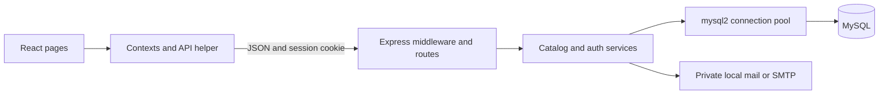
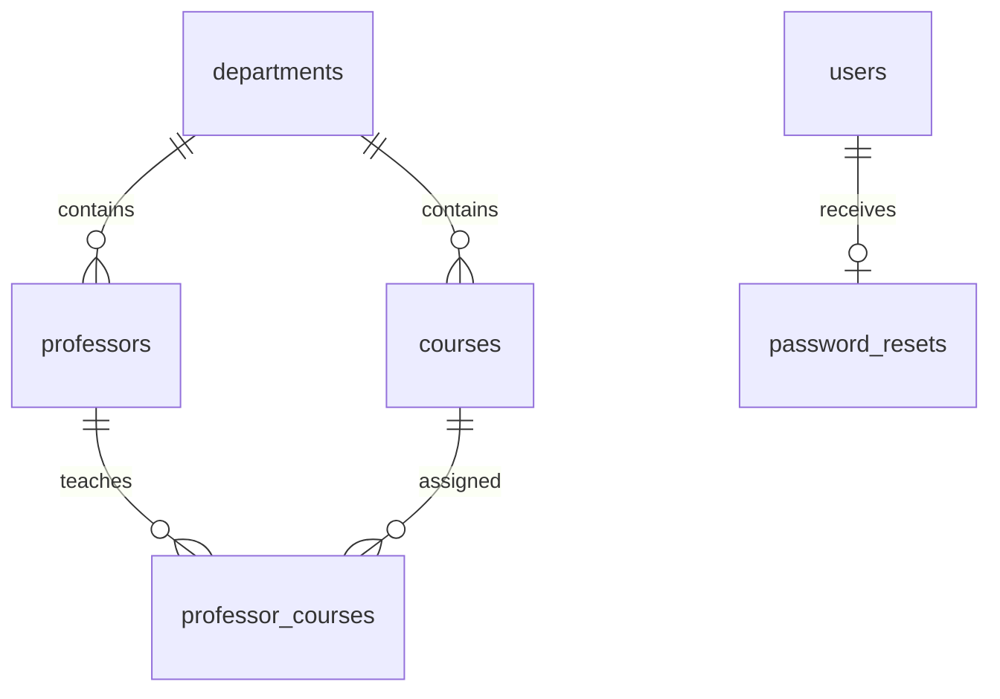

# Learn the RateMyProf codebase

Start with [BACKEND_30_MIN_GUIDE.md](BACKEND_30_MIN_GUIDE.md) for a short explanation of the implemented backend and data flows.

For the backend source walkthrough and data flows, read [BACKEND_CODE_GUIDE.md](BACKEND_CODE_GUIDE.md).

This guide explains the React frontend and Node.js/Express/MySQL backend that exist in this repository. Read it with the named source files open beside it. The frontend uses JavaScript, JSX, HTML, and plain CSS. Vite is the development/build tool; it is not another application framework.

**Modules 1 and 2 are implemented.** Departments, professors, courses, teaching assignments, accounts, sessions, and password resets persist in MySQL. Reviews, reports, moderation decisions, rating summaries, analytics are still frontend previews. Do not treat the sample ratings as student feedback.

## Contents

1. [Run and explore](#run-and-explore)
2. [Architecture and reading order](#architecture-and-reading-order)
3. [Every frontend file](#every-frontend-file)
4. [React concepts used here](#react-concepts-used-here)
5. [Frontend data and authentication](#frontend-data-and-authentication)
6. [Pages and shared components](#pages-and-shared-components)
7. [Styling and assets](#styling-and-assets)
8. [Every backend file](#every-backend-file)
9. [Database design](#database-design)
10. [Module 1 request walkthrough](#module-1-request-walkthrough)
11. [Module 2 request walkthrough](#module-2-request-walkthrough)
12. [API reference](#api-reference)
13. [Configuration and local tools](#configuration-and-local-tools)
14. [Testing and troubleshooting](#testing-and-troubleshooting)
15. [Practice and next modules](#practice-and-next-modules)

## Run and explore

Dependencies and the isolated local database have already been set up on this laptop. For a fresh checkout, run `npm install` and `npm run setup:local`. Setup creates a private `.env`, initializes the project database, creates its tables, inserts official CSE courses only (professors start empty), and creates a local administrator. It needs an installed MySQL server binary; see the README for its location/override.

For later sessions:

```sh
npm run db:local
```

Run these in two separate terminals:

```sh
npm run dev:server
```

```sh
npm run dev
```

Open `http://localhost:5173/`. Use this exact hostname because mutation requests check the configured origin. The administrator credentials are in `.local/admin-account.txt`. Student registration allows `@student.nitw.ac.in` and creates the account without a verification code. Existing accounts can sign in directly with email/password. Google OAuth is planned for later.

Development email messages are private JSON files in `.local/mail/`. Open the newest message for your recipient to find its password-reset code. There is no fixed code such as `123456`. Signup/login do not use these codes. These files simulate password-recovery delivery locally; they do not send anything to an inbox. SMTP configuration is required for real delivery.

## Architecture and reading order



React displays information and collects input. Express receives HTTP requests and checks authentication, permissions, and input. Services implement business rules. MySQL stores the actual records and enforces relationships. The browser never connects directly to MySQL and never receives database credentials.

During development, Vite serves the frontend on port 5173 and forwards `/api` to Express on port 3000. This proxy lets the browser use one origin and ordinary cookie requests. MySQL listens on loopback port 3307. These are three different processes with different responsibilities.

Read in this order:

1. `package.json`, `index.html`, `src/main.jsx`, `src/App.jsx`.
2. `src/components/UI.jsx`, `src/pages/Directory.jsx`, `src/pages/Profile.jsx`.
3. `src/services/api.js`, `src/context/DataContext.jsx`, `src/context/AuthContext.jsx`.
4. `server/schema.sql`, `server/config.js`, `server/db.js`.
5. `server/services/catalog.js`, `server/routes/catalog.js`, `src/pages/Admin.jsx`.
6. `server/lib/security.js`, `server/services/auth.js`, `server/middleware/auth.js`, `server/routes/auth.js`, `src/pages/Auth.jsx`.
7. `server/app.js`, `server/lib/session-store.js`, the setup scripts, and the tests.

## Every frontend file

| File                               | Responsibility                                                                                                                  |
| ---------------------------------- | ------------------------------------------------------------------------------------------------------------------------------- |
| `index.html`                       | HTML document, viewport settings, and root element for React.                                                                   |
| `src/main.jsx`                     | Imports CSS and mounts the application into the root element.                                                                   |
| `src/App.jsx`                      | Hash routing, page selection, document titles, providers, and page access gates. Comparison and verification pages are removed. |
| `src/services/api.js`              | Fetch wrapper, JSON errors, session bootstrap, and CSRF handling.                                                               |
| `src/context/AuthContext.jsx`      | Current account, loading/errors, login/logout/reset helpers.                                                                    |
| `src/context/DataContext.jsx`      | Loads the database catalog; exposes catalog saves/deletes and temporary review/report state.                                    |
| `src/data/formOptions.js`          | Department options and review-form labels/tags; no professor names, reviews, or metrics are seeded.                             |
| `src/components/AccessGate.jsx`    | Loading/error/retry screens and signed-in/student/admin page checks.                                                            |
| `src/components/Layout.jsx`        | Shared header, navigation, mobile menu, account controls; the footer is currently removed.                                      |
| `src/components/UI.jsx`            | Links, avatars, stars, tags, search, filters, tabs, headings, empty states, dialogs.                                            |
| `src/components/Icon.jsx`          | Reusable SVG icons identified by name.                                                                                          |
| `src/components/ProfessorCard.jsx` | Reusable professor summary card.                                                                                                |
| `src/components/ReviewCard.jsx`    | Review display, helpful interactions, and report dialog; no reviews are seeded.                                                 |
| `src/pages/Home.jsx`               | Landing page and discovery entry points.                                                                                        |
| `src/pages/Directory.jsx`          | Professor/course search, filtering, sorting, and list/grid presentation.                                                        |
| `src/pages/Profile.jsx`            | Professor/course details, linked teaching records, empty reviews and tabs; no illustrative trends.                              |
| `src/pages/WriteReview.jsx`        | Rating/text/tag form and eligibility check; saves only a temporary preview.                                                     |
| `src/pages/Auth.jsx`               | Register, login, forgot-password, and reset-password forms.                                                                     |
| `src/pages/Admin.jsx`              | Admin navigation/dashboard, professor/course CRUD, and moderation preview.                                                      |
| `src/pages/DepartmentAdmin.jsx`    | Department create/edit/delete UI with server error feedback.                                                                    |
| `src/pages/Insights.jsx`           | Blank page reserved for later implementation.                                                                                   |
| `src/pages/Information.jsx`        | About, privacy, and community guideline content.                                                                                |
| `src/pages/NotFound.jsx`           | Unknown-route screen.                                                                                                           |
| `src/styles.css`                   | Entire visual system and responsive layouts.                                                                                    |
| `public/nitw-campus.png`           | User-supplied NIT Warangal campus photograph.                                                                                   |
| `vite.config.js`                   | Development port and backend proxy configuration.                                                                               |

The shared official course dataset is in `shared/cseCurriculum.js`; it supplies the backend seed and importer. The current homepage photograph is `public/nitw-campus.png`, without quote cards, corner labels, or avatar/star testimonials. Directory result counts omit the database implementation label.

## React concepts used here

### Components, JSX, and props

A component is a function returning JSX. JSX resembles HTML but describes React elements. Use `className` instead of `class`, and JavaScript expressions inside `{...}`. A capitalized tag such as `<Profile />` refers to a component; a lowercase tag such as `<section>` refers to an HTML element.

Props are inputs supplied by a parent. For example, `Profile` receives the record type and ID from `App`; `Stars` receives a numeric value; `SearchInput` receives a value and change callback. `children` means the content placed inside a component's opening/closing tags.

### State and rendering

`useState` holds changing values such as search text, the selected tab, a form error, or the current user. Calling its setter schedules a render. Derive filtered lists from existing state instead of saving another copy unless necessary.

Treat arrays and objects as immutable. `setReviews(previous => [newReview, ...previous])` creates a new array; mutating an existing array with `push` can leave React unaware of the change. Functional setters are useful when the next value depends on the previous value.

`.map()` renders repeated items; stable `key` values tell React which item is which. Database IDs are better keys than list positions when items can move or disappear.

### Effects and cleanup

`useEffect` synchronizes React with external systems: HTTP requests, `hashchange`, focus events, document titles, and modal keyboard listeners. Its dependency array controls when it reruns. The function returned from an effect removes listeners/restores styles when the component unmounts.

`useRef` stores a DOM reference or a value that should survive renders without causing a render. The dialog uses refs to manage focus and to call the latest close handler.

### Forms

Controlled inputs receive `value` from state and update that state through `onChange`. Search fields and multi-step auth/review forms use this pattern. Some admin forms read named fields through `FormData` on submit. In either case, call `preventDefault()` so submission does not reload the page.

Frontend validation improves feedback, but the server must repeat all important checks: users can send requests without your React forms. Disable submission while an operation is running and display the server's error when it fails.

### Routing without another library

`readRoute()` reads everything after `#`. `Link` renders an anchor such as `#/professors`; a `hashchange` listener updates the selected page. `URLSearchParams` reads query values after `?` inside that hash.

Examples are `/#/courses`, `/#/register`, `/#/admin/departments`, and `/#/write-review?professor=...`. See the actual review-page parameter names before constructing your own URL. Because the route is in the hash, the server receives `/`, which avoids needing a server fallback for every page.

`<div key={location}>` remounts page content when the full hash location changes. This resets page-local form/filter state. Contexts remain mounted above that element, so shared catalog/account state remains available.

## Frontend data and authentication

### The API helper

`request('/catalog')` fetches `/api/catalog`, parses JSON, and throws `ApiError` with a message, status, and code on failure. Request bodies are JSON. `credentials: 'same-origin'` lets the browser send its cookie automatically.

The CSRF token is kept in module memory. Before a mutation, the helper loads `/auth/session` if it lacks a token. Concurrent session requests share one promise through `sessionRequest`. The helper retries once for `INVALID_CSRF` after refreshing the token; it does not blindly retry every error or every failed mutation.

Passwords and session cookies are not placed in localStorage. JavaScript cannot read the HttpOnly session cookie. A CSRF token is different from a login password: it proves that a mutation came through the expected session flow.

### DataContext

The provider loads `/catalog` and stores professors, courses, and department records. `saveCatalog` chooses POST or PUT, waits for the API, then reloads the catalog. `deleteCatalog` sends DELETE and also reloads. This makes a successful refresh show the same persisted records.

The provider stores the API catalog records directly. No sample scores, tags, counts, or review text are loaded. The provider initializes reviews to an empty array. Connection failures produce an error/retry screen, with no fixture catalog fallback.

`reviews`, `reports`, `setReviews`, and `setReports` are still in-memory frontend state. Refreshing the browser discards preview edits. Removing a catalog record also filters out its related review previews.

### AuthContext and access gates

On mount, the provider loads the current session and receives `user`, allowed student domains, mail mode, and a CSRF token. The current user's email is displayed only in their own account interface. Focus events refresh account state so returning to a tab picks up logout/session changes.

Login sets the returned user; logout and reset clear the account and cached security token. `AccessGate` checks loading, logged-in state, optionally admin role. `CatalogGate` checks database loading/errors.

These gates improve the interface. The backend checks permissions separately on every protected request. Editing React state or opening an admin URL cannot grant administrator permission.

## Pages and shared components

### Discovery pages

`Home` sends search/navigation actions into the directory. The campus-favorites section and the “Less guesswork / More perspective” guidance section shown in the earlier design have been removed. `Directory` reads the database records from `useData`, applies local search/department/sort controls, and links to profiles. The backend also provides search endpoints, useful when you later replace loading the complete catalog with server-side pagination.

`Profile` finds the requested professor/course, handles missing records, and joins related records using course IDs. Its overview, reviews, and courses/professors interfaces share components. Review lists start empty; no fake rating breakdown, tags, or trend chart is displayed.

`Insights` returns an empty page for now. The comparison page, route, links, icon, and styles are removed. The top project notice and homepage statistics strip are also removed.

### Authentication pages

`Auth` chooses its fields and submit behavior from `mode`. Registration sends email/password/agreed, login sends email/password, and password reset sends email/code/new password. Signup shows an account-created confirmation and a prefilled sign-in link. Duplicate registration shows the API's ACCOUNT_EXISTS message and a link to sign in. There is no signup verification page, code input, or resend control. Password-recovery pages retain their reset code and resend controls.

A return URL is restricted to an internal hash route rather than arbitrary external navigation. Do not relax this when adding another authentication flow.

### Administration

`Admin` chooses a section and supplies a consistent sidebar. Professor/course forms use existing department values and teaching-course checkboxes. Save/delete call the shared catalog helpers; errors stay visible in the dialog. `DepartmentAdmin` follows the same pattern and explains when a department is still referenced.

The moderation section is protected by a real admin check but its reports/actions are previews. The administrator dashboard's catalog counts are real; review/report counts start at zero.

### Review form and review cards

`WriteReview` collects ratings, text, and up to the allowed tag count. It calls the server's review-eligibility endpoint to confirm a signed-in account and an existing professor/course assignment before creating a temporary preview. There is no review-write API yet.

`ReviewCard` can render a user-created preview and helpful/report controls; no sample reviews are supplied. Module 3/5/6 must add persistence and authorization for these actions later.

### Reusable UI details

- `Link`: constructs hash navigation links.
- `Avatar`: renders initials in a shared avatar style; it is decorative to assistive technology.
- `Stars`: renders rounded visual stars while its accessible label describes the numeric score.
- `Tag`: a label or selectable button; `aria-pressed` reflects selection.
- `PageHeading` and `EmptyState`: consistent page headers and empty/error results.
- `SearchInput`: labeled input with a clear button.
- `DepartmentFilter`: selection chips generated from the catalog departments.
- `Tabs`: tab buttons whose selected state follows page state.
- `Modal`: dialog overlay, initial/restored focus, Escape handling, Tab wrapping, and body-scroll cleanup.
- `Icon`: inline SVG paths, avoiding an icon framework or image downloads.

`Layout` keeps navigation/account controls consistent across pages; it no longer renders a footer. `Information` explains project/privacy boundaries. `NotFound` provides a route back when a URL is unknown.

## Styling and assets

`styles.css` contains theme variables, typography, spacing, buttons, panels, page-specific layouts, and media queries. Read its commented sections with the corresponding page open. CSS custom properties let you change shared colors/radii without editing every component.

Grid handles card/page columns; flexbox handles controls and navigation. Media queries reduce columns, change navigation behavior, and keep forms readable on smaller screens. Some bar/chart values use inline styles because their widths depend on data. Fonts can load from Google Fonts; fallback fonts still render the site if external fonts are unavailable.

The supplied NITW photograph and SVG icons are local assets. The frontend has no Tailwind, Bootstrap, TypeScript, Next.js, or UI framework dependency.

## Every backend file

| File                               | Responsibility                                                                                                                           |
| ---------------------------------- | ---------------------------------------------------------------------------------------------------------------------------------------- |
| `server/index.js`                  | Reads configuration, connects to the database, checks schema availability, starts HTTP, schedules session cleanup, and handles shutdown. |
| `server/config.js`                 | Loads root `.env`, validates secrets/domains/production settings, constructs database/mail configuration.                                |
| `server/db.js`                     | mysql2 pool and transaction helper.                                                                                                      |
| `server/schema.sql`                | Tables, keys, constraints, and indexes.                                                                                                  |
| `server/app.js`                    | Express application, middleware order, sessions, limits, API routes, production static files, errors.                                    |
| `server/routes/catalog.js`         | Catalog HTTP endpoints and admin permission middleware.                                                                                  |
| `server/services/catalog.js`       | Catalog SQL, search, validation, CRUD, and teaching-assignment transactions.                                                             |
| `server/routes/auth.js`            | Authentication endpoints, session regeneration/save/destroy, eligibility response.                                                       |
| `server/services/auth.js`          | Registration, password login/recovery, private identity, and account rules.                                                              |
| `server/middleware/auth.js`        | CSRF/origin checks, loading the current user, account/admin authorization, safe own-account output.                                      |
| `server/lib/security.js`           | Salted scrypt hashes, random codes/secrets, keyed OTP/review hashes, timing-safe comparisons.                                            |
| `server/lib/session-store.js`      | Express session-store adapter backed by MySQL.                                                                                           |
| `server/lib/mail.js`               | Private development mail files or Nodemailer SMTP delivery.                                                                              |
| `server/lib/validation.js`         | Text, email/domain, password, catalog ID, and code validation.                                                                           |
| `server/lib/errors.js`             | Expected HTTP errors and centralized safe JSON error responses.                                                                          |
| `server/scripts/local-mysql.js`    | Starts/stops the isolated project MySQL instance.                                                                                        |
| `server/scripts/setup-local.js`    | Generates private configuration and provisions the local database/user/admin.                                                            |
| `server/scripts/migrate.js`        | Applies the initial schema using configured database credentials.                                                                        |
| `server/scripts/seed.js`           | Inserts official CSE courses without overwriting existing rows; never seeds professors.                                                  |
| `server/scripts/create-admin.js`   | Creates a configured administrator through a local trusted command.                                                                      |
| `server/tests/unit.test.js`        | Security/validation/configuration unit tests.                                                                                            |
| `server/tests/integration.test.js` | Real-MySQL API tests in a separate temporary database.                                                                                   |

Additional curriculum files:

- `shared/cseCurriculum.js`: source-backed course titles/codes/credits/semesters/category/page references.
- `server/scripts/import-curriculum.js`: private backup and transactional course replacement; preserves valid existing teaching links.
- `server/migrations/002-half-credit-courses.js`: idempotent upgrade for 0.5-credit support.

### Middleware order matters

Express runs middleware in registration order. `app.js` adds security headers, global request limits, JSON parsing/body-shape checks, health checking, no-store API headers, database sessions, CSRF checks, and current-user loading before the application routes. Authentication mutations have an additional limit. Unknown API routes return JSON 404; the error handler runs last.

`express.json` accepts only a small body size. Helmet sets browser security headers. The CSP permits the site's external fonts and data-dependent inline styles. The application does not enable unrestricted cross-origin API access; development uses the Vite proxy.

`createApp` accepts a pool/config so tests can use an isolated database. Its test options are supplied by test code, not public request parameters. Production uses normal limits.

### Pool and transactions

The pool reuses connections instead of opening a database connection for every query. `execute(sql, values)` binds placeholders: a supplied name is a value, not SQL code. Dynamic table names are chosen from the server's fixed professors/courses alternatives, never raw browser input.

The transaction helper acquires one connection, begins, runs the callback, commits on success, rolls back on failure, and releases in all cases. Do not use the pool directly halfway through a transaction: that can choose a different connection and break atomicity.

Local account-provisioning statements use escaped values through mysql2's query mechanism because MySQL account-management DDL does not work like ordinary prepared CRUD statements. Database names are separately restricted to safe characters.

## Database design

| Table               | Main fields and purpose                                                                           |
| ------------------- | ------------------------------------------------------------------------------------------------- |
| `departments`       | ID, unique name/code; parent of professors and courses.                                           |
| `professors`        | Name, department FK, designation, office, biography, sample marker.                               |
| `courses`           | Unique code, name, department FK, credits, semester, description, sample marker.                  |
| `professor_courses` | Composite professor/course primary key; many-to-many teaching relationship.                       |
| `users`             | Unique normalized email, password hash, student/admin role, private random seed, session version. |
| `password_resets`   | One current password-reset code per user; keyed hash, expiry, send time, failed-attempt count.    |
| `sessions`          | Session ID, JSON session data, expiry.                                                            |



A professor can teach several courses, and a course can have several professors. The junction table represents that without duplicating professor/course records. Its composite key prevents duplicate assignments.

Department foreign keys restrict deletion while records refer to that department. Professor/course deletion cascades only to teaching links. User deletion cascades to challenges. Sessions contain a user reference inside JSON, so they are checked against the users table on requests rather than represented by a separate relational FK.

Passwords are stored as encoded hashes, not plaintext. Code hashes are stored in challenges, not the six-digit code. BIGINT expiry timestamps are milliseconds; normal creation columns are SQL timestamps. Database names use snake_case; catalog read models translate fields such as `department_id` into frontend `departmentId`.

There is no review/report table yet. Indexes help name/department lookups and expired-session cleanup. The current substring search loads small result sets; it is not an indexed full-text search engine or a paginated large-catalog design.

## Course curriculum import

`shared/cseCurriculum.js` contains 101 CS-coded entries from the user-provided NIT Warangal B.Tech. CSE curriculum, effective AY 2024-25. Pages 6–9 supply 37 core/lab/project/Fractal entries; pages 10–11 supply 49 professional electives; page 13 supplies 6 minor and 9 honors entries. Non-CS courses and generic CS13XX/CS14XX slots are excluded. Each entry records its category/source page. Titles and curriculum-table credits/semesters are preserved; descriptions identify the source rather than invent syllabus details.

`server/scripts/import-curriculum.js` first saves a private backup of courses and teaching assignments, then applies the migration and replaces the course catalog in a transaction. It removes codes outside the source list, upserts the official records, preserves account/professor rows, and retains valid assignments for retained course codes. Deleted courses lose their links through the foreign key. No new teacher/course link is inferred. `npm run catalog:import` is an explicit replacement; additive `db:seed` is different.

`server/migrations/002-half-credit-courses.js` checks existing columns/constraints and upgrades integer credits to DECIMAL(3,1) with a 0.5–10 range. Re-running it is safe. The catalog service converts MySQL decimal strings into JavaScript numbers and validates half-credit increments. The admin number input uses min=0.5 and step=0.5. “Semester 7 or 8” preserves the CS1M06 option from the table.

## Module 1 request walkthrough

Example: an administrator creates a professor.

1. The admin form reads its named inputs and selected course IDs.
2. `saveCatalog('professors', null, body)` sends POST through the API helper with cookie and CSRF token.
3. Express parses JSON, checks origin/token, loads the user from MySQL, and confirms the admin role.
4. The catalog service validates name/designation/department and each course ID.
5. One transaction inserts the professor and its teaching assignments. A bad course fails the entire operation.
6. The service returns a frontend-shaped record; React reloads `/catalog` and displays it.
7. Refreshing the browser still shows the saved record because MySQL holds it.

Example payload:

```json
{
  "name": "Dr. Example Teacher",
  "department": "Computer Science",
  "designation": "Assistant Professor",
  "office": "CSE 101",
  "bio": "A practice catalog record.",
  "courses": ["cs1206"]
}
```

Replace the course ID with one actually returned by your `/api/courses` endpoint. Department selection currently submits its name; the service resolves that to a stable department ID. Renaming a department updates displayed names through joins without rewriting every professor/course.

Editing locks the existing record and replaces teaching links atomically. Shared locks protect selected courses during assignment. Duplicate course IDs are collapsed before insertion. Removing an in-use department returns conflict feedback rather than silently deleting its professors/courses.

`list` combines optional search/department/course conditions with parameter values. Professor search also searches linked course names/codes using EXISTS. `snapshot` reads departments/professors/courses in a transaction for a consistent catalog response. `find` currently looks through the list; you can optimize to a direct indexed ID query when the catalog grows.

## Module 2 request walkthrough

### Registration without verification

1. React submits email, password, and `agreed: true`.
2. The server trims/lowercases email, checks the exact approved domain, rejects plus aliases, and enforces password length 12–128.
3. It hashes the password with a fresh random salt and creates a student account with a UUID/private random seed.
4. Registration does not create a code or send mail. It returns an account-created message.
5. The browser displays confirmation and a sign-in link. Login accepts the password immediately, including for previously pending accounts.

The unique normalized email constraint prevents duplicate addresses. A duplicate returns ACCOUNT_EXISTS and never overwrites the existing password or changes the account's role. The browser cannot create an administrator through registration.

Current domain checking does not prove ownership of the mailbox or one physical person per account. Google OAuth is planned for later.

### Password hashing

`hashPassword` uses Node's built-in scrypt with a 16-byte random salt, 64-byte derived key, and explicit work parameters (`N=32768`, `r=8`, `p=1`). It stores algorithm, salt, and hash together. The salt need not be secret; it makes equal passwords produce different stored values.

`verifyPassword` derives the candidate key with the stored salt and compares bytes using `timingSafeEqual`. A dummy password hash is checked for nonexistent accounts to reduce timing differences. Password hashes are not included in HTTP responses.

### Password recovery and replay prevention

Password recovery stores one current reset code per account in `password_resets`. It expires after ten minutes. After five wrong attempts it cannot be used. Resend is limited by a 60-second cooldown and replaces the old challenge.

The service locks account/challenge rows while consuming a code. A wrong attempt increments its counter and returns from the transaction so that increment commits; throwing before commit would undo the counter and allow unlimited guesses. A successful code updates the account, removes the challenge, and cannot be replayed.

The stored code hash is HMAC-SHA256 with `OTP_SECRET` plus user, a fixed reset context, and code. A plain fast hash of a six-digit code would be cheap to brute-force if the database leaked. Keep the HMAC secret outside the database and out of frontend bundles.

### Login and sessions

Login checks the password. It regenerates the session ID to prevent fixation, records user ID/session version, creates a fresh CSRF token, saves the session, and returns the safe own-account object.

The browser receives an `rmp.sid` cookie. HttpOnly blocks JavaScript reads; SameSite=Lax limits cross-site cookie sending; Secure is enabled in production. The server-side session JSON is stored in MySQL and expires after the configured one-day cookie lifetime. The session adapter implements get/set/destroy/touch and pruning expired rows.

On every API request, `loadUser` reloads the user's role and session version. An authenticated account can participate. A missing user or version mismatch removes the logged-in association. It does not trust a role cached by the browser.

### CSRF, origin, and limits

Mutation requests require the session's CSRF token in `X-CSRF-Token`. If an Origin header is present, it must match APP_ORIGIN. Read methods do not require the mutation token. Global and authentication-specific rate limits reduce request/guess floods; they supplement challenge-attempt limits.

The current limiter is process-local. Multiple production server processes would need coordinated rate limiting. These defaults are a foundation for this local implementation, not a claim that deployment infrastructure is complete.

### Logout and recovery

Logout destroys the server-side session and clears its cookie. Forgot-password returns a generic response for syntactically valid email input; an eligible existing account receives a reset challenge.

Reset verifies email/code, hashes the new password, increases `session_version`, removes challenges, and destroys the requesting browser's session. Other devices fail the version comparison on their next request, so old sessions cannot continue after password recovery.

### Anonymous identity foundation

Each account has a private random `anonymous_seed`. `anonymousReviewKey` computes a keyed hash over seed/professor ID/course ID using `ANONYMOUS_SECRET`. The same context yields the same private key; another professor/course yields a different key. Module 3 can enforce one review per account/context through a unique constraint without exposing email in review output.

`review-eligibility` checks the account and teaching relationship and uses this helper internally. Its response contains eligibility, not the seed or private key. Do not send those values to the browser or add them to public review payloads.

This is pseudonymity toward other users. The server operator has accounts and controls the application/database; it does not provide anonymity from that operator. Module 3 must decide how review storage/retention and duplicate rules use this foundation.

## API reference

All paths below have `/api` in front. Catalog reads are public. Every mutation needs a valid session CSRF token, including unauthenticated auth forms.

| Method/path                    | Body or query                                          | Access/result                                               |
| ------------------------------ | ------------------------------------------------------ | ----------------------------------------------------------- |
| GET `/health`                  | —                                                      | Database reachability.                                      |
| GET `/catalog`                 | —                                                      | Departments/professors/courses snapshot.                    |
| GET `/departments`             | —                                                      | Department list.                                            |
| POST `/departments`            | name, code                                             | Admin creates department.                                   |
| PUT `/departments/:id`         | name, code                                             | Admin edits department.                                     |
| DELETE `/departments/:id`      | —                                                      | Admin; rejects referenced departments.                      |
| GET `/professors`              | q, department, course                                  | Public filtered list.                                       |
| GET `/professors/:id`          | —                                                      | Public professor detail.                                    |
| POST/PUT `/professors[/:id]`   | name, department, designation, office, bio, courses    | Admin create/edit.                                          |
| DELETE `/professors/:id`       | —                                                      | Admin removes record/teaching links.                        |
| GET `/courses`                 | q, department                                          | Public filtered list.                                       |
| GET `/courses/:id`             | —                                                      | Public course detail.                                       |
| POST/PUT `/courses[/:id]`      | code, name, department, credits, semester, description | Admin create/edit.                                          |
| DELETE `/courses/:id`          | —                                                      | Admin removes record/teaching links.                        |
| GET `/auth/session`            | —                                                      | Own user or null; token/domains/mail mode.                  |
| POST `/auth/register`          | email, password, agreed                                | Creates student; no verification challenge in current mode. |
| POST `/auth/login`             | email, password                                        | Creates logged-in session.                                  |
| POST `/auth/logout`            | —                                                      | Destroys current session.                                   |
| POST `/auth/forgot-password`   | email                                                  | Starts recovery with generic response.                      |
| POST `/auth/reset-password`    | email, code, password                                  | Changes password/invalidate sessions.                       |
| GET `/auth/review-eligibility` | professorId, courseId                                  | Signed-in account; checks relationship.                     |

Use the browser Network panel to inspect a real request. Public reads can also be explored without credentials:

```sh
curl http://127.0.0.1:3000/api/health
curl 'http://127.0.0.1:3000/api/professors?q=database'
```

Expected errors are JSON `{ "error": { "message": "...", "code": "..." } }`. Typical statuses are 400 invalid input/code, 401 login required/invalid login, 403 permission/token/origin, 404 missing record, 409 duplicate/reference conflict, and 429 throttling. Unexpected internal errors receive a generic response rather than SQL details or secrets.

## Configuration and local tools

`.env.example` is a public template. `.env`, `.local/`, dependency/build folders, and generated credentials are excluded from Git. Never prefix a private setting with `VITE_`: Vite exposes those settings to frontend code.

| Setting                                        | Why it exists                                                                                      |
| ---------------------------------------------- | -------------------------------------------------------------------------------------------------- |
| APP_ENV                                        | Development/production behavior; avoids putting NODE_ENV=development into Vite's production build. |
| APP_ORIGIN                                     | Exact frontend origin for mutation checks.                                                         |
| PORT                                           | Express listener, default 3000.                                                                    |
| DB_HOST/PORT/NAME/USER/PASSWORD                | Database connection; current isolated server uses 127.0.0.1:3307.                                  |
| SESSION_SECRET                                 | Signs the session cookie.                                                                          |
| OTP_SECRET                                     | Keys stored password-reset code hashes.                                                            |
| ANONYMOUS_SECRET                               | Keys private future review identities.                                                             |
| STUDENT_EMAIL_DOMAINS                          | Comma-separated allowed domains, currently student.nitw.ac.in.                                     |
| MAIL_MODE                                      | file locally or smtp for real delivery.                                                            |
| SMTP_HOST/PORT/SECURE/USER/PASSWORD, MAIL_FROM | SMTP transport and sender.                                                                         |
| ADMIN_EMAIL/ADMIN_PASSWORD                     | Inputs for trusted local administrator creation.                                                   |
| TRUST_PROXY                                    | Enable only behind the expected trusted proxy.                                                     |

`setup-local` uses random passwords/secrets, restrictive permissions, and a project-specific database account. Its root password is stored privately in `.local/mysql-root.json` for local provisioning/testing. The application itself uses the limited project account, not MySQL root.

`local-mysql` initializes `.local/mysql-data`, starts the installed mysqld with a project socket/PID/log, and disables unrelated listeners. Stop verifies that the PID belongs to this project before signaling it. This does not reconfigure another database installation.

`migrate` creates initial tables if absent, runs the idempotent half-credit upgrade in `server/migrations/002-half-credit-courses.js`, and removes obsolete feature fields through `003-remove-unused-features.js`. Further schema changes need explicit migrations. `seed` inserts official CSE courses without overwriting edited records or teaching mappings. It never creates professors or reviews. Rerunning it can reintroduce a deleted curriculum course; avoid using it as an everyday reset command.

`create-admin` creates an admin locally and refuses to promote an existing student account or silently reset an existing admin's password. Admin creation is not exposed through the public API.

File mail creates private JSON messages containing recipient, reset code, creation time, and expiry instructions. SMTP uses Nodemailer, with TLS requirements for the normal STARTTLS path. Production rejects file delivery and HTTP APP_ORIGIN. Configure a real provider before verifying external delivery. Do not share outbox files, `.env`, or admin/root credential files.

For production, build with `npm run build`, run the server with production configuration, and put its loopback listener behind a trusted HTTPS reverse proxy. Express can then serve `dist`. Deployment, institutional mail policy, distributed limits, backups, and monitoring are separate work.

## Testing and troubleshooting

### Existing tests

```sh
npm test
npm run test:integration
npm run build
```

Unit tests exercise salted password verification, domain/alias validation, scoped keyed hashes, and production configuration rejection. Integration tests create a separate temporary MySQL database/user, apply the schema, exercise HTTP APIs, then remove that database/user. They do not wipe the application database. They require the running isolated server and its private local provisioning credentials.

Integration coverage includes public search, identity exclusion, origin/CSRF checks, guest/student permission failures, admin CRUD, foreign keys, transactional rollback, registration validation (including direct signup/login), wrong/expired/exhausted/replayed reset codes, cooldown, session regeneration, password-reset session invalidation, logout, and teaching-link cleanup.

Verification for this implementation also included browser walkthroughs of code-free register/duplicate-signup/login/reset, real admin CRUD and refresh persistence, responsive pages at mobile/tablet widths, and browser console checks. Browser automation was a development check, not an added runtime frontend stack.

### Troubleshooting by layer

| Symptom                       | Check                                                                                        |
| ----------------------------- | -------------------------------------------------------------------------------------------- |
| Cannot load catalog           | Start MySQL and Express; open `/api/health`; check backend terminal.                         |
| Vite proxy connection refused | Express must listen on configured port 3000.                                                 |
| MySQL access denied           | `.env` DB user/password and running server; rerun local setup only for the project instance. |
| MySQL connection refused      | `npm run db:local`; inspect `.local/mysql.log`; check port 3307.                             |
| Tables missing                | `npm run db:migrate` against the intended configured database.                               |
| Origin rejected               | Use localhost:5173 consistently; align APP_ORIGIN and frontend URL.                          |
| CSRF expired                  | Refresh; the helper refreshes/retries once automatically.                                    |
| Registration rejects email    | Exact student.nitw.ac.in domain; use original address without plus alias.                    |
| Code fails                    | Correct recipient/latest message, ten-minute expiry, five wrong-attempt limit.               |
| No email in real inbox        | MAIL_MODE=file only writes local files; configure SMTP for delivery.                         |
| Cannot open admin             | Log in with the local admin account; students cannot gain that role from the browser.        |
| Department delete fails       | Reassign/remove its professors/courses first.                                                |
| Review vanishes on refresh    | Review persistence is Module 3; current submission is a preview.                             |

Use Network to follow payload/status/response; use the backend terminal for errors; read the SQL service for persistence. Avoid logging passwords, codes, session cookies, or private seeds while debugging.

## Practice and next modules

Try these with clearly named practice records:

1. Follow a directory record from SQL row to service read model to context to rendered card.
2. Create a practice department, course, and professor; refresh; edit the mapping; verify deletion order.
3. Explain why a student request to an admin endpoint fails even if you remove AccessGate in React.
4. Register a test account, sign in immediately, then try registering the same email again. Confirm the original password still works. Separately request password recovery and inspect its failed-code counter without copying secrets into shared logs.
5. Explain the difference between password salt, OTP HMAC secret, session cookie, and CSRF token.
6. Log in from two browser contexts, reset the password, and explain why both old sessions fail.
7. Add a harmless optional catalog field by tracing schema → validation/service → response → form → display. Create an explicit migration for it.

Before Module 3, decide the review schema, unique identity context, allowed ratings/text/tags, edit policy, and moderation state. Compute private identity keys only on the backend. Write validation/API tests and replace the temporary `setReviews` submission with a real endpoint.

Module 4 should derive real aggregates and add server-side pagination/filtering. Module 5 should persist reports/moderation with authorization and audit records. Module 6 should persist helpful votes and use privacy-aware cohort aggregates. None of these future modules should expose student email, anonymous seed, or private review keys in public output.

You understand the current project when you can explain each file's purpose, trace a request from a button through SQL and back, identify which data persists, diagnose failures by layer, and describe which checks protect each mutation.

## Cleanup of removed features

The removed comparison, footer, homepage statistics/guidance/testimonials, photo overlays, and Insights content have no remaining React components or corresponding CSS rules. The unused campus illustration and rating-breakdown helper are deleted. `src/data/formOptions.js` contains only active department options and review-form labels/tags. Catalog records no longer receive fabricated rating/tag fields.

Signup verification routes, mail templates, configuration switch, account verification column, and sample-record flags are removed. `003-remove-unused-features.js` upgrades older databases: it preserves password recovery records in `password_resets`, removes obsolete signup challenges, and drops unused columns. It is safe to repeat and retains accounts, passwords, sessions, catalog records, and teaching links. Migration code is retained so existing installations can upgrade. A private local backup was saved before applying the cleanup.

`setup:local` runs migrations with the local provisioning account while keeping the application account restricted. For an older local installation, run `npm run setup:local` to apply upgrades; the normal application account intentionally cannot drop tables. Password recovery still needs its code input and mail settings. Active catalog CRUD and review/report previews remain because their screens are still accessible.
